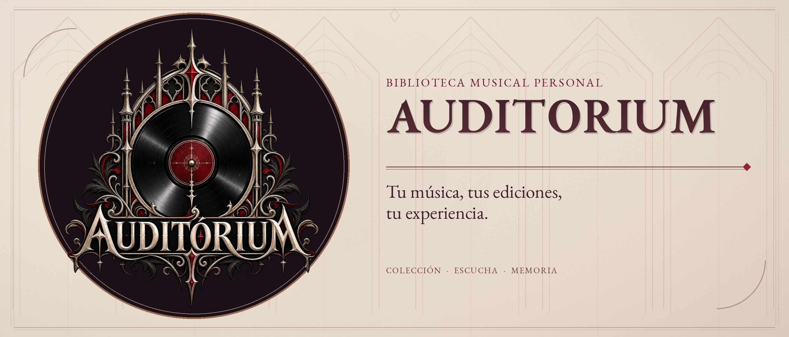
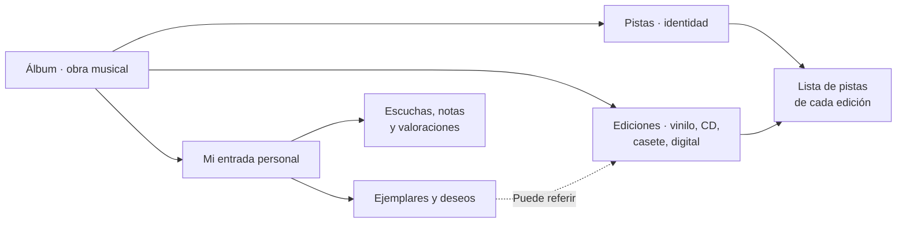
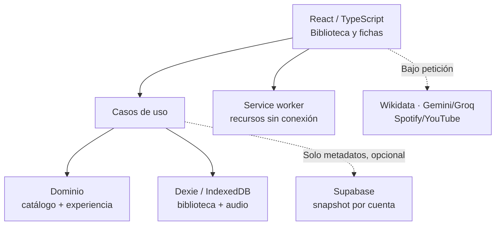

<div align="center">

<picture>
  <source media="(prefers-color-scheme: dark)" srcset="branding/banners/auditorium-banner-oscuro.png" />
  
</picture>

# Auditorium

**Una fonoteca digital donde el álbum es una obra, las ediciones tienen identidad y la colección cuenta su propia historia.**

[](CHANGELOG.md)
[](docs/tecnica/03-datos-y-persistencia.md)
[](docs/tecnica/03-datos-y-persistencia.md)
[](LICENSING.md)

[**Abrir Auditorium**](https://nicocg32.github.io/Auditorium/) · [**Guía de uso**](docs/general/02-uso-y-limites.md) · [**Documentación**](docs/README.md) · [**Versión 1.1.0**](https://github.com/NicoCG32/Auditorium/releases/tag/v1.1.0)

</div>

---

## Por qué quise construirlo

Siempre he visto un álbum como algo más que una lista de canciones. Una misma obra puede tener un lanzamiento original, reediciones, pistas adicionales y distintas presentaciones; además, **escucharla, valorarla y poseer un ejemplar son experiencias diferentes**.

Desarrollé Auditorium para organizar esas relaciones en mi propia fonoteca, sin depender de una plataforma de streaming para conservar mis datos. Quería un espacio que se sintiera como una colección física: discos, portadas y notas que uno vuelve a explorar. De ahí surgieron su estética **gótica y metalera**, los fondos tipo santuario y el **vinilo como pieza central**.

Este es **mi proyecto personal e independiente**. Soy su **único participante humano** y lo he desarrollado con apoyo de herramientas de inteligencia artificial, bajo mis decisiones e instrucciones. No hubo un equipo humano adicional.

## Tres cosas distintas, conectadas

- **Catálogo musical:** artistas, álbumes, ediciones, pistas y apariciones de pistas. Una canción puede formar parte del álbum y aparecer en varias ediciones, incluso con distinta posición o material adicional.
- **Mi experiencia:** estado de escucha, notas, valoraciones generales, de pistas y por género. Una valoración no demuestra que haya comprado el álbum.
- **Mi colección:** ejemplares físicos, compras digitales y deseos de adquisición. Puedo tener varias copias de una edición o querer conseguir otra.

<details>
<summary><strong>Ver cómo se relacionan álbum, edición y colección</strong></summary>



Este es un esquema **conceptual**; [el modelo formal](docs/tecnica/02-dominio.md) define las relaciones y la integridad. Las pistas de una reedición no se duplican automáticamente como obras independientes.

</details>

## Qué puedes hacer

**Biblioteca y catálogo.** Registrar álbumes manualmente, artistas, créditos, géneros, ediciones, pistas y variantes; revisar candidatos de Wikidata cuando lo solicites, sin copiar cambios automáticamente.

**Experiencia y colección.** Anotar escuchas y valoraciones independientes; registrar formatos físicos o digitales, varias copias y deseos de compra; conservar enlaces personales.

**Reproducción.** Asociar audio propio a este navegador, o cargar los reproductores oficiales de Spotify y YouTube desde enlaces admitidos. Ninguna de esas opciones convierte Auditorium en un servicio de streaming ni concede permisos para redistribuir música.

**Conservación de datos.** Exportar un JSON de metadatos, o un ZIP completo que incluya archivos de audio propios. Existe cuenta **opcional** para sincronizar metadatos con Supabase; **los bytes de audio no se suben a Supabase**.

**Recomendaciones opcionales.** Pedir a Gemini o Groq una selección para reescuchar o reevaluar, usando una clave que introduces para esa sesión. La IA no escribe tus notas.

## Qué está listo y qué no

- **Implementado en código:** web/PWA, catálogo y experiencia personal, ejemplares y deseos, audio local, respaldos JSON7/ZIP1, fuentes de reproducción externas, consultas opcionales y sincronización de metadatos si el alojamiento está configurado.
- **En validación:** persistencia y recuperación bajo cuotas reales del navegador, grandes bibliotecas, servicio externo, compatibilidad móvil, accesibilidad y conflictos entre dispositivos.
- **Sin publicar en la versión 1.1.0:** importación aditiva de respaldos e importación de un catálogo musical JSON. Ya figuran en el código y el [changelog](CHANGELOG.md), pero no deben confundirse con una funcionalidad distribuida en la release 1.1.0.
- **Futuro:** empaquetado nativo de escritorio y Android. La PWA existente **no** es una APK ni una aplicación de escritorio independiente.

## Dónde viven tus datos

| Elemento                                | Almacenamiento                    | Transporte                                   |
| --------------------------------------- | --------------------------------- | -------------------------------------------- |
| Álbumes, ediciones, notas y colección   | IndexedDB local, mediante Dexie 4 | Respaldo JSON7 o snapshot remoto opcional    |
| Audio que asocias                       | IndexedDB del dispositivo         | **ZIP1 completo**, no JSON ni Supabase       |
| Recursos para abrir la PWA sin conexión | Cache Storage del navegador       | Se descargan de nuevo al instalar/actualizar |
| Clave de recomendaciones                | Memoria de la sesión              | No se incluye en respaldos                   |

El esquema local utiliza **Dexie DB11 con 17 almacenes**. No confundas esa versión con el formato JSON7 del respaldo o el ZIP1 de audio. **Guarda una copia fuera del navegador**: cambiar de origen, limpiar datos o agotar la cuota puede dejarte sin la biblioteca local. [Guía de respaldos](docs/RESPALDOS_JSON.md).

## Arquitectura en una mirada

<details>
<summary><strong>Mostrar componentes principales</strong></summary>



[Arquitectura C1–C4](docs/tecnica/01-arquitectura.md) · [Modelo de dominio](docs/tecnica/02-dominio.md) · [Esquema y versiones](docs/tecnica/03-datos-y-persistencia.md) · [Flujos y estados](docs/tecnica/04-flujos-y-estados.md).

</details>

## Ejecutarlo desde el repositorio

Requiere Node.js **24.15+ dentro de la rama 24**, o **26+**, y npm **12.2.x**. El proyecto fija versiones en `package-lock.json`.

```sh
npm ci
npm run dev
```

Para revisar un cambio:

```sh
npm run check
npm run test:e2e
npm run build:pages
```

La biblioteca local funciona sin configurar Supabase. Las pruebas end-to-end necesitan navegadores Playwright instalados. [Preparación y pruebas](docs/desarrollo/02-entorno-y-verificacion.md).

## Leer según lo que necesites

- **General:** [origen](docs/general/01-origen-y-alcance.md), [uso y límites](docs/general/02-uso-y-limites.md), [identidad visual](docs/general/03-diseno-e-identidad.md).
- **Técnica:** [arquitectura](docs/tecnica/01-arquitectura.md), [dominio](docs/tecnica/02-dominio.md), [datos](docs/tecnica/03-datos-y-persistencia.md), [integraciones](docs/tecnica/05-integraciones-y-seguridad.md).
- **Desarrollo:** [metodología](docs/desarrollo/01-proceso-y-decisiones.md), [verificación](docs/desarrollo/02-entorno-y-verificacion.md), [pendientes](docs/desarrollo/03-evolucion-y-pendientes.md).

[**Índice completo, guías especializadas y ADR**](docs/README.md).

## Autoría, licencia y contenido musical

El **código y la documentación originales** se distribuyen bajo [PolyForm Noncommercial 1.0.0](LICENSE), dentro de los derechos que su titular puede conceder. Los [avisos propios](NOTICE), [condiciones](LICENSING.md) y [derechos sobre recursos y contenido musical](docs/DERECHOS_Y_RECURSOS.md) se consultan por separado.

**Las canciones, portadas, grabaciones, marcas y metadatos de terceros no pasan a ser míos por aparecer enlazados o guardados en Auditorium.** La licencia del programa no autoriza compartir archivos musicales ajenos. Los archivos de prueba de audio son tonos sintéticos documentados por separado.
