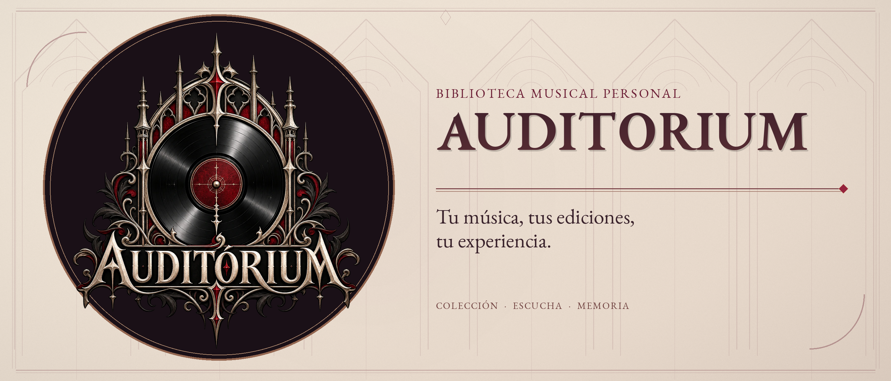

<div align="center">

<picture>
  <source media="(prefers-color-scheme: dark)" srcset="branding/banners/auditorium-banner-oscuro.png" />
  
</picture>

# Auditorium

**Tu música, tus ediciones, tu experiencia.**

[](#sobre-el-proyecto) [](#usar-o-descargar) [](LICENSING.md)

[](#tecnologías) [](#tecnologías) [](#tecnologías) [](#tecnologías)

[Abrir aplicación](https://nicocg32.github.io/Auditorium/) · [Releases y descargas](https://github.com/NicoCG32/Auditorium/releases/tag/v1.1.0) · [Documentación](docs/README.md) · [Arquitectura](docs/01-arquitectura-general.md) · [Inicio rápido](#ejecutar-desde-el-código)

</div>

---

## Sobre el proyecto

Biblioteca musical personal para organizar álbumes, ediciones, escuchas, valoraciones y adquisiciones, con independencia del formato o de las plataformas de streaming.

**Estado:** Web/PWA 1.1.0 disponible. Funciona localmente sin cuenta; la web ofrece sincronización opcional. El audio propio se conserva por dispositivo. Escritorio empaquetado y APK siguen planificados.

## Tecnologías

| Área             | Tecnologías y responsabilidad                                                 |
| ---------------- | ----------------------------------------------------------------------------- |
| **Interfaz**     | React 19, TypeScript 6 y Tailwind CSS; Vite 8 y PWA.                          |
| **Datos**        | IndexedDB mediante Dexie 4; cuentas y sincronización opcionales con Supabase. |
| **Verificación** | Vitest, Testing Library y Playwright.                                         |

> **Enfoque técnico:** Biblioteca local primero, con audio y respaldos por dispositivo.

## Usar o descargar

[Abrir la web/PWA](https://nicocg32.github.io/Auditorium/) · [Release 1.1.0 y ZIP web](https://github.com/NicoCG32/Auditorium/releases/tag/v1.1.0) · [Instalación y respaldos](docs/ENTREGA.md). El ZIP web no es un instalador de escritorio ni una APK.

## Ejecutar desde el código

Con Node.js 24.15+ dentro de la rama 24 y npm 12.2.x, desde la raíz:

```sh
npm ci
npm run dev
```

Abre la dirección indicada por Vite. La biblioteca local no necesita claves. [Configuración, build y comprobaciones](docs/09-instalacion-y-despliegue.md).

## Documentación

[Índice completo y rutas de lectura](docs/README.md) · [Biblioteca, audio y entrega](docs/ENTREGA.md).

| Tipo       | Lectura                                                                                                                                                                          |
| ---------- | -------------------------------------------------------------------------------------------------------------------------------------------------------------------------------- |
| General    | [Problema, cliente y solución](docs/00-problematica-cliente-y-valor.md) · [Motivación](docs/16-motivacion-y-contexto.md)                                                         |
| Técnica    | [Arquitectura y diagramas](docs/01-arquitectura-general.md) · [Dominio y datos](docs/04-base-de-datos.md)                                                                        |
| Desarrollo | [Etapas y metodología](docs/17-desarrollo-y-metodologia.md) · [Proyección](docs/15-escalabilidad-y-nuevos-mercados.md) · [Costos CLP/USD](docs/18-analisis-economico-clp-usd.md) |

[Identidad visual](branding/README.md): logos, banners y variantes de aplicación.

## Licencia y créditos

Código y documentación propios: [PolyForm Noncommercial 1.0.0](LICENSE), con [atribución](NOTICE). Uso comercial fuera de sus permisos: acuerdo previo de créditos y compensación. [Alcance y contacto](LICENSING.md).
