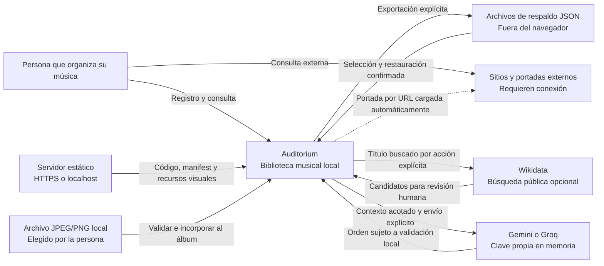
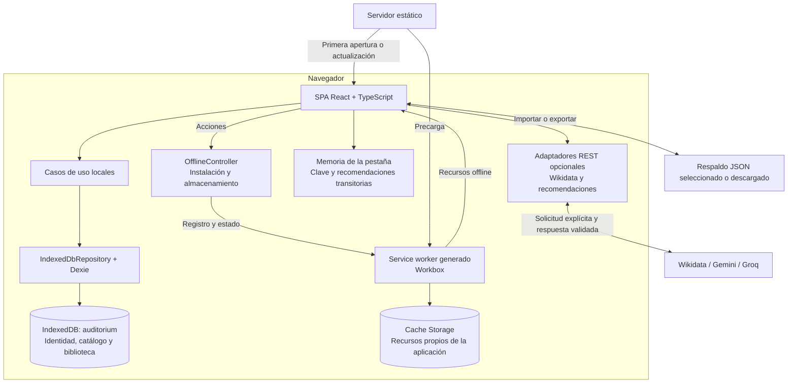
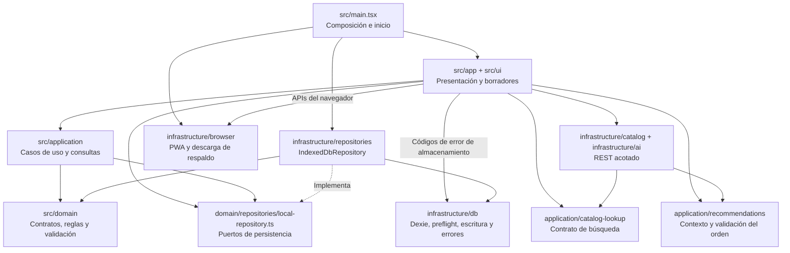
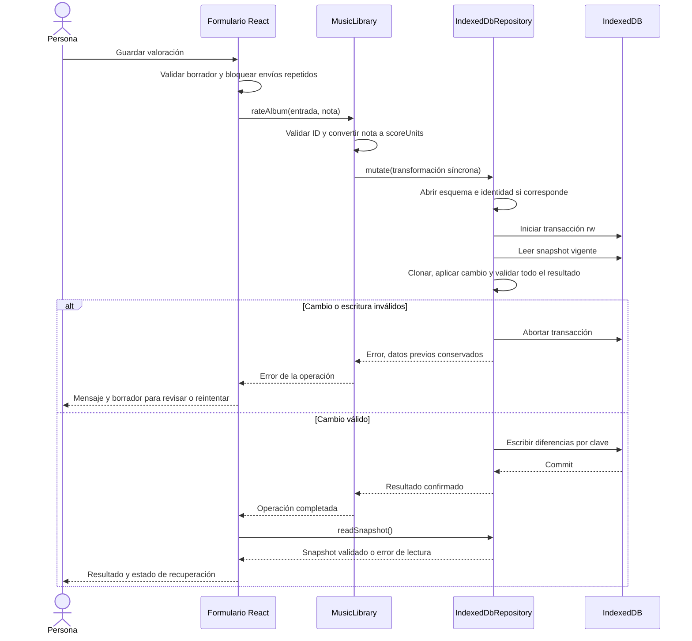
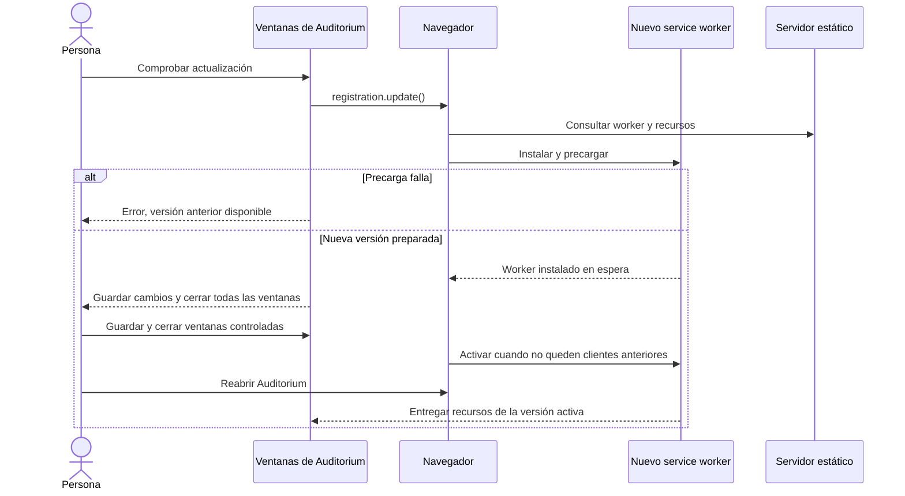
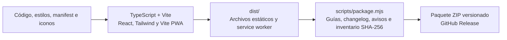

# Arquitectura del sistema

Referencia: MVP **Auditorium v1.0.0** e incrementos posteriores de web, identidad visual e integraciones opcionales. Este documento describe la implementación vigente y sus límites; las decisiones históricas se conservan en los [ADR](README.md#decisiones-de-arquitectura). Los modelos de [dominio](MODELO_DOMINIO.md) y [datos](MODELO_DATOS.md) completan esta vista.

## 1. Objetivo y alcance

Auditorium permite registrar, consultar y valorar una biblioteca musical y organizar ediciones, ejemplares y deseos de compra. La versión 1.0.0 es una aplicación web de una sola página, instalable como PWA donde el navegador lo admita. Ejecuta sus casos de uso y conserva la biblioteca en el dispositivo, por origen y perfil del navegador.

La estructura distingue datos musicales de catálogo, experiencia personal y recursos de la aplicación. No dispone de servidor de biblioteca ni de una cuenta autenticada. CAT-01 añade búsqueda opcional de referencias de álbumes en Wikidata y AI-01 permite solicitar un orden de escucha mediante Gemini o Groq con clave propia de sesión. UX-01 permite corregir álbumes guardados, registrar géneros y país de artista y conservar una portada local o su URL. Estos incrementos están en revisión y no modifican la release v1.0.0. Las plataformas musicales se enlazan como referencias; no se reproducen ni sincronizan sus catálogos.

## 2. Contexto del sistema

El servidor estático distribuye archivos de la aplicación; no recibe las notas, valoraciones o respaldos. Las solicitudes opcionales van directamente al proveedor: Wikidata recibe el título buscado y Gemini/Groq un contexto acotado de candidatos, incluida nota y escucha cuando existan, tras acción explícita. No se transmite el snapshot completo ni se amplía el contexto con géneros, países o imágenes. Una portada externa se solicita a su proveedor al aportar una URL válida o mostrar el álbum guardado. Una portada local se valida en el navegador y se conserva como parte del catálogo, sin enviarla a esos proveedores. La disponibilidad de red que informa el navegador es una señal local, no una comprobación de disponibilidad de esos sitios.

## 3. Componentes en ejecución

IndexedDB y Cache Storage tienen responsabilidades diferentes. IndexedDB v5/nativa50 conserva los registros musicales, su identidad y las portadas locales de los álbumes. La precaché conserva el código y los recursos propios necesarios para reabrir la aplicación sin conexión; no copia imágenes remotas. El service worker y `OfflineController` no leen ni migran la biblioteca musical.

Las referencias de catálogo seleccionadas pertenecen a `Album` y se guardan con el alta local. Las claves y recomendaciones viven sólo en memoria, sin tablas, respaldo o caché. Las consultas se realizan fuera de cualquier transacción IndexedDB; el modelo no recibe un repositorio ni ejecuta escrituras.

La navegación entre biblioteca, ficha, registro, retirados y respaldos depende del estado de React. Las aperturas de la PWA admiten la base del build, `index.html` y sus variantes con query o fragmento; no existe un router de fichas por URL o por ID. La distribución local utiliza `/`; el modo Pages utiliza `/Auditorium/`, con manifest, recursos, fallback y alcance verificados para esa base.

## 4. Organización del código y dependencias

Las flechas continuas indican uso o dependencia; la discontinua representa implementación de un contrato. El dominio y los casos de uso no importan React, Dexie ni el adaptador de persistencia. La interfaz sí conoce utilidades del navegador, el controlador offline y códigos de error de infraestructura para ofrecer mensajes y recuperación adecuados. Esta separación es por responsabilidades, con un puerto de almacenamiento; no supone independencia total de todos los adaptadores en la presentación.

| Área            | Responsabilidad y contrato                                                                            | Fuente                                                                                                                                              |
| --------------- | ----------------------------------------------------------------------------------------------------- | --------------------------------------------------------------------------------------------------------------------------------------------------- |
| Composición     | Instancia repositorio y controlador offline, inicia este último y monta React; libera recursos en HMR | [main.tsx](../src/main.tsx)                                                                                                                         |
| Presentación    | Estado de carga/consulta, vistas internas, borradores, validación visible, confirmaciones y foco      | [App](../src/app/App.tsx), [LibraryPage](../src/ui/library/LibraryPage.tsx)                                                                         |
| Casos musicales | Registro, relaciones, listas, experiencia, valoraciones, propiedad, deseos y retirada                 | [MusicLibrary](../src/application/music-library.ts), [track-lists](../src/application/track-lists.ts)                                               |
| Consultas       | Proyección `LibraryAlbum`, búsqueda, filtros y orden sobre un snapshot local                          | [library-query](../src/application/library-query.ts)                                                                                                |
| Respaldos       | Exportación, lectura/validación de archivos y restauración delegada al repositorio                    | [LibraryBackups](../src/application/library-backups.ts)                                                                                             |
| Dominio         | Schemas Zod, invariantes entre colecciones, cambios puros y contratos de persistencia                 | [catalog](../src/domain/catalog/catalog.ts), [library](../src/domain/library/library.ts), [puertos](../src/domain/repositories/local-repository.ts) |
| Persistencia    | Apertura compatible, identidad, snapshots validados y transacciones atómicas                          | [IndexedDbRepository](../src/infrastructure/repositories/indexeddb-repository.ts), [database](../src/infrastructure/db/database.ts)                 |
| Navegador       | Capacidades PWA/almacenamiento y descarga de Blob JSON                                                | [OfflineController](../src/infrastructure/browser/offline-controller.ts), [backup-download](../src/infrastructure/browser/backup-download.ts)       |

### Puerto de persistencia

`LocalRepository` ofrece `open`, `readSnapshot` y `close`. `TransactionalLocalRepository` añade `mutate`, con una transformación síncrona sobre un `LocalSnapshot`; devuelve su resultado después del commit. `BackupLocalRepository` añade `restoreEmpty(snapshot, expectedIdentity)` para el único flujo que puede adoptar otra identidad.

Los casos musicales reciben `TransactionalLocalRepository`. `LibraryBackups` y la presentación reciben el contrato ampliado de respaldos. Las pruebas pueden inyectar instancias y generadores de IDs/fechas; la implementación habitual usa UUID y fechas del dispositivo. Los contratos no incorporan transporte HTTP ni autenticación de cuenta.

### Contratos de integraciones opcionales

`CatalogLookupClient.search` devuelve candidatos tipados y una referencia validada; la interfaz conserva la decisión de selección y el borrador. El adaptador Wikidata usa un endpoint fijo, lectura anónima, `Api-User-Agent`, lotes y separación de solicitudes, sin caché del service worker. El guardado posterior utiliza los casos musicales habituales, incluidos duplicados y commit atómico.

`buildRecommendationContext` selecciona hasta 24 álbumes activos (ocho recientes y hasta dieciséis adicionales). El adaptador de recomendaciones sólo serializa una lista permitida: referencias temporales, título/artista acotados, año, nota, escucha y orden relativo de alta. Los UUID se resuelven localmente. No recibe notas libres, identidad, compras, deseos, fechas exactas ni respaldos. La clave se envía en cabecera al proveedor elegido, nunca en URL. La respuesta sólo puede ordenar candidatos conocidos y no modifica valoraciones.

Cada flujo exige una acción explícita, timeout, cancelación, validación y mensajes propios de error. No hay reintentos ni cambios automáticos de proveedor. La [guía de integraciones](INTEGRACIONES_OPCIONALES.md) contiene los diagramas de interacción, modelos fijados, privacidad y límites de cuotas. La [ADR-008](adr/008-integraciones-opcionales.md) diferencia esta implementación de la propuesta de importador MusicBrainz JSON.

## 5. Flujo de una escritura musical

El siguiente flujo representa guardar una valoración; registro, listas y otras operaciones utilizan el mismo límite transaccional, con sus propias reglas y comprobaciones de concurrencia.

La apertura e inicialización de identidad pueden preceder a la transacción de negocio. Dentro de esta última, leer el estado vigente, transformar, validar y escribir forman una operación atómica. Las mutaciones musicales conservan `userId` y `createdAt`; ninguna realiza I/O externo dentro del callback. El detalle de índices, diferencias y rollback está en [modelo de datos](MODELO_DATOS.md).

La interfaz distingue fallo antes del commit de fallo al actualizar la vista después del commit. Cuando la escritura ya fue confirmada, recupera la lectura sin repetirla. Las confirmaciones destructivas y los editores que requieren referencia previa comprueban su destino dentro de la transacción; no existe un número global de revisión o un protocolo de sincronización entre dispositivos.

`MusicLibrary.updateAlbum` aplica ese límite a la [edición de metadatos](EDICION_CATALOGO.md): compara álbum, créditos ordenados y artistas con la referencia esperada y conserva el ID del álbum y sus relaciones. Renombrar un crédito crea una identidad de artista para ese álbum; corregir el país de un artista que mantiene su ID afecta a sus demás créditos y se advierte en el editor. Géneros y países se proyectan para búsqueda, filtros y orden sin servicios externos. Las portadas locales se validan antes de incorporarse al borrador y no se decodifican dentro de una transacción IndexedDB.

## 6. PWA y actualización de recursos

El registro se inicia explícitamente desde el punto de composición. La precarga incluye HTML, JS/CSS compilados, manifest e iconos y recursos visuales propios seleccionados en el [diseño base](DISENO_BASE.md). La configuración mantiene `runtimeCaching: []`, `skipWaiting: false` y `clientsClaim: true`; el service worker de desarrollo está desactivado. Tema y ambientación se guardan como preferencias opcionales de presentación en localStorage. La vista previa de una foto local sólo vive en memoria durante la apertura; ninguna de estas opciones modifica IndexedDB ni el respaldo musical.

La aplicación no envía `SKIP_WAITING` ni fuerza una recarga. `clientsClaim` facilita el control inicial tras la activación y no salta la espera de actualizaciones. Workbox administra las entradas de su propia precaché; no se activa una limpieza general de otras cachés. Actualizar estos recursos no sustituye una migración de IndexedDB ni una restauración de datos.

`OfflineController` publica estado de red, recursos preparados, actualización, instalación y almacenamiento. La solicitud `persist()` requiere una acción de la persona. Que la aplicación pueda funcionar offline o que el navegador conceda persistencia no garantiza conservación ante limpieza manual o pérdida del dispositivo. Véanse [PWA](PWA_OFFLINE.md) y [ADR-006](adr/006-actualizaciones-pwa.md).

## 7. Compilación, distribución y entorno

El navegador ejecuta React, Zod, Dexie y los recursos de Workbox compilados. Node y npm son herramientas de desarrollo/compilación o para iniciar el servidor de revisión; no son un servicio de datos de Auditorium. La configuración de Vite separa Dexie en un chunk de almacenamiento, también incluido en la precarga de la PWA.

La [guía de entrega](ENTREGA_MVP.md) explica requisitos, apertura del ZIP y alojamiento. La release distribuye archivos para raíz. El hito WEB-01 añade una [publicación web en GitHub Pages](PUBLICACION_WEB.md) desde revisiones validadas de `main`, con build separado para `/Auditorium/`. El paquete base de v1.0.0 conserva sus guías y evidencia; la documentación técnica vigente se mantiene en el repositorio.

Fuentes: [package.json](../package.json), [vite.config.ts](../vite.config.ts), [empaquetado](../scripts/package.mjs) y [flujo de calidad](../.github/workflows/calidad.yml).

## 8. Propiedades, límites y decisiones

| Propiedad                | Mecanismo y límite                                                                                                                                                                                                 |
| ------------------------ | ------------------------------------------------------------------------------------------------------------------------------------------------------------------------------------------------------------------ |
| Integridad local         | Validación de schemas y referencias en snapshots, índices seleccionados y commit/rollback transaccional                                                                                                            |
| Identidad estable        | Un registro local persistente; las operaciones musicales no lo sustituyen y un respaldo solo lo adopta en un destino vacío                                                                                         |
| Concurrencia             | Transacciones sobre estado vigente y comprobaciones específicas de contenido/valor esperado; sin suscripción automática a cambios de otras ventanas                                                                |
| Recuperación             | Errores conservan datos y ofrecen acciones explícitas; no se borra ni recrea una base incompatible automáticamente                                                                                                 |
| Uso offline              | Recursos propios preparados por service worker y datos en IndexedDB, incluidas portadas locales; consultas de catálogo, recomendaciones, portadas por URL y enlaces externos necesitan conexión                    |
| Privacidad del contenido | Biblioteca y respaldo procesados localmente; sólo consultas o contexto reducido se envían al solicitar servicios opcionales. Las claves no persisten. Un respaldo contiene información personal sin cifrado propio |
| Costo obligatorio        | El núcleo local no requiere una cuenta o servicio contratado. Gemini/Groq ofrecen niveles gratuitos sujetos a cuenta, cuotas y condiciones; Auditorium no activa facturación ni garantiza el plan de una clave     |
| Escala                   | Lectura y validación del snapshot completo, búsqueda/proyección en memoria y escrituras diferenciales; sin medición de bibliotecas grandes que justifique garantías de rendimiento                                 |

Las pruebas se distribuyen por dominio, aplicación, adaptador e interfaz; los E2E ejercitan producción, offline, migraciones y aceptación. La [matriz de validación](VALIDACION_MVP.md) registra cobertura y límites. La evaluación con lectores de pantalla, instalación en Safari/iOS real y rendimiento en hardware limitado siguen fuera de esa evidencia.

Las [decisiones de arquitectura](README.md#decisiones-de-arquitectura) explican almacenamiento local, separación álbum/edición/pista, costo, retirada, identidad del respaldo, espera de actualizaciones e integraciones opcionales. Cuentas y sincronización siguen en el backlog del [plan de desarrollo](PLAN_DESARROLLO.md).

La [evaluación de metadatos externos](METADATOS_EXTERNOS.md) conserva la propuesta pendiente de importación de JSON de ediciones MusicBrainz. CAT-01 implementa búsqueda Wikidata de álbumes y no ese importador; tampoco incorpora listas o ediciones desde el servicio externo. La generación autenticada y calidad musical de las recomendaciones requiere comprobarse con una clave propia; las pruebas controladas del contrato no sustituyen esa evidencia.
