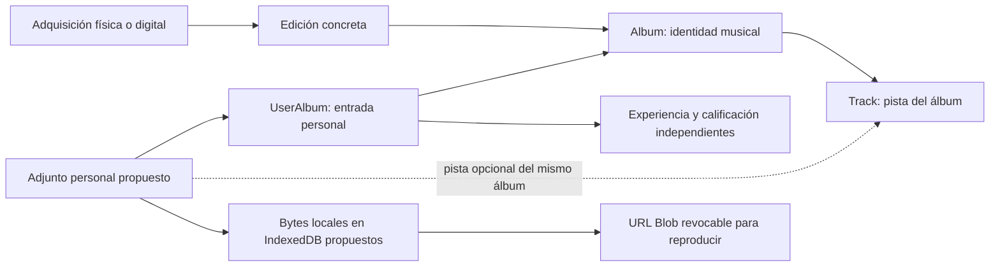
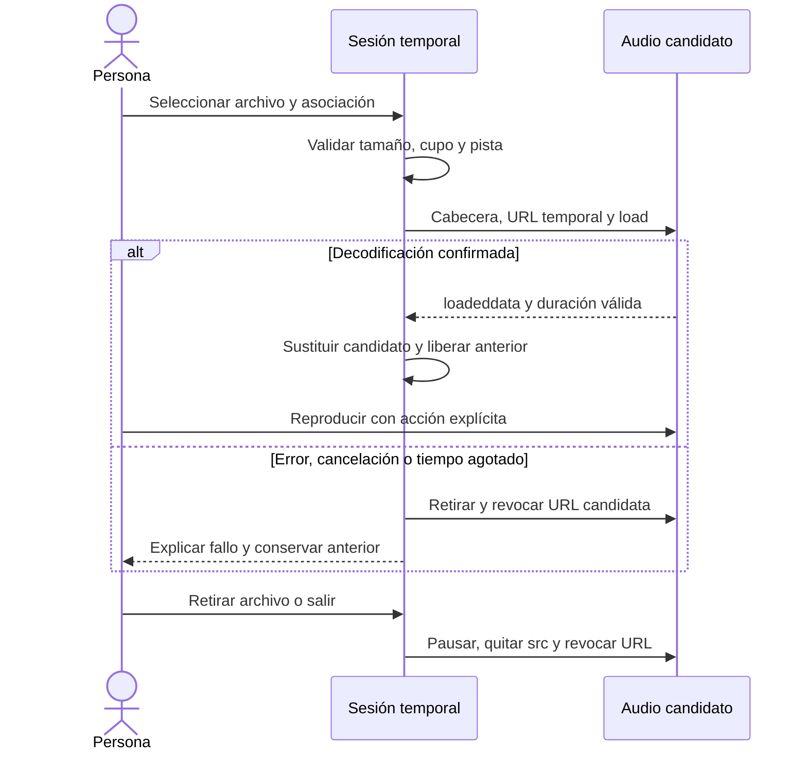

# Audio personal: evaluación y propuesta

AUDIO-01 #69 · 23 de octubre de 2026. Investigación y [prototipo aislado](../prototypes/audio-01/README.md). La aplicación publicada todavía no incorpora adjuntos de audio. AUDIO-02 #70 implementará el contrato de conservación local y respaldo propio acordado aquí.

## Decisión de producto y técnica

Se elige **audio persistente en este dispositivo, con respaldo propio**. La opción temporal se evaluó como alternativa de menor alcance, pero no es el contrato elegido. Seleccionar audio propio debe guardarlo localmente sólo después de validar asociación, presupuesto, decodificación y escritura. Al recargar, cerrar o reabrir, se recuperarán los adjuntos conservados por el navegador. La persistencia sigue siendo susceptible de evicción o limpieza del sitio; no sustituye el respaldo.

Para #70 se concreta un presupuesto inicial de **16 MiB por archivo, 128 MiB de audio y hasta 128 adjuntos por biblioteca local, con un reproductor activo**. La matriz mide 1 y 16 MiB por escritura y la sonda de reinicio comprueba ocho registros de 16 MiB. Son límites conservadores de producto, no una cuota garantizada: limitan copias y el tamaño de recuperación. Permiten pistas comprimidas, pero excluyen álbumes largos sin comprimir y muchos archivos de alta resolución. El tamaño no determina duración ni memoria decodificada; no se ha medido el consumo máximo en móviles físicos. No se amplían esos límites sin nueva validación.

Se selecciona **IndexedDB con bytes binarios** como base para #70, por su escritura comprobada en los dos motores disponibles de Windows y su capacidad de transacción con metadatos. Blob y OPFS se conservan como comparaciones, no como fallback obligatorio. El incremento incluye migración, gestión de cuota, coherencia entre metadatos y binarios, eliminación, recuperación tras reinicio y un paquete de respaldo completo. No se solicitan permisos persistentes automáticamente ni se bloquea el registro de un álbum por fallar el audio. La cuenta y sincronización actuales no transportan audio.

El selector manual del laboratorio conserva su experimento temporal de cuatro archivos/32 MiB para comparar ciclos de vida; **no es la interfaz ni el presupuesto final elegido**. Una segunda sonda automatizada usa almacenamiento y un perfil nuevo, cierra el proceso y lo vuelve a abrir offline para verificar 128 MiB sintéticos y un WAV almacenado. No implementa el respaldo ni modifica la aplicación.

## Separación del dominio

Un archivo es una fuente personal de reproducción. No es la identidad del álbum, una edición, una adquisición ni una valoración. Seleccionarlo no crea una compra digital ni marca el álbum como escuchado. Tampoco altera nota, comentario o edición de referencia.



La asociación exige una entrada personal válida y, si se indica pista, que pertenezca al mismo álbum. Sólo se copian esos identificadores. El prototipo utiliza dos entradas ficticias; no lee repositorios de la aplicación. En una implementación persistente, el adjunto deberá tener identidad propia para eliminar o reemplazar su archivo sin borrar la entrada personal.

## Matriz de contenedor y códec

Las ocho [muestras](../prototypes/audio-01/fixtures/manifest.json) son tonos matemáticos de 440 Hz, mono, 48 kHz y aproximadamente 1,2 segundos. El manifiesto conserva tamaño, SHA-256 y el códec/contenedor comprobados con ffprobe. Son CC0 y no contienen grabaciones de una colección musical. El generador y su procedimiento están versionados; FFmpeg no se distribuye con la aplicación.

La señal de aceptación combina cabecera reconocible, `loadeddata`, duración finita positiva y avance de `currentTime` después de una acción de reproducción. `canPlayType()` se registra por separado: sólo predice compatibilidad, no confirma que un archivo se decodifique. La extensión y el MIME aportados por el selector pueden ser incorrectos. [MDN: canPlayType](https://developer.mozilla.org/en-US/docs/Web/API/HTMLMediaElement/canPlayType).

| Contenedor / códec real | Archivo de muestra | Chromium, Windows, Blob | WebKit, Windows, Blob |
| ----------------------- | ------------------ | ----------------------- | --------------------- |
| WAV / PCM s16le         | `.wav`             | Decodifica y reproduce  | Error de medio 4      |
| MPEG audio / MP3        | `.mp3`             | Decodifica y reproduce  | Error de medio 4      |
| FLAC / FLAC             | `.flac`            | Decodifica y reproduce  | Error de medio 4      |
| Ogg / Vorbis            | `.ogg`             | Decodifica y reproduce  | Error de medio 4      |
| Ogg / Opus              | `.opus`            | Decodifica y reproduce  | Error de medio 4      |
| WebM / Opus             | `.webm`            | Decodifica y reproduce  | Error de medio 4      |
| MP4 / AAC               | `.m4a`             | Decodifica y reproduce  | Error de medio 4      |
| ADTS / AAC              | `.aac`             | Decodifica y reproduce  | Error de medio 4      |

En este entorno de WebKit para Windows, el **mismo WAV servido por HTTP local sí alcanzó `loadeddata`**; falló desde URL de Blob, tanto con File como con Blob y con el elemento conectado o separado del documento. No hubo infracción de CSP. La diferencia impide atribuir los ocho fallos únicamente al códec. Una URL de datos tampoco confirmó decodificación y no se adopta como alternativa. Firefox no arrancó en Windows (`spawn UNKNOWN`); su validación corresponde a la CI de Linux.

La sonda ejecuta la misma matriz en los tres motores de Playwright de Linux y registra incompatibilidades como resultados, separadas de errores del experimento. Un informe aprobado significa que el protocolo y sus invariantes se verificaron; **no significa que todos los formatos reproduzcan en todos los motores**. Chromium no equivale a Chrome instalado y el puerto WebKit no acredita Safari, iOS o móviles físicos. Los códecs también dependen de la plataforma. [Playwright: navegadores](https://playwright.dev/docs/browsers#chromium), [MDN: códecs de audio](https://developer.mozilla.org/en-US/docs/Web/Media/Guides/Formats/Audio_codecs).

## Comparación de conservación

| Mecanismo                                      | Recarga o cierre                                                               | Coste y límites observados                                                                                         | Evaluación                                                                                |
| ---------------------------------------------- | ------------------------------------------------------------------------------ | ------------------------------------------------------------------------------------------------------------------ | ----------------------------------------------------------------------------------------- |
| Referencia File/Blob en memoria y URL temporal | Se descarta; hay que volver a seleccionar el original                          | Sin copia completa a almacenamiento; metadatos y decodificación consumen recursos. No requiere permiso persistente | Alternativa temporal; las URLs revocables también se usan al reproducir bytes persistidos |
| IndexedDB, Blob                                | Sobrevive a recarga si la transacción termina y el navegador retiene el origen | Chromium correcto; WebKit Windows falla al preparar Blob/File con `UnknownError`                                   | No asumir soporte por existir IndexedDB                                                   |
| IndexedDB, Uint8Array                          | Sobrevive a recarga bajo la misma política del origen                          | Funciona en Chromium y WebKit Windows; materializa una copia completa y tiene más coste observado                  | Opción elegida para el incremento persistente acotado                                     |
| OPFS, archivo privado del origen               | Sobrevive a recarga si escritura y cierre terminan                             | Chromium correcto; WebKit Windows ofrece API pero `getDirectory()` falla con `UnknownError`                        | No aporta una alternativa universal                                                       |

Medición puntual en perfiles vacíos de Windows; valores en milisegundos, escritura/lectura. Se usaron **datos sintéticos**, no los archivos seleccionados. El tiempo incluye conversión de Blob a bytes donde corresponde y no incluye el cálculo de SHA-256. No representa un benchmark estadístico ni garantiza velocidad o memoria en otro equipo.

| Backend         | Chromium, 1 MiB | Chromium, 16 MiB | WebKit, 1 MiB | WebKit, 16 MiB |
| --------------- | --------------- | ---------------- | ------------- | -------------- |
| IndexedDB Blob  | 2,5 / 0,6       | 7,0 / 1,5        | Error nativo  | Error nativo   |
| IndexedDB bytes | 8,5 / 3,1       | 35,0 / 15,4      | 34 / 27       | 103 / 39       |
| OPFS            | 7,4 / 0,9       | 20,9 / 0,5       | Error nativo  | Error nativo   |

Cada ruta que escribe correctamente comprueba bytes y hash, lectura tras recarga y conservación del archivo anterior ante un fallo de cuota **inyectado** antes del commit/cierre. La prueba no llena el disco ni demuestra el agotamiento real de cuota. El informe distingue el error nativo de almacenamiento de la simulación de `QuotaExceededError`.

La sonda adicional cerró y reabrió procesos con perfiles nuevos: Chromium recuperó ocho registros de 16 MiB y el WAV, con hashes correctos y reproducción del archivo recuperado offline. WebKit Windows recuperó los mismos bytes y hashes tras reinicio, pero su worker no terminó de prepararse en ese perfil persistente y el WAV recuperado volvió a fallar al decodificar Blob. Allí se verificó conservación con red disponible, no reapertura offline ni reproducción. Los contextos efímeros de WebKit sí reabrieron offline la interfaz del laboratorio. Estos resultados corresponden a Playwright 1.64.0 y no garantizan Safari.

IndexedDB y OPFS comparten las restricciones del almacenamiento del origen. Por defecto éste puede ser expulsado; limpiar el sitio, los perfiles privados o las decisiones del navegador también pueden eliminarlo. Una cuota estimada no reserva espacio libre. La evaluación sólo consulta `estimate()` y `persisted()`; **nunca solicita `persist()`**. Persistencia local no sustituye un respaldo. [MDN: cuotas y evicción](https://developer.mozilla.org/en-US/docs/Web/API/Storage_API/Storage_quotas_and_eviction_criteria), [estimaciones](https://developer.mozilla.org/en-US/docs/Web/API/StorageManager/estimate), [OPFS](https://developer.mozilla.org/en-US/docs/Web/API/File_System_API/Origin_private_file_system). La [política publicada por WebKit](https://webkit.org/blog/14403/updates-to-storage-policy/) también contempla límites y expulsión del origen; su disponibilidad efectiva debe probarse.

## Selección, errores y liberación



El prototipo rechaza vacíos, cabeceras desconocidas, corrupción, archivo mayor de 16 MiB, exceso de cantidad o presupuesto y pistas de otro álbum. La prueba cubre la frontera exacta y el reemplazo descontando el archivo anterior. No convierte audio ni intenta saltar DRM. Una cabecera correcta tampoco basta: un error nativo o cinco segundos sin confirmar decodificación conserva el adjunto anterior y muestra una causa útil.

Cancelar el selector, retirar un candidato o recibir una respuesta tardía no reemplaza un archivo válido. Sólo se confirma el reemplazo después de preparar el nuevo. Las URLs creadas/revocadas se cuentan; retirar, reemplazar, limpiar o salir pausa el elemento, quita su origen y revoca la URL. Cada archivo necesita una nueva URL para otra visita. [MDN: archivos del usuario](https://developer.mozilla.org/en-US/docs/Web/API/File_API/Using_files_from_web_applications), [revocación](https://developer.mozilla.org/en-US/docs/Web/API/URL/revokeObjectURL_static).

No hay reproducción automática. La acción de escucha usa `play()` y trata su rechazo; los controles permiten pausar y desplazar la posición. El volumen depende de los controles o del dispositivo. El progreso observado confirma inicio, no reproducción completa ni salida audible del altavoz. [MDN: play](https://developer.mozilla.org/en-US/docs/Web/API/HTMLMediaElement/play).

## Respaldo, traslado y eliminación

El JSON ordinario de biblioteca **no incluye audio, nombres de archivo, rutas locales ni URLs de Blob** y conserva su contrato y límite actuales de 20 MiB. Antes de seleccionar audio, guardar el respaldo o sincronizar, la interfaz explicará qué permanece sólo en este dispositivo. Retirar un adjunto elimina su copia en Auditorium; no elimina el original del equipo.

El respaldo propio de #70 será una descarga explícita **ZIP con biblioteca y audio**, independiente del JSON ordinario y sin base64. Contrato inicial:

1. `library.json` conserva el formato vigente de biblioteca; `audio-manifest.json` tiene versión propia inicial 1, identidad de biblioteca, hash del JSON y una lista de adjuntos. Cada adjunto incluye ID, entrada personal, pista opcional, tamaño, formato detectado, SHA-256 y ruta interna `audio/<id>.bin`. Un nombre visible opcional será sólo basename acotado, sin ruta local. No se exportan tokens, claves ni URLs temporales.
2. Máximo 16 MiB por archivo, 128 MiB de binarios, 128 adjuntos, 1 MiB de manifiesto y 160 MiB de ZIP total. Se admite inicialmente ZIP sin compresión (método Store), sin cifrado ni ZIP64. Las entradas permitidas son las dos de control y exactamente los binarios del manifiesto: rechazar duplicados, rutas relativas ascendentes, enlaces, entradas extra, métodos no admitidos y tamaños discordantes antes de importar. La biblioteca mantiene sus validaciones y su límite de 20 MiB.
3. «Respaldo JSON sin audio» y «Respaldo completo con audio» son acciones distintas. El completo toma una instantánea coherente; si falta un binario o no coincide su hash, no anuncia un respaldo completo válido. El paquete no está cifrado y debe guardarse como archivo personal. El traslado consiste en descargarlo y restaurarlo manualmente, sin subida o sincronización automática.
4. Restauración completa sólo en destino vacío, incluidos sus adjuntos. Validar biblioteca, asociaciones, cantidades, tamaños, hashes y estructura entera antes del commit; conservar identidad y bytes mediante una transacción coherente o staging con rollback probado. Corrupción, cancelación, cuota insuficiente o cierre durante restauración no dejan una biblioteca parcial. La decodificación puede diferir en el destino: se conservan bytes válidos y se informa si ese navegador no puede reproducirlos.
5. Metadatos y binarios locales comparten un ámbito de biblioteca y las mismas operaciones de confirmación/borrado. Reemplazar descuenta el anterior al calcular el presupuesto de producto, pero necesita espacio transitorio real; un error conserva el anterior. Consultar cuota es orientativo y nunca equivale a reservar espacio. Eliminar un adjunto o biblioteca libera sus binarios; retirar un álbum de forma reversible los conserva. Cambiar de biblioteca o cuenta no expone adjuntos de otro ámbito. Resolver explícitamente una pista eliminada evita enlaces inválidos sin borrar audio silenciosamente.

La evicción o un binario ausente se presentan como «Archivo no disponible en este dispositivo» y permiten volver a seleccionar o restaurar. Álbum, enlaces, experiencia y adquisiciones mantienen sus reglas. La migración no inventa adjuntos para datos anteriores; la sincronización sigue excluyendo tanto binarios como metadatos locales de audio. #70 debe verificar estos contratos antes de anunciar la función; #69 entrega investigación, no esa implementación.

El perfil ZIP anterior es una decisión de Auditorium: utiliza el método 0 sin compresión definido por [PKWARE APPNOTE 6.3.10](https://pkware.cachefly.net/webdocs/casestudies/APPNOTE.TXT) y debe validar también CRC32 y coherencia de cabeceras/directorio. SHA-256 añade comprobación de contenido, sin acreditar autenticidad del remitente. El laboratorio aún no genera ni restaura ese paquete.

## Reproducción de la evaluación

Desde la raíz del repositorio, con dependencias y navegadores de Playwright instalados:

```sh
node --test prototypes/audio-01/audio.test.mjs
node prototypes/audio-01/probe.mjs --browser all
node prototypes/audio-01/serve.mjs
```

El servidor imprime dos rutas: raíz y prefijo `/Auditorium/`. La prueba usa contextos nuevos, registra un worker exclusivamente bajo el directorio del laboratorio y verifica reapertura offline de su interfaz. Los archivos seleccionados no se incluyen en Cache Storage. La selección/reproducción offline se acredita sólo en motores que realmente decodifican el WAV local.

El benchmark escribe únicamente su base/directorio `auditorium-audio-01-evaluation`. Su limpieza elimina sólo esos recursos y comunica si OPFS no permite verificarla; no informa éxito total ante ese fallo. La sonda exige ausencia de peticiones HTTP externas y de solicitudes de permiso persistente. No utiliza datos, sesiones, cachés o cuentas del navegador habitual.

La CI conserva el resumen por motor y formato en el job de calidad; los formatos no reproducibles y las APIs inaccesibles permanecen visibles. `--allow-unavailable` sólo sirve para diagnóstico local de un motor que no arranque y **no se usa en CI**. Este laboratorio no está incluido en el build, paquete estático ni service worker de Auditorium; las rutas Pages de la evaluación se sirven localmente, no prueban por sí solas HTTPS o un móvil real.

## Paso a AUDIO-02

El contrato elegido es persistente local con respaldo ZIP propio. #70 incorpora alta/edición/ficha, borradores, accesibilidad, navegación y un reproductor con URLs temporales reconstruidas desde bytes persistidos. Sus criterios incluyen migración, ámbitos de biblioteca, límites, errores de cuota, reinicio/offline, exportación y restauración completa o rollback. No se preparará una implementación temporal que contradiga la conservación acordada. La investigación y el cumplimiento de ese contrato son entregas distintas.
