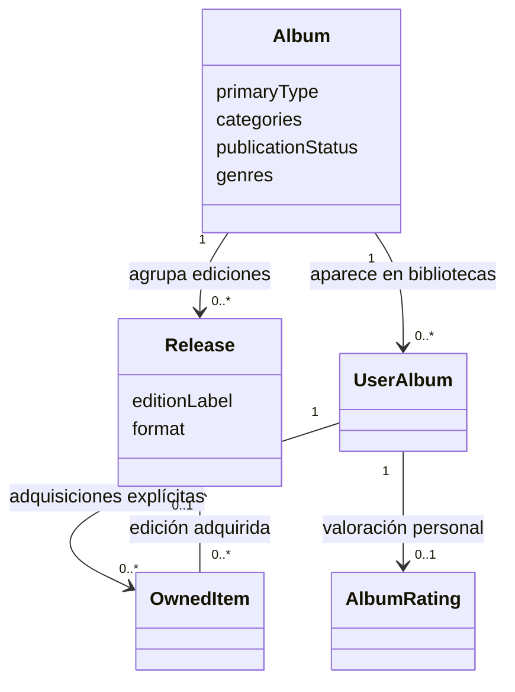
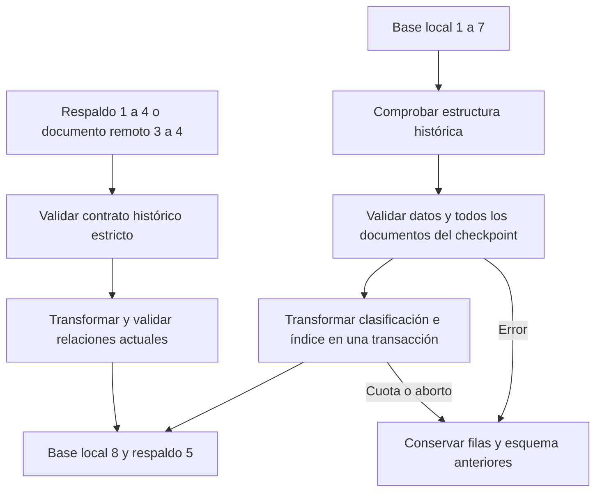

# Clasificación del álbum y alta guiada

UX-06 conserva esta clasificación en DB9/respaldo6 y añade la [edición de referencia de la nota](MI_EXPERIENCIA.md). Las versiones8/5 siguientes describen la migración que introdujo la clasificación.

UX-05 ([#65](https://github.com/NicoCG32/Auditorium/issues/65)) implementa tres dimensiones independientes del álbum conceptual. El contrato ejecutable está en [classification.ts](../src/domain/catalog/classification.ts); los formularios de alta y edición usan las mismas opciones.

## Modelo y responsabilidades

| Campo de Album      | Valores persistidos                                   | Presentación                                                                  |
| ------------------- | ----------------------------------------------------- | ----------------------------------------------------------------------------- |
| `primaryType`       | `unspecified`, `full_length`, `ep`, `single`, `other` | Sin especificar, Full-length, EP, Single, Otro                                |
| `categories`        | `demo`, `split`, `compilation`, `live`, `soundtrack`  | Demo, Split, Recopilación, En vivo, Banda sonora; combinables, sin duplicados |
| `publicationStatus` | `unknown`, `published`, `unreleased`                  | Desconocido, Publicado, Inédito                                               |

Artista y título bastan para guardar. Los valores iniciales son Sin especificar, ninguna categoría y Desconocido. La ausencia de categorías no confirma un álbum de estudio. Año, género, enlace o adquisición no determinan el tipo ni la publicación.

EP + Demo + Split + Inédito y Full-length + En vivo son combinaciones válidas. Los géneros son etiquetas musicales libres, separadas de estas categorías. Full-length no indica que se posea un vinilo.

Deluxe, Especial, Aniversario o Remaster siguen en `Release.editionLabel`. Una edición puede ser digital y existir sin una adquisición. Añadir o clasificar un álbum no crea una edición, un ejemplar, un enlace, una escucha ni una nota. La referencia opcional de una calificación a una edición se concreta en UX-06; esta entrega no añade ese contrato.

## Recorrido de alta y corrección

1. Identificar artista y título. Buscar en Wikidata es opcional; sus resultados se identifican como referencias externas y requieren selección y revisión. Continuar manualmente cancela una búsqueda en curso y enfoca «Revisar y guardar».
2. Ante artistas locales con ese nombre, elegir el registro correcto o confirmar un homónimo nuevo. Ninguna alternativa se selecciona por defecto. Se muestran país y álbumes conocidos; no hay fusión automática. Los créditos múltiples se añaden manualmente o desde una referencia externa y se conservan separados.
3. Abrir «Detalles del álbum (opcionales)» para clasificación, géneros, países, enlaces, portada y otros datos. Las portadas se previsualizan al aportar una URL HTTPS o un JPEG/PNG válido. Los enlaces permiten escuchar, comprar y elegir un favorito; no se extraen metadatos de una URL sin una integración comprobada.
4. Revisar la identificación y clasificación y guardar. Las coincidencias en el catálogo local se presentan antes de crear otra obra; abrir una conserva sus metadatos y permite incorporar explícitamente los enlaces del borrador.
5. Tras confirmar la escritura y la lectura posterior, abrir la ficha con un aviso y acceso a experiencia, calificación y biblioteca. Si falla sólo la lectura, el reintento no repite la escritura.

Editar conserva ID, relaciones, pistas, ediciones, notas y colección. El alcance compartido del país del artista se explica en el editor. Cancelar no escribe. Los conflictos comparan los metadatos y enlaces esperados dentro de la transacción y conservan el borrador; no sobrescriben cambios ajenos. Véanse [edición](EDICION_CATALOGO.md), [enlaces personales](ENLACES_PERSONALES.md) y [navegación y borradores](NAVEGACION.md).

Wikidata distingue [álbum](https://www.wikidata.org/wiki/Q482994), [Demo](https://www.wikidata.org/wiki/Q220935), [Split](https://www.wikidata.org/wiki/Q368281) y [banda sonora](https://www.wikidata.org/wiki/Q4176708). La clase genérica álbum no prepara Full-length por sí sola; las dimensiones conocidas se proponen por separado y publicación sigue desconocida.

La búsqueda de Biblioteca también incluye las etiquetas de clasificación conocidas. Las recomendaciones mantienen su lista de datos permitidos: este cambio no envía clasificación, géneros, países ni portadas al proveedor.

## Migración y compatibilidad

IndexedDB **8**, versión nativa **80**, reemplaza únicamente el índice `albums.releaseType` por `albums.primaryType`. Mantiene las catorce tablas, las demás claves e índices y la identidad local. El formato de respaldo es **5** y sigue limitado a 20 MiB.

| `releaseType` histórico | `primaryType` | `categories`    | `publicationStatus` |
| ----------------------- | ------------- | --------------- | ------------------- |
| `album`                 | `full_length` | `[]`            | `unknown`           |
| `ep`                    | `ep`          | `[]`            | `unknown`           |
| `single`                | `single`      | `[]`            | `unknown`           |
| `other`                 | `other`       | `[]`            | `unknown`           |
| `demo`                  | `unspecified` | `[demo]`        | `unknown`           |
| `live`                  | `unspecified` | `[live]`        | `unknown`           |
| `compilation`           | `unspecified` | `[compilation]` | `unknown`           |
| `soundtrack`            | `unspecified` | `[soundtrack]`  | `unknown`           |

Se conserva el significado almacenado, incluido el antiguo valor por defecto `album`; no se convierte en una verificación externa. La transformación no modifica el texto histórico, UUID, fechas, referencias, listas, valoraciones, enlaces, ejemplares ni deseos.

Los respaldos 1–4 se validan antes de convertirlos. Un archivo antiguo que declare campos nuevos se rechaza; no se relajan sus enums ni se ignoran campos desconocidos. Las versiones futuras se rechazan conservando los datos existentes. El lector actual vuelve a comprobar todas las relaciones después de transformar.

La actualización local convierte también `base`, ambos documentos pendientes y las dos copias de recuperación del checkpoint. Un error en cualquiera revierte filas e índices. Un envío anterior ya confirmado remotamente puede reconocerse por revisión siguiente y documento normalizado idéntico, conservando su identificador de operación; una revisión o contenido distintos siguen siendo conflicto.

Supabase admite formatos 3, 4 y 5. Los documentos antiguos se normalizan al leer sin reescribirlos por una simple consulta; la siguiente escritura válida guarda 5. La función de guardado rechaza campos de clasificación declarados como 3/4, clasificación inválida en 5 y cualquier vuelta a una versión anterior de una fila. Se mantienen aislamiento por propietario, RLS, revisión esperada e idempotencia. No cambian cuentas, correo ni credenciales.

## Verificación

Las pruebas cubren los ocho valores históricos, respaldos estrictos, migración de todos los documentos del checkpoint, reversión íntegra, lectura remota versionada y envíos históricos confirmados. Los recorridos de navegador comprueban alta mínima, varios artistas, homónimos, continuidad a la ficha, edición, conservación de relaciones, enlaces, portadas, accesibilidad y uso móvil. Las pruebas SQL utilizan cuentas ficticias y revierten toda la transacción. El [plan](PLAN_DESARROLLO.md) y la issue conservan la evidencia de entrega.
