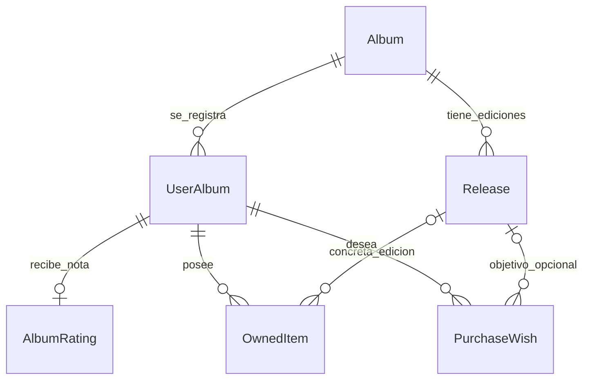
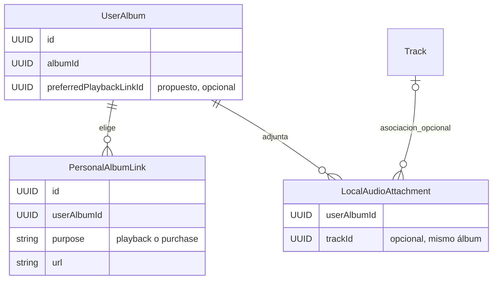
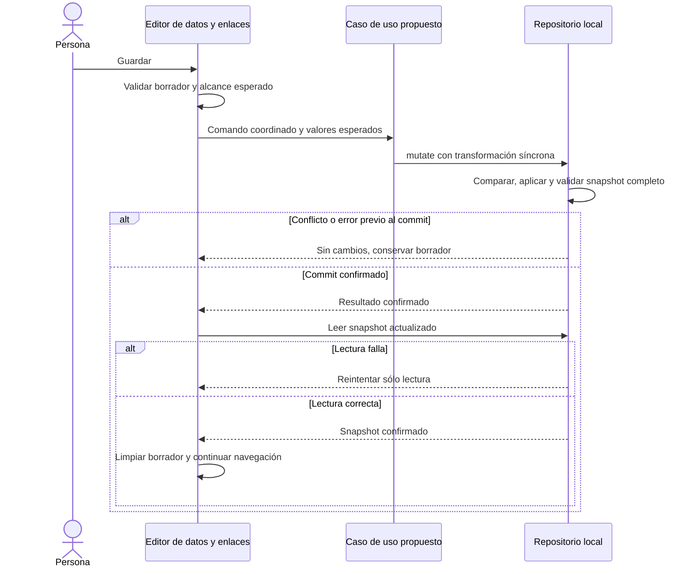

# Contratos de experiencia y acceso musical

Actualización LINK-01: enlaces personales y favorito ya están implementados con almacenamiento contenido en UserAlbum, DB7 y respaldo4; la [guía vigente](ENLACES_PERSONALES.md) concreta sus contratos. UX-05 implementa clasificación y formularios con DB8/respaldo5; véase la [guía vigente](CLASIFICACION_ALBUM.md). Los refinamientos posteriores mantienen su seguimiento.

UX-06 implementa la [experiencia conjunta y edición de referencia](MI_EXPERIENCIA.md), con DB9/respaldo6. PLAY-01 implementa la reproducción desde enlaces; AUDIO-02 implementa los adjuntos persistentes y el respaldo ZIP completo con DB10/respaldo6. Sus guías precisan los contratos vigentes.

Estado original: **diseño lógico propuesto en UX-03**, 2026-10-18. Los apartados que siguen propuestos no son schemas ejecutables ni migraciones aplicadas. Complementa la [experiencia propuesta](EXPERIENCIA_USUARIO.md) y el [modelo vigente](MODELO_DOMINIO.md); la [ADR-010](adr/010-navegacion-experiencia.md) recoge la decisión de interacción.

## 1. Responsabilidades y relaciones

| Concepto                           | Dueño y responsabilidad                                                   | No significa                                                        |
| ---------------------------------- | ------------------------------------------------------------------------- | ------------------------------------------------------------------- |
| `Album`, `Artist`, créditos        | Identidad musical y metadatos del catálogo                                | Que una persona lo haya escuchado, calificado o adquirido           |
| `Release`, pistas y apariciones    | Ediciones, versiones y orden musical                                      | Copia poseída o fuente de reproducción personal                     |
| `UserAlbum`                        | Relación de la identidad local con un álbum; escucha, comentario y fechas | Álbum duplicado por plataforma o formato                            |
| `AlbumRating`, `TrackRating`       | Opinión personal independiente sobre álbum o pista                        | Promedio obligatorio ni efecto de un evento de reproducción         |
| `PersonalAlbumLink` propuesto      | Dirección elegida por la persona para escuchar o comprar                  | Referencia universal confirmada ni compra realizada                 |
| Favorito de reproducción propuesto | Elección de un enlace de escucha de la propia entrada                     | Preferencia de todos los usuarios o de todo el catálogo             |
| `LocalAudioAttachment` propuesto   | Relación de un archivo propio con una entrada y opcionalmente una pista   | Archivo en el repositorio, copia física o compra digital demostrada |
| `OwnedItem`                        | Ejemplar/adquisición personal; `Release` opcional                         | Escucha, calificación o deseo satisfecho automáticamente            |
| `PurchaseWish`                     | Intención personal por formato/edición                                    | Existencia de ejemplar o simple URL de tienda                       |



La ampliación de acceso personal se muestra aparte para no confundir identidad musical, opinión y posesión con fuentes de escucha:



Son cardinalidades conceptuales, no nuevas tablas ni claves foráneas instaladas. El puntero de favorito sólo admite un enlace de reproducción de la misma entrada; cada enlace sólo puede ser favorito de su propia entrada. La relación opcional con pista exige que pertenezca al mismo álbum. Una entrada no puede referenciar entidades ajenas a su identidad local. Las notas de pistas siguen en `TrackRating`, separadas de `AlbumRating`, como documenta el modelo vigente.

`Album.catalogReference` conserva una referencia externa seleccionada, con su procedencia. Un identificador Spotify/YouTube de esa referencia puede ofrecerse como candidato; sólo una elección explícita lo convierte en enlace personal o favorito. Una búsqueda por título/artista no es una URL confirmada del álbum.

### Tipo, categorías, publicación y edición

La clasificación musical pertenece a `Album`, pero se divide en dimensiones independientes. No se obliga a elegir entre «EP» y «Demo» en un mismo selector.

Biblioteca muestra una sola entrada personal por álbum conceptual. Original, Deluxe, Especial y Aniversario son ediciones agrupadas en su ficha, nunca entradas duplicadas por edición, formato, plataforma o adquisición. Las diferencias de pistas de una reedición se describen en su propia lista, conservando la identidad del álbum. No se fusionan automáticamente obras distintas por compartir título; una regrabación completa o un disco de remezclas concebido como obra independiente requiere revisar su identidad.

| Dimensión propuesta   | Ubicación        | Valores o ejemplos                                | Regla                                                                             |
| --------------------- | ---------------- | ------------------------------------------------- | --------------------------------------------------------------------------------- |
| Tipo principal        | `Album`          | Full-length, EP, Single, Otro, Sin especificar    | Un valor; no depende del soporte ni del número de copias                          |
| Categorías            | `Album`          | Demo, Split, Recopilación, En vivo, Banda sonora  | Selección múltiple; ninguna registrada no significa «álbum de estudio» confirmado |
| Estado de publicación | `Album`          | Publicado, Inédito, Desconocido                   | «Inédito» no sustituye tipo ni categorías; no se deduce de un enlace o del año    |
| Edición               | `Release`        | Original, Deluxe, Especial, Aniversario, Remaster | Publicación concreta, física o digital; no exige que se posea                     |
| Soporte de la edición | `Release.format` | Vinilo, CD, Casete, Digital, Otro                 | Una edición digital no se cuenta como copia física                                |
| Ejemplar personal     | `OwnedItem`      | Mi vinilo, su condición, adquisición y notas      | Puede vincularse a una edición del mismo álbum sin duplicar éste                  |

Se reserva «Full-length» para el tipo musical. «LP» puede mostrarse como término equivalente contextual, pero **Vinilo LP** identifica el soporte: un full-length digital sigue siendo full-length y un EP puede editarse en vinilo.

Ejemplo ficticio: «Umbral» puede ser **EP + Demo + Split + Inédito**, sin nota ni copias. «La última luz» puede tener una edición **Deluxe digital** para escuchar y otra **Aniversario en CD**; poseer dos unidades de esta última produce dos `OwnedItem` vinculados al mismo `Release`, no dos álbumes ni dos ediciones. Una demo publicada sigue siendo Demo y pasa a Publicado; no pierde su categoría.

En la interfaz, tipo, categorías y publicación se completan bajo demanda en Añadir/Editar datos. Deluxe o Aniversario se eligen al consultar/registrar una edición, especialmente desde Mi colección; no se piden para guardar el álbum abstracto. Condición, fecha de adquisición y notas describen el ejemplar. Cambiar la edición asociada a una copia no renombra el álbum ni altera las demás copias; editar datos compartidos de una edición es otra operación con alcance visible.

La separación de tipo principal y categorías toma como referencia [MusicBrainz: tipos de grupo de publicación](https://musicbrainz.org/doc/Release_Group/Type). La distinción entre edición digital/física y ejemplar es coherente con [MusicBrainz: publicación concreta](https://musicbrainz.org/doc/Release). **Split y el estado Publicado/Inédito/Desconocido son decisiones de esta propuesta de Auditorium**, no una equivalencia automática con los vocabularios externos. Toda clasificación sugerida por catálogo se revisa y la entrada manual sigue disponible.

#### Transición desde la clasificación vigente

El antiguo Album.releaseType mezclaba tipo y categoría. UX-05 lo sustituye por primaryType, categories y publicationStatus; la [guía ejecutable](CLASIFICACION_ALBUM.md) concreta campos, formularios y compatibilidad. La transformación conserva la tabla lógica siguiente:

| Valor anterior                                 | Tipo propuesto  | Categoría conservada                                          |
| ---------------------------------------------- | --------------- | ------------------------------------------------------------- |
| `album`                                        | Full-length     | Ninguna registrada                                            |
| `ep` / `single`                                | EP / Single     | Ninguna registrada                                            |
| `live` / `demo` / `compilation` / `soundtrack` | Sin especificar | En vivo / Demo / Recopilación / Banda sonora, respectivamente |
| `other`                                        | Otro            | Ninguna registrada                                            |

La migración conserva la clasificación heredada, incluidos antiguos valores por defecto, sin atribuirles verificación externa. No adivina duración/tipo desde Demo o En vivo, ni inventa Split; el estado de publicación anterior queda Desconocido. La persona puede completar esos datos después. `Release.editionLabel`, formatos, listas, IDs y ejemplares no se trasladan a `Album` ni se pierden. Los lectores de respaldos1/2/3/4 mantienen enums históricos estrictos antes de normalizar al formato5.

### Calificación única y edición de referencia

La valoración personal pertenece al álbum conceptual a través de `AlbumRating`, no a cada `Release`. Una nueva escucha de una edición Deluxe, remasterizada o con bonus puede motivar recalificar ese mismo álbum; no crea otra nota, otro álbum ni un promedio entre versiones o pistas.

UX-06 implementa un campo opcional `AlbumRating.referenceReleaseId`, contexto de la valoración actual. Se elige mediante un selector simple **Edición de referencia**:

- Primera opción **Sin edición de referencia**, predeterminada para datos anteriores y nuevas notas.
- Sólo ediciones ya añadidas a ese álbum (`Release.albumId` coincide), incluidas físicas o digitales que no se posean. Las adquisiciones no son las opciones del selector.
- Etiquetas con edición, formato y año conocidos, por ejemplo «Deluxe · Digital · 2021» y «Aniversario · CD · 2031». Distinguir etiquetas coincidentes con datos de edición disponibles sin usar UUID como texto principal.
- Sin ediciones, explicar «Aún no has añadido ediciones» y permitir calificar sin referencia. Añadir una edición sigue siendo otra tarea; el selector no crea ediciones por texto libre ni consulta catálogos.
- Cambiar o quitar la selección no cambia la cifra de la nota, pistas, enlaces ni colección. Una nueva edición o adquisición no sustituye automáticamente la referencia elegida.
- Guardar nota y referencia es atómico dentro de Mi experiencia, junto al resto de ese ámbito. La referencia sólo se guarda cuando existe nota; quitar la nota también retira su referencia y conserva escucha/comentario.
- Recalificar conserva la referencia vigente salvo cambio explícito. No se permite eliminar una edición y dejar una referencia huérfana: antes de eliminarla debe resolverse explícitamente esa referencia, conservando la nota.

No es la edición favorita de reproducción ni una prueba de adquisición. El cambio usa DB9, respaldo6 y sincronización3/4/5/6, con comparación concurrente del valor esperado y validación de pertenencia al mismo álbum. Las calificaciones anteriores llegan sin referencia y no se deduce una desde la primera edición, un enlace o un ejemplar.

### Mi colección: adquisiciones físicas y digitales

El destino antes llamado Colección física pasa a **Mi colección**, con filtros **Físico** y **Digital adquirido** y recuentos separados, además de una vista conjunta. `OwnedItem.medium` conserva `physical` o `purchased_digital`; el cambio de nombre no reclasifica datos. Registrar una adquisición es explícito, con edición opcional del mismo álbum y formato compatible. Dos ejemplares de la misma edición siguen siendo dos registros.

Una compra individual digital puede registrarse como adquisición; una suscripción, un enlace de streaming, la reproducción o un audio adjunto no acreditan por sí solos una compra ni crean registros. Los deseos conservan su acceso secundario y no cuentan como adquisiciones. Quitar una adquisición no elimina la edición del catálogo ni la referencia de una nota.

## 2. Contrato lógico de enlaces y adjuntos

### Enlaces personales

Representación propuesta para concretar y validar en LINK-01:

```ts
type PersonalAlbumLink = {
  id: string
  userAlbumId: string
  purpose: 'playback' | 'purchase'
  url: string
  label?: string
  createdAt: string
  updatedAt: string
}

// Ampliación futura de la entrada personal; no existe todavía en DB5.
type PlaybackPreference = {
  userAlbumId: string
  preferredPlaybackLinkId?: string
}
```

La preferencia se representa lógicamente como un puntero opcional de la entrada (`UserAlbum.preferredPlaybackLinkId` en la propuesta), no como varios booleanos que puedan quedar activos a la vez. No requiere una tabla de preferencias adicional. LINK-01 debe fijar schema, ubicación física, límites y versionado antes de persistirlo.

Invariantes:

1. El destino es una URL HTTPS validada, sin credenciales embebidas. No se aceptan HTML, scripts o un iframe pegado. Se concreta un máximo de enlaces y longitud en LINK-01, con error visible antes de escribir.
2. Proveedor y capacidad de inserción se derivan de host, ruta e identificador reconocidos; una etiqueta del usuario no autoriza un embed. Una URL genérica válida sigue siendo un enlace externo.
3. Dos enlaces equivalentes del mismo propósito no se duplican silenciosamente. La normalización de proveedores sólo elimina diferencias documentadas, sin perder parámetros necesarios ni asumir que una redirección acortada ya está resuelta.
4. El favorito debe apuntar a un enlace `playback` de esa misma `UserAlbum`. Cambiarlo no modifica otros enlaces ni sus propósitos. Quitar el favorito limpia la preferencia en la misma transacción; no elige otro sin decisión.
5. Editar o quitar un enlace no modifica catálogo, notas, escucha, deseos o propiedad. Retirar/restaurar el álbum conserva enlaces y preferencia junto a la entrada personal.
6. Con varios enlaces y sin favorito, Escuchar permite elegir. Con uno puede ofrecer «Abrir en [servicio]» sin persistir una preferencia implícita. Comprar agrupa únicamente enlaces `purchase`.
7. No contactar a servicios al normalizar o guardar. Una consulta de metadatos o reproducción integrada es otra acción, con adaptador aprobado, cancelación y alternativa externa.

Una referencia externa invalidada por corregir identidad musical no borra los enlaces personales. El editor pide revisarlos y permite corregirlos o retirarlos. La aplicación no puede demostrar que el contenido de cualquier URL corresponde al álbum sólo por su formato.

### Audio personal

El descriptor local del adjunto incluye identidad propia, `userAlbumId`, `trackId` opcional, nombre mostrado, tamaño, tipo observado y estado de disponibilidad. La referencia al almacenamiento binario es opaca y local; nunca es una ruta absoluta del equipo ni una URL temporal exportable.

El binario se mantiene fuera de `Album` y fuera de la precaché del producto. Una URL `blob:` sólo sirve al reproductor durante su uso y debe revocarse; no identifica un archivo recuperable tras reiniciar. Cambiar de álbum o pantalla libera la reproducción. Eliminar un adjunto requiere una acción independiente de retirar el álbum; esta última conserva los datos personales hasta que se concrete una política de eliminación explícita.

La asociación opcional a una pista sólo es válida cuando `Track.albumId` coincide con el álbum de la entrada. No se crean pistas automáticamente al elegir un archivo. La pertenencia a una edición concreta o múltiples archivos por pista no son requisitos iniciales de esta propuesta.

AUDIO-01 eligió persistencia en este dispositivo. AUDIO-02 implementa DB10/nativa100 con bytes IndexedDB, 16 MiB por archivo, 128 MiB y 128 adjuntos por biblioteca, un reproductor activo y guardado atómico. El [contrato serializado de audio y ZIP1](AUDIO_LOCAL.md) mantiene los adjuntos fuera del JSON6 de 20 MiB y de los documentos remotos. Los binarios no se convierten a base64 de portada.

## 3. Operaciones y concurrencia

El diseño propone estos ámbitos de escritura, que se implementan en sus tareas respectivas:

| Acción visible           | Cambio coordinado                                              | Conserva                                                             |
| ------------------------ | -------------------------------------------------------------- | -------------------------------------------------------------------- |
| Añadir a mi biblioteca   | Álbum/créditos/entrada, enlaces y favorito elegidos            | Identidad local y registros anteriores; no crea nota ni copias       |
| Guardar datos del álbum  | Metadatos/créditos/portada y enlaces del editor                | IDs musicales/personales, experiencia, listas, copias y deseos       |
| Guardar mi experiencia   | Nota y edición de referencia opcionales, escucha y comentario  | Catálogo, enlaces, adjuntos, adquisiciones, deseos y notas de pistas |
| Quitar nota              | Retirada explícita de `AlbumRating` y su referencia de edición | Entrada, escucha, comentario y resto de relaciones                   |
| Guardar adquisición      | Datos de ejemplar físico o compra digital y edición opcional   | Álbum, experiencia, enlaces y otras adquisiciones                    |
| Elegir o quitar favorito | Puntero de preferencia y enlace afectado cuando proceda        | Metadatos, experiencia y propiedad                                   |

La arquitectura actual permite transformaciones síncronas dentro de `repository.mutate`; las tareas de implementación deben incorporar la escritura coordinada en un único límite de commit. No encadenar varios comandos independientes y anunciar un éxito conjunto cuando sólo se ha guardado una parte. Las consultas externas y la lectura/decodificación de archivos ocurren fuera de la transacción; sólo sus resultados ya validados entran en el guardado.



Cada comando compara sólo el conjunto esperado que puede sobrescribir: álbum/créditos/artistas compartidos y enlaces/preferencia para el editor de datos; nota/referencia de edición/escucha/comentario para experiencia; adquisición objetivo para inventario. Una modificación de otro álbum no debe provocar conflicto por sí sola. Un cambio relevante concurrente conserva borrador y exige revisión; nunca basta un botón genérico que sobrescriba lo nuevo sin mostrarlo.

Las mutaciones no cambian la identidad local. Editar un artista conserva la regla vigente sobre país compartido y renombre de un crédito; el contexto visible explica ese alcance. Un reintento posterior a un commit sólo recupera lectura, no recrea enlaces, copias o el álbum.

## 4. Compatibilidad y transición

**La propuesta inicial conservaba DB5/respaldo3; la implementación vigente de UX-05 usa DB8/nativa80 y respaldo5, documentados en [clasificación](CLASIFICACION_ALBUM.md).** Los contratos ejecutables siguen en [schemas de catálogo](../src/domain/catalog/schemas.ts), [biblioteca](../src/domain/library/schemas.ts), [ejemplares](../src/domain/library/owned-items.ts) y [respaldo](../src/domain/backup.ts).

| Momento        | Requisito                                                                                                                  |
| -------------- | -------------------------------------------------------------------------------------------------------------------------- |
| UX-04 / VIS-02 | Navegación, borradores y consultas sin cambiar el contrato musical por conveniencia de UI                                  |
| LINK-01        | Versionar esquema y respaldo al incorporar enlaces/preferencia; validar relaciones y migraciones antes de exponer guardado |
| UX-05          | Separar tipo/categorías/publicación con migración y respaldo versionados; mantener IDs y reglas previas                    |
| UX-06          | Versionar referencia opcional de edición en la nota; escritura coordinada de experiencia y compatibilidad de notas previas |
| AUDIO-01       | Resolver almacenamiento y recuperación con evidencia, sin afirmar que JSON contiene el audio                               |
| AUDIO-02       | Persistencia DB10, ZIP1 y restauración atómica implementados según el contrato de audio local                              |
| COL-05         | Presentar Mi colección con adquisiciones físicas/digitales separables, conservando registros y acceso a deseos             |

Los archivos de respaldo1/2/3 mantienen validadores históricos estrictos. Un importador futuro normaliza desde cada contrato validado, sin aceptar campos nuevos en versiones antiguas. Los registros anteriores llegan sin enlaces personales ni favorito; no se inventan a partir de referencias de catálogo. La identidad, UUID, fechas, texto de notas, ratings, pistas, ediciones, copias, deseos y retirada se conservan.

Una versión antigua debe rechazar esquemas y respaldos futuros con mensaje recuperable. La migración es atómica, conserva la barrera de versión existente y nunca elimina filas por cambiar la vista de Mi colección. No se fija ahora un número de versión futuro ni se cambia el tag publicado.

La restauración continúa limitada al destino vacío, con adopción atómica de identidad y datos; el rediseño no introduce fusiones de bibliotecas. El respaldo completo ZIP1 incluye JSON musical6, manifiesto y binarios; el JSON separado excluye los adjuntos. La interfaz explica esta diferencia antes de exportar. Un archivo JSON de 20 MiB no equivale a un paquete de medios completo.

## 5. Matriz de independencia y comprobación

| Evento                    | Catálogo        | Experiencia                            | Enlaces                             | Adjuntos                         | Mi colección        |
| ------------------------- | --------------- | -------------------------------------- | ----------------------------------- | -------------------------------- | ------------------- |
| Guardar enlace o favorito | Se conserva     | Se conserva                            | Cambia                              | Se conserva                      | Se conserva         |
| Abrir/reproducir fuente   | Se conserva     | Se conserva                            | Se conserva                         | Sólo recurso temporal si procede | Se conserva         |
| Calificar/recalificar     | Se conserva     | Cambia nota personal                   | Se conserva                         | Se conserva                      | Se conserva         |
| Adjuntar audio            | Se conserva     | Se conserva                            | Se conserva                         | Cambia según contrato aprobado   | Se conserva         |
| Registrar segunda copia   | Se conserva     | Se conserva                            | Se conserva                         | Se conserva                      | Añade otro ejemplar |
| Corregir año/portada      | Cambia metadato | Se conserva                            | Se conserva salvo edición explícita | Se conserva                      | Se conserva         |
| Retirar/restaurar entrada | Se conserva     | Se conserva, cambia estado de retirada | Se conserva                         | Asociación se conserva           | Se conserva         |

Aplicar esta matriz a los [cinco escenarios de diseño](EXPERIENCIA_USUARIO.md#6-escenarios-de-aceptación-del-diseño). Para compatibilidad, usar una biblioteca ficticia con entrada activa y retirada, varios créditos, géneros literales, portada local, ratings de álbum/pistas, dos copias físicas, una adquisición digital y deseos. Comparar identidad y relaciones antes/después de migración y restauración, incluyendo fallos de cuota y concurrencia.

Añadir casos de EP Demo inédito, full-length En vivo, Split con varios créditos y Deluxe digital sin ejemplares. Verificar la transformación de cada valor antiguo de `releaseType`, corrección posterior sin pérdida de relaciones y dos copias de una misma edición. Ningún caso debe exigir calificación, escucha o propiedad para guardar la clasificación. Comprobar nota única con/sin referencia, selección de edición no poseída, rechazo de edición ajena, retirada explícita de referencia, conservación al recalificar, eliminación de edición referenciada y migración/restauración de notas anteriores sin selección inventada.

La arquitectura de información de UX-03 puede revisarse sin ejecutar esas migraciones todavía inexistentes. LINK-01 aporta su evidencia en la guía de enlaces; UX-05 y AUDIO-02 aportan sus contratos y validación en las guías de clasificación y audio local. La [validación de persistencia actual](VALIDACION_PERSISTENCIA.md) y las [reglas de respaldo](RESPALDOS_JSON.md) siguen siendo referencias de comportamiento vigente.
