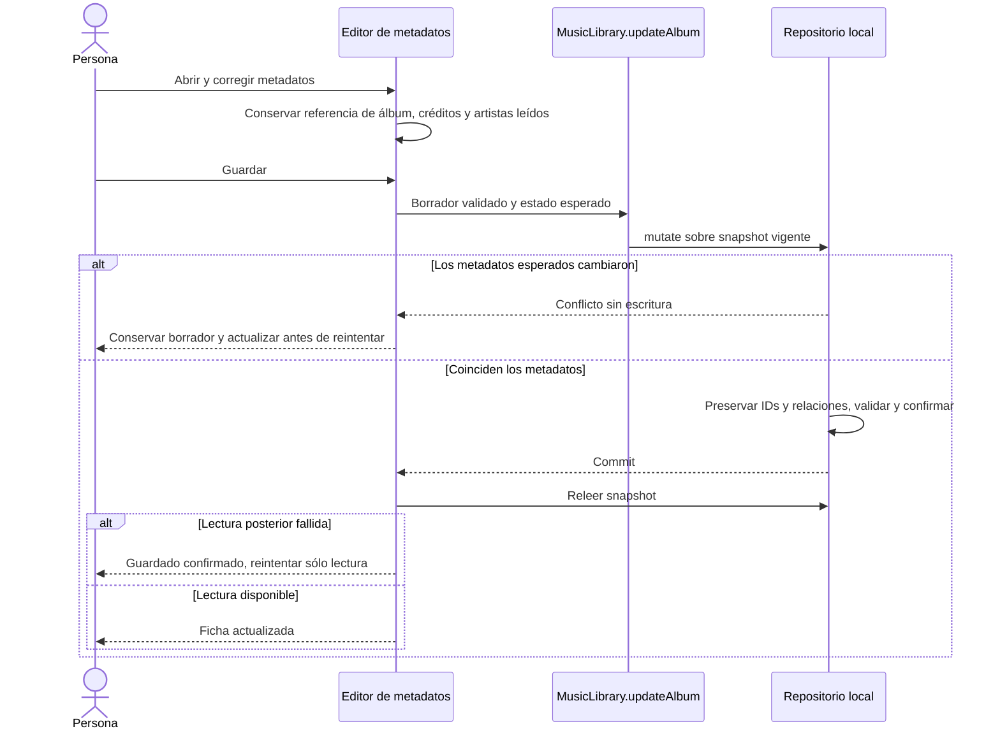

# Editar álbumes, géneros y países

UX-01 refina el incremento de catálogo y recomendaciones antes de su publicación. Se sigue en la [issue #59](https://github.com/NicoCG32/Auditorium/issues/59) y la [PR #58](https://github.com/NicoCG32/Auditorium/pull/58). El contrato y los recorridos descritos aquí están en desarrollo y revisión; no cambian el tag ni los archivos de la release v1.0.0.

## Corregir un álbum guardado

Desde la ficha, «Editar álbum» abre los metadatos actuales: título, artistas acreditados, tipo, año original, géneros, país de origen de cada artista, portada y descripción. Cancelar descarta el borrador. Guardar valida y confirma una sola escritura local; no crea otra entrada de biblioteca ni cambia el ID del álbum.

Se mantienen listas, pistas, ediciones, escucha, notas personales, valoraciones, ejemplares, deseos y retirada. Cambiar el nombre de un artista crea un registro de artista para ese crédito del álbum; no renombra al artista usado por otros álbumes. Si se conserva su identidad y se corrige su país, el dato cambia también donde se acredita ese mismo artista. El editor informa de ese alcance antes de guardar. No hay fusión automática por nombre.

Título, nombre, alias o papel de los créditos forman parte de la identidad musical que ampara la referencia externa. Cambiarlos descarta `catalogReference` para evitar atribuir una coincidencia anterior al nuevo contenido. Corregir año, descripción, géneros, país o portada conserva la referencia. La edición no inicia consultas ni enriquecimiento automático en Wikidata.

La comprobación compara álbum, créditos ordenados y artistas referenciados dentro de la transacción. Un cambio ajeno en una valoración no invalida por sí solo esos metadatos. Un conflicto no sobrescribe el estado vigente; una cuota insuficiente o aborto conserva los datos anteriores y el borrador. Si falla la lectura después de confirmar el commit, recuperar la vista no repite la escritura.

## Géneros y país de origen

`Album.genres` contiene hasta veinte etiquetas libres de hasta ochenta caracteres cada una. El alta y el editor permiten agregarlas o retirarlas; se omiten los valores vacíos y se rechazan duplicados normalizados. No se fuerza un vocabulario musical ni se deduce un género desde el título.

`Artist.country` es un texto opcional de hasta cien caracteres. Describe el origen del artista o banda; es independiente de `Release.countryCode`, que describe una edición. Se introduce manualmente, sin geolocalización ni catálogo obligatorio de países. Los álbumes con varios créditos pueden mostrar varios países conocidos; no se inventa el de los créditos incompletos.

La biblioteca permite buscar por género o país, combinarlos con escucha y nota, y ordenar por género o país A–Z. Las opciones se obtienen de toda la biblioteca activa para evitar filtros circulares. Se agrupan alias de mayúsculas, acentos y espacios, conservando una etiqueta legible. Los álbumes sin ese dato siguen visibles con «Todos» y se sitúan al final al ordenar por el campo ausente.

## Portada automática y archivo local

Elige una URL HTTPS o un archivo JPEG/PNG de hasta **2 MiB**. La vista previa aparece automáticamente al aportar el enlace o seleccionar un archivo válido; la ficha y las tarjetas muestran la portada guardada al abrirlas. No hay un paso adicional «Mostrar portada». Un error conserva la representación local y ofrece reintento.

La URL se solicita directamente al proveedor de la imagen, sin referrer de la aplicación; sólo se conserva el enlace. La búsqueda de catálogo puede proponer una portada representativa, pero el usuario decide si la incorpora. La existencia y los derechos de una imagen no se infieren por su URL. Las imágenes remotas requieren red y no se guardan mediante reglas del service worker.

El archivo local se comprueba por tamaño, MIME admitido, firma y decodificación de imagen antes de incorporarse al borrador. Se admiten hasta 8192 píxeles por eje y 32 millones de píxeles en total. SVG y otros formatos no se aceptan como portadas locales. Se guarda una data URL PNG/JPEG en `Album.coverImage`, sin rutas del equipo ni referencias temporales a Blob. Elegir URL o archivo es excluyente; cambiar de fuente permite reemplazar la portada anterior. El contrato del dominio y el importador de respaldos comprueban estructura, base64, tamaño y firma; la decodificación y las dimensiones se comprueban al seleccionar un archivo en la interfaz.

Una portada local confirmada pertenece a IndexedDB y al respaldo, por lo que puede mostrarse offline. Es distinta de la foto temporal de «Apariencia», que sólo vive en memoria. Los datos base64 ocupan más que el archivo original y cuentan dentro del límite de respaldo de **20 MiB**. Las imágenes de usuarios no se añaden a los recursos públicos del repositorio ni a la precaché.

## Compatibilidad, privacidad y validación

El incremento utiliza DB5/nativa50, sin añadir tablas ni índices, y exporta respaldo3. Las bases v1 a v4 se actualizan conservando identidad y filas; los respaldos1/2 se aceptan con sus contratos históricos estrictos y se normalizan al formato actual. No se completan metadatos durante la migración. Una aplicación anterior no puede abrir la base nueva ni leer el archivo nuevo; conserva respaldos previos al actualizar.

El contexto de recomendaciones mantiene la lista permitida anterior. No se envían géneros, países, URL de portada ni imágenes locales al modelo. La edición no genera solicitudes de IA. Consulta [respaldos](RESPALDOS_JSON.md), [integraciones](INTEGRACIONES_OPCIONALES.md) y [ADR-009](adr/009-edicion-metadatos-portadas.md).

La aceptación debe comprobar alta y edición, cancelación, conflictos, conservación de relaciones y recarga; combinación de filtros y orden sin datos; archivos válidos e inválidos, cambio de portada y fallos de red; respaldo3 y versiones previas; reapertura offline de imágenes locales; teclado, foco, errores y pantallas pequeñas. La validación de UX-01 está en curso y se registrará en la PR antes de integrar.
