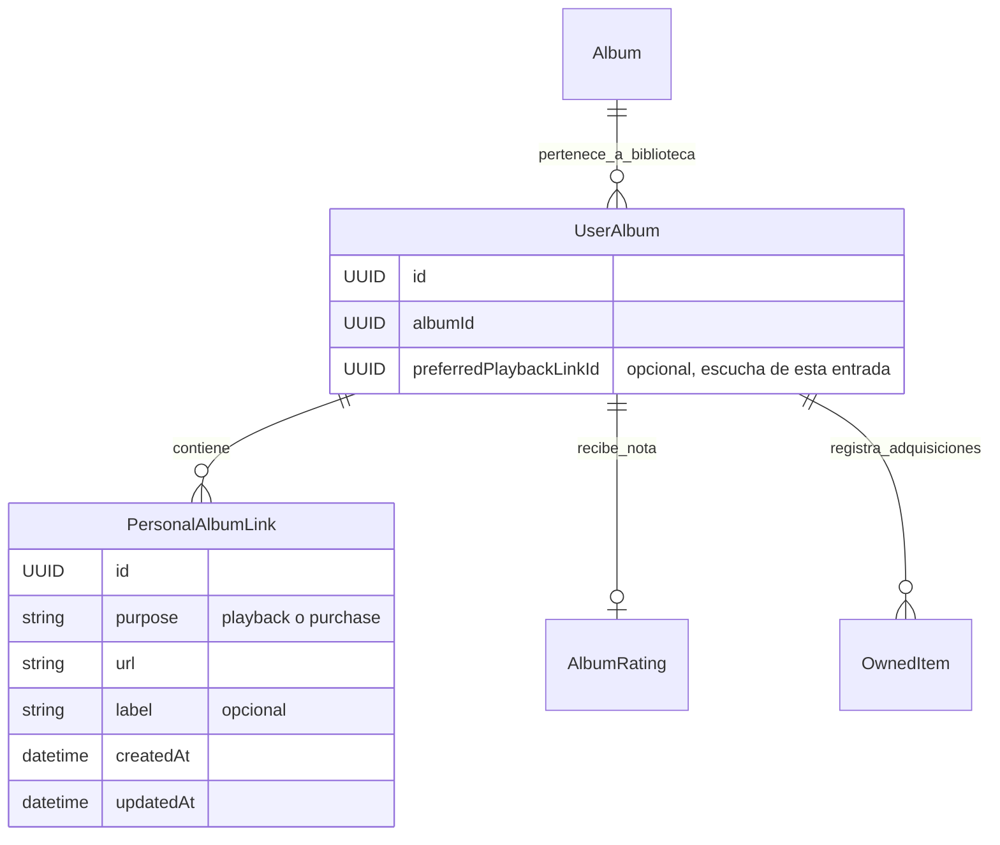

# Enlaces personales de reproducción y compra

Cada entrada personal de un álbum puede guardar hasta **20 enlaces HTTPS**, repartidos entre **Escuchar** y **Comprar**. Se añaden al registrar el álbum y se corrigen desde **Editar álbum** o **Editar enlaces** en la ficha. Una etiqueta opcional permite distinguir versiones; el proveedor se obtiene del dominio de la URL.

Escuchar admite un **favorito de reproducción opcional**. Cambiarlo conserva las alternativas. Quitar el enlace favorito, o cambiar su propósito a compra, elimina esa preferencia; no se elige otro automáticamente. Con un único enlace tampoco se guarda una preferencia implícita. Todos los enlaces abren el servicio en otra pestaña, con `noopener noreferrer` y sin enviar el referente. Este incremento no incorpora reproductores ni descarga audio.

## Modelo de dominio

`PersonalAlbumLink` es un valor identificado contenido en `UserAlbum.links`; su entrada contenedora determina el propietario y el álbum. No añade una tabla ni una referencia universal de catálogo. El favorito es un único puntero a un enlace de escucha de esa misma entrada. Los IDs de los enlaces no pueden repetirse entre entradas.

Guardar o abrir un enlace no modifica nota, estado de escucha, ejemplares ni deseos. Una URL de compra no acredita adquisición. Retirar y restaurar una entrada conserva sus enlaces y preferencia. Corregir la identidad musical no borra enlaces personales: la persona debe revisar si siguen correspondiendo al álbum.

Las **Referencias del catálogo** aparecen en otra sección. Wikidata, MusicBrainz y sus URLs de Spotify/YouTube no se incorporan automáticamente a los enlaces personales ni al favorito. Las búsquedas por título/artista siguen siendo búsquedas, sin coincidencia confirmada.

## Validación y guardado

Las URLs tienen un máximo de 2048 caracteres; las etiquetas, 80. No se aceptan HTTP, credenciales embebidas, scripts, HTML ni controles o espacios sin codificar. Las etiquetas se muestran como texto. La normalización estándar de `URL` conserva ruta, consulta y fragmento y normaliza host y puerto; no resuelve acortadores, elimina parámetros de seguimiento ni equipara URLs de proveedores distintos. Dos URLs equivalentes bajo esa normalización, con el mismo propósito, se rechazan como duplicadas. La misma URL puede tener propósitos distintos.

Spotify, YouTube y Bandcamp se identifican por dominios reconocidos. Cualquier otro destino HTTPS válido conserva su dominio como proveedor y su salida externa. No se inventan IDs, se infiere que la URL es del álbum ni se contacta al servicio al guardar.

El alta confirma catálogo, entrada, enlaces y favorito en una transacción. La edición compara los metadatos y enlaces esperados, conservando cambios ajenos de experiencia o colección; un conflicto no sobrescribe el borrador. Una operación sin cambios de enlaces conserva sus fechas. El editor admite cancelación y la protección de [borradores](NAVEGACION.md).

Al elegir una coincidencia durante el alta, se avisa que los enlaces preparados se añadirán sin borrar los anteriores. Los duplicados conservan su ID y etiqueta existentes. Sólo un favorito elegido en el formulario sustituye la preferencia anterior. Un conflicto o superar el límite cancela todo el guardado.

Si la escritura se confirma y falla la lectura posterior, sólo se permite **Reintentar lectura**: no se vuelve a guardar ni se crean duplicados.

## Persistencia, respaldo y sincronización

**IndexedDB 7 / nativa 70** conserva las tablas e índices de v6. Añade una barrera de compatibilidad para los campos opcionales, validando la biblioteca durante la migración sin generar enlaces, cambiar UUID ni reescribir notas. El checkpoint de sincronización permanece intacto.

El respaldo exportado usa **formato 4** e incluye enlaces y favorito dentro de cada entrada, activa o retirada. Los formatos históricos 1/2/3 se validan estrictamente y se convierten a 4 sin inventar enlaces. Los campos nuevos se rechazan en archivos que declaren una versión histórica. Restaurar sigue requiriendo un destino vacío y confirma identidad y datos conjuntamente; el límite total continúa en 20 MiB.

Supabase admite documentos 3 y 4. Una escritura nueva envía 4; después de actualizar una biblioteca a 4 se rechaza cualquier escritura que intente volver a 3. La RPC conserva propietario autenticado, revisión esperada, idempotencia y permisos. Los enlaces viajan con la biblioteca privada; el servidor no visita sus destinos. La mezcla entre dispositivos compara entradas completas: dos ediciones incompatibles de la misma entrada conservan ambas copias para resolver el conflicto, según la [guía de sincronización](SINCRONIZACION_SUPABASE.md).

## Validación de la entrega

[LINK-01 #64](https://github.com/NicoCG32/Auditorium/issues/64) cubre contratos, protocolos, duplicados, pertenencia del favorito, guardado conjunto, conflictos, reapertura, migración DB6→DB7, respaldo/restauración y retirada/restauración. Los recorridos de navegador comprueban varios servicios, un proveedor genérico, cancelación, URL inválida, cambio y retirada del favorito y accesibilidad. Las pruebas SQL comprueban aislamiento, revisiones, reintentos, versiones 3/4 y rechazo de downgrade con cuentas ficticias revertidas íntegramente.

La clasificación del álbum, el selector de edición de referencia, los reproductores y los adjuntos de audio conservan sus tareas independientes.
