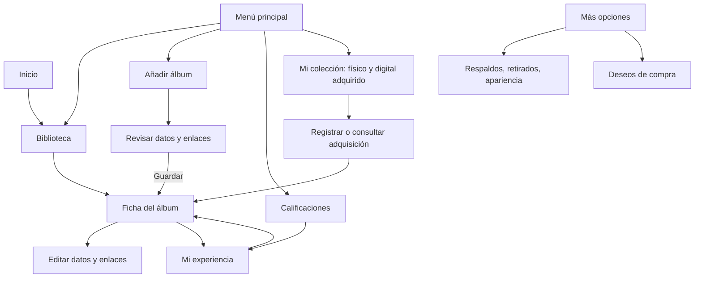
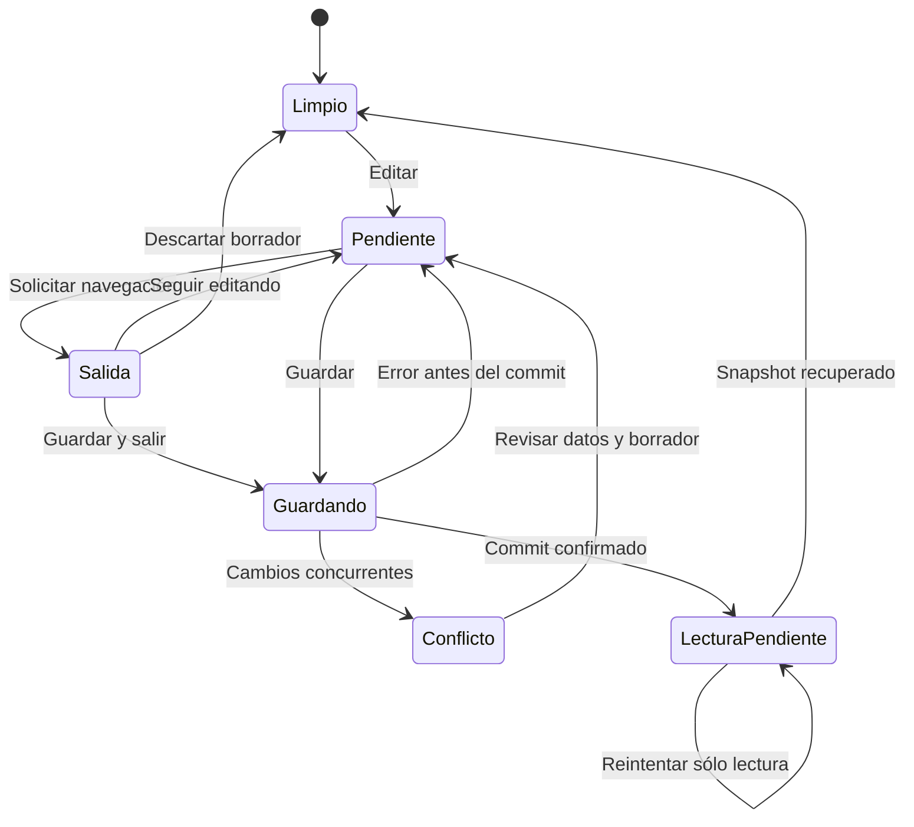

# Experiencia de biblioteca, escucha y colección

Estado: **diseño propuesto para UX-03, pendiente de revisión**. Fecha: 2026-10-18. Referencias: [UX-02 #60](https://github.com/NicoCG32/Auditorium/issues/60), [UX-03 #61](https://github.com/NicoCG32/Auditorium/issues/61) y [ADR-010](adr/010-navegacion-experiencia.md).

Este documento define el recorrido que se implementará por tareas. No describe una interfaz ya publicada ni modifica el contrato vigente DB5/respaldo3. Los [contratos propuestos](CONTRATOS_EXPERIENCIA.md) separan música, experiencia, enlaces y posesión. Los [bocetos navegables](prototipos/experiencia/index.html) permiten comparar las pantallas en escritorio y móvil con datos ficticios; no acceden a la biblioteca real ni guardan cambios.

## 1. Jerarquía de navegación

El menú principal mantiene este orden en escritorio y móvil:

| Destino        | Propósito                                                         | Acción principal                                      |
| -------------- | ----------------------------------------------------------------- | ----------------------------------------------------- |
| Biblioteca     | Encontrar y explorar todos los álbumes personales                 | Buscar o abrir un álbum; añadir como acción destacada |
| Añadir álbum   | Identificar música y revisar sus datos/enlaces antes de guardarla | Revisar datos → Añadir a mi biblioteca                |
| Calificaciones | Encontrar álbumes por valorar y revisar opiniones anteriores      | Calificar o recalificar                               |
| Mi colección   | Controlar ejemplares físicos y adquisiciones digitales            | Registrar una adquisición                             |

La ficha se abre desde cualquiera de estos destinos y conserva su origen. «Añadir álbum» es un destino y también el botón destacado de Biblioteca; ambos abren el mismo recorrido. Mi colección es el último destino principal, sin convertirse en requisito de los demás.

Respaldos, álbumes retirados, apariencia y almacenamiento se agrupan bajo **Más opciones**. Recomendaciones es una acción secundaria de Biblioteca/Calificaciones con configuración propia; no introduce un quinto formulario permanente en la cabecera. Las compras digitales existentes se consultan en Mi colección, diferenciadas de los ejemplares físicos. Los deseos conservan acceso secundario bajo **Más opciones → Deseos**, con acceso contextual cuando corresponda; no se pierden ni cuentan como adquisiciones.

## 2. Pantallas y alcance de las acciones

### Biblioteca

Cabecera compacta con título, cantidad de álbumes y botón Añadir. La búsqueda permanece visible. **Filtros** despliega género, país, escucha y nota, muestra cuántos filtros están activos y permite limpiarlos. Orden y cuadrícula/lista son controles secundarios. Todos operan sobre datos locales y se combinan; filtros inexistentes tras una edición siguen indicando su selección y falta de coincidencias.

Las tarjetas priorizan portada, título y artista; después año, géneros y experiencia resumida. «Escucha sin registrar» explicita el dato, en lugar de una etiqueta aislada «Sin registrar». Portada y título abren la misma ficha mediante una entrada accesible; controles secundarios no quedan anidados dentro de otro botón o enlace.

Cada álbum conceptual aparece una sola vez en la biblioteca personal. Original, Deluxe y Aniversario se agrupan en su ficha como ediciones; no generan tarjetas adicionales por formato, plataforma o propiedad. La entrada mantiene una sola calificación personal actual.

En una biblioteca poblada a **360 × 800**, deben verse búsqueda y comienzo de un álbum sin desplegar filtros ni desplazarse. Es un criterio de composición para texto normal; a 320 px o con texto ampliado se prioriza legibilidad, orden y acceso completo, sin exigir la misma cantidad de contenido visible. La portada alternativa es una composición local cuidada, no una llamada a buscar imágenes externas.

### Añadir y editar datos

El alta tiene dos etapas reconocibles, sin exigir datos de escucha o propiedad:

1. **Identificar:** artista y título, búsqueda de referencia opcional y alternativa «Revisar datos manualmente». Un enlace pegado puede ayudar a preparar datos cuando un adaptador aprobado lo permita; nunca es obligatorio. Sin red o sin coincidencias se sigue manualmente.
2. **Revisar:** resumen de identidad, portada y metadatos opcionales, sección Escuchar/Comprar y un único guardado. Créditos avanzados, año, descripción y datos adicionales se despliegan según necesidad. La etapa anterior sigue disponible sin borrar el borrador.

Las coincidencias de la biblioteca se distinguen de referencias de catálogo. «Ya está en tu biblioteca → Abrir álbum» no reemplaza silenciosamente el borrador actual. La elección de otro artista con el mismo nombre es explícita y comprensible; no se crean duplicados por una opción predeterminada invisible ni se fusionan homónimos automáticamente.

**Clasificación del álbum**, bajo demanda, presenta tres controles independientes: tipo principal (Full-length, EP, Single, Otro o Sin especificar), categorías combinables (Demo, Split, Recopilación, En vivo y Banda sonora) y publicación (Publicado, Inédito o Desconocido). No exige esos datos para el alta manual. Un EP Demo inédito es una combinación válida; «LP» no debe confundirse con poseer un vinilo. Deluxe, Especial y Aniversario corresponden a una edición física o digital, fuera de la identidad abstracta. El [contrato de clasificación](CONTRATOS_EXPERIENCIA.md#tipo-categorías-publicación-y-edición) define responsabilidad y migración propuesta.

Guardar conduce siempre a la ficha del álbum, tanto para un alta nueva como al abrir una entrada existente. La confirmación ofrece **Calificar este álbum** y **Volver a biblioteca**. No abre de inmediato un formulario de inventario.

**Editar datos del álbum** abre directamente la etapa de revisión con datos y enlaces existentes. Guarda ese conjunto de forma coordinada según [el contrato de escritura](CONTRATOS_EXPERIENCIA.md#3-operaciones-y-concurrencia); no incluye nota, escucha, comentario, pistas o copias. El país pertenece al artista: si corregirlo afecta a otros álbumes con ese mismo artista, se avisa en el propio campo. Cambiar la identidad musical exige revisar o retirar la referencia externa anterior y revisar que los enlaces personales sigan correspondiendo; no se borran enlaces personales sin decisión.

### Ficha del álbum

Presenta portada, título, artistas, año/géneros y experiencia resumida. **Escuchar** utiliza el enlace elegido o permite elegir una fuente; **Comprar** se presenta como acción separada. Sin favorito ni enlaces no se inventa un destino confirmado: se ofrece añadir un enlace, y cualquier búsqueda externa se rotula como búsqueda.

La ficha es primero una vista de consulta. Las acciones abren un área concreta:

| Área               | Lectura inicial                                                   | Edición explícita                          |
| ------------------ | ----------------------------------------------------------------- | ------------------------------------------ |
| Mi experiencia     | Escucha, nota y comentario guardados                              | Calificar / Editar mi experiencia          |
| Datos del álbum    | Metadatos, créditos y referencia externa                          | Editar datos del álbum                     |
| Escuchar y comprar | Enlaces personales agrupados por propósito                        | Editar enlaces, dentro del editor de datos |
| Pistas y ediciones | Resumen y acceso a listas                                         | Editar lista o edición elegida             |
| Mi colección       | Recuento separado de ejemplares físicos y adquisiciones digitales | Registrar adquisición en Mi colección      |

La retirada reversible se sitúa en acciones secundarias, lejos de los guardados habituales. No se mantienen simultáneamente todos los formularios abiertos en una ficha extensa. Abrir una edición específica tampoco convierte esa edición en una copia poseída.

### Calificaciones y experiencia

Calificaciones ofrece **Por calificar** y **Calificados**, búsqueda y orden. No confunde «Sin nota» con una nota cero. Cada fila muestra álbum, artista, nota y escucha, con acción Calificar/Recalificar.

El editor **Mi experiencia** agrupa nota, estado de escucha y comentario, con un único botón **Guardar mi experiencia**. Los valores siguen siendo independientes: la persona puede dejar escucha sin registrar y añadir una nota, o registrar escucha sin nota. Se conserva la escala vigente 1–10 en pasos de 0,5, incluyendo coma decimal en la entrada. La nota del álbum no se calcula desde pistas.

Recalificar reemplaza la valoración personal actual, con confirmación visible; no introduce un historial como requisito de esta entrega. Quitar la nota es una acción explícita que conserva álbum y demás datos. El guardado conjunto necesita un caso transaccional en UX-06; agrupar visualmente controles sin resolver la escritura no basta.

**Edición de referencia** es un selector opcional junto a la nota, con **Sin edición de referencia** y las ediciones ya añadidas a ese álbum. Incluye ediciones que no se posean; no lista adquisiciones ni exige crear una. Las opciones muestran etiqueta, formato y año conocidos, por ejemplo «Deluxe · Digital · 2021». Sin ediciones se explica el estado y se puede valorar igualmente. La ficha puede mostrar «Edición de referencia: Deluxe» junto a la única nota del álbum. Elegir otra edición no cambia la cifra ni genera una nota independiente; una escucha de bonus o remasters puede motivar recalificar ese mismo álbum. El [contrato de valoración y referencia](CONTRATOS_EXPERIENCIA.md#calificación-única-y-edición-de-referencia) define guardado y relaciones.

### Mi colección

Vista conjunta de registros `physical` y `purchased_digital`, con filtros **Físico / Digital adquirido**, búsqueda, formato y acceso al álbum. Los recuentos distinguen ambos medios. **Registrar adquisición** solicita el álbum ya existente o permite volver al alta y elegir su edición opcional. Deluxe, Especial o Aniversario describen esa edición (`Release`); adquisición y notas describen el registro personal (`OwnedItem`), con condición cuando proceda para ejemplares físicos. Se muestran varias copias por separado con etiquetas humanas, por ejemplo «Vinilo · Edición de 2021 · Copia 2». Una edición digital puede conocerse y ser referencia de una nota sin haber sido adquirida.

Las adquisiciones anteriores conservan identidad y relaciones. Los deseos siguen accesibles en la zona secundaria indicada. Una URL de tienda, una suscripción, un deseo o un audio adjunto no registran una adquisición; una compra individual digital puede añadirse explícitamente. Las operaciones sobre inventario no cambian experiencia ni metadatos musicales. Eliminar una adquisición no elimina la edición ni la referencia de una valoración.

## 3. Rutas, historial y regreso

Se propone navegación por **fragmentos de URL**, independiente de un servidor de rutas. El servidor recibe `/` o `/Auditorium/`; el fragmento representa la pantalla. UX-04 podrá implementarlo sin imponer una biblioteca de routing adicional.

| Ruta propuesta                          | Contexto                                             |
| --------------------------------------- | ---------------------------------------------------- |
| `#/biblioteca`                          | Inicio; consulta y vista conservadas en la pestaña   |
| `#/anadir`                              | Alta con su borrador activo                          |
| `#/album/{userAlbumId}`                 | Ficha de una entrada personal                        |
| `#/album/{userAlbumId}/editar`          | Datos del álbum y enlaces personales                 |
| `#/calificaciones`                      | Lista de valoraciones                                |
| `#/album/{userAlbumId}/experiencia`     | Editor personal                                      |
| `#/coleccion`                           | Mi colección: ejemplares físicos y compras digitales |
| `#/coleccion/nueva?album={userAlbumId}` | Nueva adquisición en contexto de un álbum            |
| `#/opciones/{seccion}`                  | Utilidades y registros secundarios                   |

La query del último ejemplo pertenece al fragmento, no a la URL enviada al alojamiento. No poner claves, notas, nombres de archivos ni binarios en rutas o estado de historial. Un enlace a una ficha funciona únicamente si esa entrada existe en el navegador de destino; no implica compartir datos ni sincronizar.

**Reglas de historial:** navegación nueva añade una entrada, actualizaciones de consulta no generan una entrada por pulsación y los reemplazos de ruta inválida usan `replaceState`. Una recarga recupera la pantalla si hay datos válidos; ruta desconocida ofrece Biblioteca y una entrada inexistente muestra «Este álbum no está en esta biblioteca». Ninguno borra datos. Atrás/Adelante pasa por la misma protección de borradores que los botones de la aplicación.

El contexto de origen guarda en memoria consulta, filtros, orden, vista, posición y elemento de foco. Abrir un álbum desde Calificaciones o Colección devuelve a esa vista, no siempre a Biblioteca. La apertura directa sin contexto ofrece Biblioteca. Después del alta se abre la ficha nueva con regreso a Biblioteca, conservando su consulta; si el álbum no coincide con los filtros, se explica y ofrece «Ver todos», sin eliminarlos silenciosamente.

Para interceptar Atrás/Adelante, el controlador mantiene un índice propio de las entradas de historial, conserva la vista editada mientras resuelve una navegación pendiente y revierte o reanuda el recorrido de forma controlada. Debe probarse cancelación, viajes de varias entradas y ausencia de bucles antes de integrar UX-04. No se declara ya resuelto por utilizar fragmentos.

## 4. Borradores y ámbitos de guardado

Cada editor mantiene un borrador central de la pestaña, separado del snapshot confirmado y referenciado por entrada y tipo de editor. Desmontar una pantalla no elimina ese borrador. La primera entrega no promete recuperarlo tras cerrar/recargar: se muestra **Cambios sin guardar** y se solicita la protección nativa de salida donde el navegador la admita; no se garantiza que los móviles la muestren. La persistencia entre sesiones requeriría otro contrato explícito y nunca incluiría claves o URLs temporales de archivos.

| Estado                               | Comportamiento                                                                                             |
| ------------------------------------ | ---------------------------------------------------------------------------------------------------------- |
| Sin cambios                          | Navegar o cerrar sin aviso adicional                                                                       |
| Cambios pendientes                   | Conservar borrador; para abandonar la tarea, ofrecer Guardar y salir / Descartar cambios / Seguir editando |
| Guardando                            | Impedir envíos repetidos y navegación que desmonte la operación                                            |
| Conflicto                            | Mantener borrador y datos esperados; revisar cambios antes de reintentar                                   |
| Guardado confirmado, lectura fallida | Bloquear nuevas escrituras; reintentar sólo lectura                                                        |
| Lectura recuperada                   | Actualizar snapshot, limpiar el borrador confirmado y continuar a la pantalla solicitada                   |

Guardar y salir valida el mismo ámbito que Guardar. Si falla, permanece en el editor. Descartar sólo elimina el borrador de ese editor después de elegirlo expresamente; no retira el álbum. Seguir editando o Escape cierra el diálogo, conserva ruta/contexto y devuelve el foco. Pistas, copias y deseos siguen la misma política, con sus propios ámbitos.

Los controles indican si muestran un valor guardado o un borrador. Un mensaje de éxito no se conserva al abrir otra tarea de manera que parezca confirmar cambios aún pendientes. Cada transición termina con foco y anuncio de estado adecuados. Las cancelaciones de lectura de archivos invalidan los resultados tardíos y no eliminan una portada anterior válida.

## 5. Composición visual y bocetos

El prototipo usa marca, carmesí, hueso y temas oscuro/pergamino. Reduce la cabecera decorativa; el detalle ornamental acompaña al contenido y no ocupa la primera pantalla móvil. La rejilla conserva proporciones de portada y separa con claridad navegación, contenido y acción principal. Los textos explicativos aparecen junto a la decisión que los necesita; IDs y detalles del almacenamiento no se convierten en etiquetas cotidianas.

[Abrir bocetos HTML](prototipos/experiencia/index.html) y [guía de revisión](prototipos/experiencia/README.md). Se incluyen Biblioteca, Identificar, Revisar, Editar, Ficha, Calificaciones, Mi experiencia y Colección física. Son vistas de propuesta, no una segunda aplicación musical ni una integración de servicios. Su distintivo de prototipo forma parte de la herramienta de revisión, no de la futura interfaz de producto.

Los bocetos anteceden al refinamiento de Mi colección y del selector Edición de referencia. El contrato de este documento prevalece para esas decisiones; los controles y nombres del HTML aún deben adaptarse en una entrega de interfaz posterior.

## 6. Escenarios de aceptación del diseño

Todos los nombres y datos de esta tabla son ficticios.

| Escenario                          | Recorrido                                                                   | Resultado e independencia que revisar                                                         |
| ---------------------------------- | --------------------------------------------------------------------------- | --------------------------------------------------------------------------------------------- |
| Álbum desconocido para el catálogo | Añadir «Umbral» de «Círculo Norte» → revisar manualmente → guardar          | Ficha disponible sin referencia, nota ni ejemplar; siguiente acción para calificar            |
| Álbum recién escuchado             | Calificaciones → Por calificar → Mi experiencia → Escuchado y 8,5 → guardar | Experiencia actualizada; identidad y enlaces musicales no cambian; no se crea propiedad       |
| Corrección de datos                | Ficha → Editar datos → corregir año y enlaces → guardar                     | Mismos IDs, comentario, nota, pistas y ejemplares; vuelta a ficha y luego consulta original   |
| Fuente favorita sin compra         | Añadir enlace de reproducción → elegir favorito → abrirlo                   | Enlace personal independiente de catálogo; no se completa escucha ni aparece una copia física |
| Dos copias del mismo álbum         | Mi colección → registrar vinilo → registrar CD del mismo álbum              | Un álbum, dos ejemplares y ediciones opcionales; experiencia y enlaces no cambian             |

Añadir el caso de un álbum con tres ediciones: Biblioteca mantiene una entrada y una nota; Mi experiencia permite seleccionar una edición añadida que no se posea, conservar o quitar la referencia y recalificar sin duplicar el álbum. No inventar una referencia para notas anteriores ni permitir una edición de otro álbum. Revisar Físico y Digital adquirido por separado en Mi colección.

Revisar también editar → navegar → Seguir editando; Atrás → Descartar; error de guardado; commit confirmado con lectura fallida; biblioteca filtrada sin coincidencia para un alta; adquisición digital y deseo existentes que siguen accesibles fuera del inventario físico. Los bocetos permiten revisar la composición y navegación entre vistas; no validan transacciones, historial protegido ni comprensión con participantes.

## 7. Entregas y decisiones pendientes

| Tarea                                                            | Resultado definido aquí                                          | Decisión o prueba que sigue siendo obligatoria                                                                     |
| ---------------------------------------------------------------- | ---------------------------------------------------------------- | ------------------------------------------------------------------------------------------------------------------ |
| [UX-04 #62](https://github.com/NicoCG32/Auditorium/issues/62)    | Rutas por fragmento, contexto y política de borradores           | Guardas reales, historial, foco, recarga y recuperación                                                            |
| [VIS-02 #63](https://github.com/NicoCG32/Auditorium/issues/63)   | Composición compacta, filtros bajo demanda y entradas de tarjeta | Responsive, contraste, teclado y estados con datos reales de prueba                                                |
| [LINK-01 #64](https://github.com/NicoCG32/Auditorium/issues/64)  | Enlaces personales y favorito independiente                      | Contrato persistente, versión, transacción y backup                                                                |
| [UX-05 #65](https://github.com/NicoCG32/Auditorium/issues/65)    | Alta en dos etapas y edición con continuación coherente          | Duplicados, conservación de campos, conflictos y errores                                                           |
| [UX-06 #66](https://github.com/NicoCG32/Auditorium/issues/66)    | Ficha, nota única y selector opcional de edición de referencia   | Versionado, escritura atómica de experiencia/referencia y regresiones                                              |
| [MEDIA-01 #67](https://github.com/NicoCG32/Auditorium/issues/67) | Separar enlace, metadatos y reproducción                         | Viabilidad por proveedor antes de [PLAY-01 #68](https://github.com/NicoCG32/Auditorium/issues/68)                  |
| [AUDIO-01 #69](https://github.com/NicoCG32/Auditorium/issues/69) | Asociación personal del adjunto, sin posesión inferida           | Formatos, cuota, duración y recuperación antes de [AUDIO-02 #70](https://github.com/NicoCG32/Auditorium/issues/70) |
| [COL-05 #71](https://github.com/NicoCG32/Auditorium/issues/71)   | Mi colección con medios físico y digital adquirido diferenciados | Operaciones de adquisiciones y compatibilidad, después del flujo principal                                         |
| [UX-07 #72](https://github.com/NicoCG32/Auditorium/issues/72)    | Matriz de recorridos y límites de evidencia                      | Observación de uso, pruebas automatizadas y revisión de aceptación                                                 |

El diseño no aprueba un proveedor de reproducción, un formato de audio, un límite de archivo ni un esquema futuro. Tampoco inicia cuentas o sincronización. La implementación se presenta por tareas verificables y preserva las capacidades existentes mientras se reorganizan.
