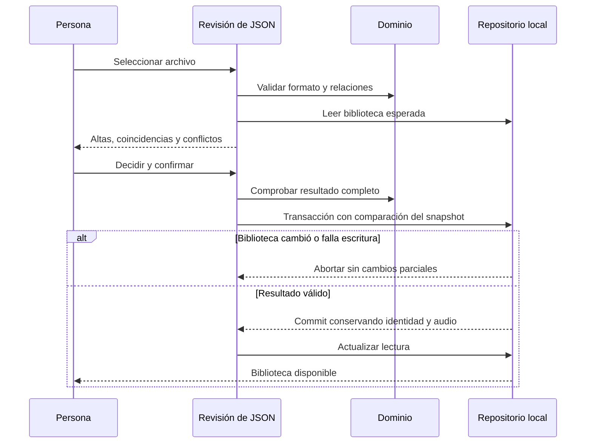

# Incorporar datos desde JSON

La opción **Respaldos → Incorporar datos desde JSON** añade datos a una biblioteca vacía o existente. Se diferencia de restaurar un respaldo en un destino vacío: conserva la identidad actual y combina registros después de revisarlos. Todo se procesa en el dispositivo; seleccionar un archivo no lo sube a un servicio ni escribe en la biblioteca.

## Recorrido

1. Conserva un respaldo de la biblioteca antes de incorporar datos.
2. Selecciona un JSON de hasta 20 MiB: respaldo compatible de Auditorium o catálogo sencillo en el contrato descrito abajo.
3. Revisa registros nuevos, coincidentes y conflictos. Un campo diferente con el mismo identificador requiere elegir entre el registro actual y el del archivo; la fecha más reciente no decide por ti. Las acciones conjuntas se limitan a estas diferencias de registros.
4. Un artista homónimo con otro identificador requiere elegir si es distinto o si debe reutilizar un artista existente. Un álbum con igual título y nombres de artistas pero otro identificador requiere omitirlo o incorporarlo como obra distinta. Esta coincidencia es una advertencia; no prueba que sea la misma música. Omitir excluye su experiencia, pistas, ediciones y demás datos asociados del archivo, además de artistas que sólo lo acompañan.
5. Confirma cuando todas las decisiones estén resueltas y formen una biblioteca válida. Cancelar o Escape no escriben. Los conflictos extensos se muestran en páginas de veinte.

Elegir el registro del archivo sustituye ese registro completo, incluidos sus campos opcionales. No elimina otras filas por estar ausentes del archivo. Las notas, enlaces, ejemplares, deseos, álbumes retirados y audio que no se sustituyan se conservan. Una nota por género o una referencia de edición debe seguir siendo compatible con el álbum elegido; una combinación incoherente bloquea la confirmación.

Los posibles duplicados con identificadores distintos no se unen automáticamente. Para actualizar un álbum conocido con precisión, conserva sus identificadores en el archivo. Las adquisiciones con identificadores distintos pueden representar varias copias legítimas y no se deduplican por su descripción.

## Dos formatos

### Respaldo musical

Se aceptan los [respaldos JSON](RESPALDOS_JSON.md) de versiones1–7 mediante sus contratos estrictos. Se conserva el contenido válido del archivo, incluidas sus relaciones, pero no se adopta su identidad: las entradas se asignan a la identidad de destino. Para el mismo álbum conocido se reutiliza la entrada personal activa existente antes de comparar los datos asociados. Las ausencias no significan borrado ni retirada.

La restauración original en destino completamente vacío sigue disponible por separado y mantiene su contrato de adopción de identidad. El respaldo completo ZIP conserva su recorrido de [audio y restauración](AUDIO_LOCAL.md); esta importación no lee binarios.

### Catálogo sencillo

`auditorium-catalog`, versión1, permite añadir obras para evaluarlas más adelante. No admite experiencia, notas, adquisiciones, deseos, pistas o ediciones. Para álbumes nuevos crea una entrada con escucha **Sin registrar**, sin valoraciones. Una entrada conocida conserva su experiencia; un álbum retirado no se reactiva al recibir un catálogo.

Ejemplo ficticio válido:

```json
{
  "format": "auditorium-catalog",
  "schemaVersion": 1,
  "artists": [
    {
      "id": "672a5f78-48af-45bd-95cd-7e2bb8a08020",
      "name": "Conjunto De Ejemplo",
      "country": "Chile"
    }
  ],
  "albums": [
    {
      "id": "db3825af-4289-412b-825f-3c11f6be9d52",
      "title": "Horizonte De Ejemplo",
      "artistIds": ["672a5f78-48af-45bd-95cd-7e2bb8a08020"],
      "primaryType": "full_length",
      "categories": [],
      "publicationStatus": "published",
      "originalYear": 2026,
      "genres": ["Death Metal", "Metal Progresivo"]
    }
  ]
}
```

| Objeto              | Campos                                                                                                                                                                                                                                                        |
| ------------------- | ------------------------------------------------------------------------------------------------------------------------------------------------------------------------------------------------------------------------------------------------------------- |
| Raíz                | `format`, `schemaVersion`, `artists`, `albums`; no admite otros campos                                                                                                                                                                                        |
| Artista             | `id` UUID y `name` no vacío; `country` opcional, hasta100 caracteres                                                                                                                                                                                          |
| Álbum               | `id` UUID, `title` y `artistIds` no vacío, sin repetir y con artistas presentes en el archivo                                                                                                                                                                 |
| Clasificación       | `primaryType`: `unspecified`, `full_length`, `ep`, `single`, `other`; `categories`: `demo`, `split`, `compilation`, `live`, `soundtrack`; `publicationStatus`: `unknown`, `published`, `unreleased`. Si se omiten, se aplican `unspecified`, `[]` y `unknown` |
| Opcionales de álbum | `originalYear` entero1–9999; `genres` hasta20 textos únicos de hasta80 caracteres; `coverUrl` HTTPS; `description` no vacía                                                                                                                                   |
| Límites             | Hasta2.000 artistas, 5.000 álbumes, 50 artistas por álbum y20 MiB por archivo                                                                                                                                                                                 |

Los identificadores deben ser UUID válidos y únicos dentro de cada conjunto. Cada artista referenciado se incluye en `artists`. Se rechazan campos desconocidos, referencias ausentes, versiones futuras y JSON mal formado. Los datos opcionales desconocidos se omiten, sin `null` ni cadenas vacías. Se normalizan nombres nuevos de artistas, álbumes y géneros con la convención de [registro manual](REGISTRO_MANUAL.md), conservando siglas. Los respaldos mantienen sus nombres históricos.

En un álbum conocido, el catálogo conserva metadatos opcionales no proporcionados, portada local, referencias de catálogo y experiencia. Una nueva URL de portada propone sustituir la portada local mediante el conflicto correspondiente. Los cambios explícitos de clasificación o géneros también se revisan, sin borrar notas para forzar compatibilidad.

## Plantilla y privacidad

**Descargar plantilla de catálogo** exporta únicamente artistas y metadatos de álbumes con sus identificadores y créditos principales. No incluye identidad, notas personales, valoraciones, enlaces personales, adquisiciones, deseos, archivos o descriptores de audio ni portadas en base64. No es un respaldo restaurable: utiliza el respaldo musical o completo para recuperar tu experiencia.

La plantilla puede revelar gustos musicales y descripciones de catálogo; revisa su contenido antes de compartirla. No necesita contraseñas ni claves de base de datos. Un archivo ampliado puede contener sólo las obras que interese incorporar, manteniendo los identificadores de las existentes.

## Escritura y recuperación



La vista previa no es una autorización permanente. Antes de escribir, una transacción compara la biblioteca actual con la revisada; una edición o sincronización concurrente obliga a seleccionar de nuevo el archivo. Un fallo de cuota o aborto revierte todas las filas del intento. Las relaciones y el audio existente se validan también en la transacción.

Después de confirmar, si falla la lectura, se bloquean navegación y escrituras hasta **Reintentar lectura tras importación**. Ese botón no vuelve a importar. Tras recuperar la lectura, la biblioteca se puede abrir y evaluar normalmente, también offline cuando la aplicación esté preparada. No se modifica el esquema DB11/nativa110 ni los formatos de respaldo JSON7/ZIP1.
