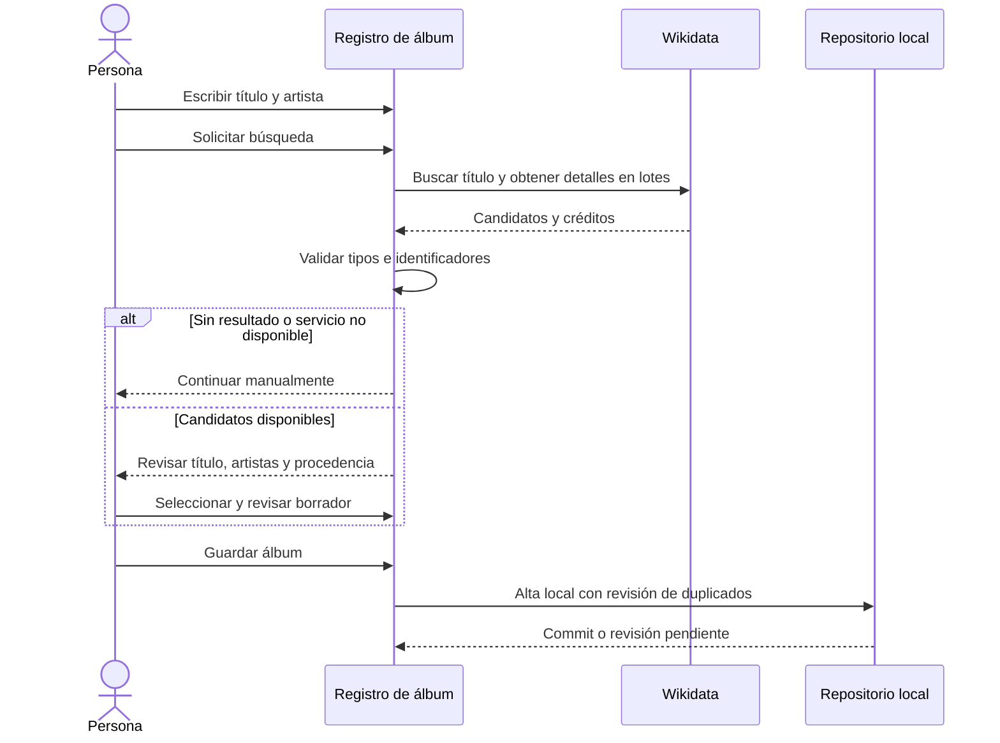
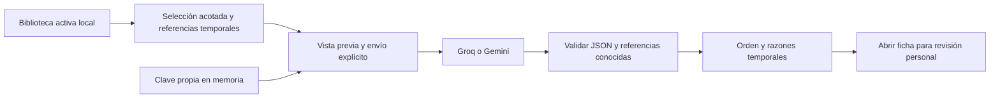

# Recomendaciones y referencias externas

Auditorium mantiene la biblioteca local y permite dos acciones opcionales con conexión: buscar referencias al registrar un álbum y pedir un orden de escucha o revaloración. Ninguna es necesaria para guardar música, abrir la biblioteca, valorar o restaurar un respaldo. El incremento se sigue en [CAT-01](https://github.com/NicoCG32/Auditorium/issues/57) y [AI-01](https://github.com/NicoCG32/Auditorium/issues/56); la [ADR-008](adr/008-integraciones-opcionales.md) explica sus límites.

## Buscar un álbum

Escribe título y artista en «Añadir álbum» y solicita la búsqueda de catálogo. La consulta se inicia mediante el botón; escribir no envía solicitudes. Wikidata recibe el título buscado y datos técnicos de la conexión. El artista se contrasta localmente con los créditos recuperados. No se transmite la biblioteca, sus notas, calificaciones, compras o deseos.

Los resultados muestran título, artistas, tipo, año disponible y procedencia. Revisa los homónimos y selecciona la referencia que corresponda. La selección prepara un borrador editable; guardar sigue siendo otra acción. Los créditos de varios artistas se conservan. Cambiar título o artista descarta la asociación anterior para evitar guardar una referencia que ya no corresponda.

Una búsqueda vacía o fallida no significa que el álbum no exista. Puedes continuar con el registro manual, conservar tus campos o cancelar la búsqueda. La revisión de duplicados locales sigue vigente: abrir o añadir un álbum ya registrado conserva sus datos; no lo fusiona ni lo enriquece automáticamente con la coincidencia externa.

### Qué se conserva

El álbum local mantiene su UUID. `Album.catalogReference` guarda el proveedor `wikidata`, el QID y la fecha UTC de consulta, junto con los identificadores opcionales que existan en la fuente: grupo de publicación de MusicBrainz, álbumes de Spotify y videos de YouTube. No se guarda la respuesta remota completa. La ficha permite consultar la procedencia y los enlaces canónicos derivados de esos IDs.

Un ID de Spotify no certifica disponibilidad en tu región. Un video de YouTube no garantiza un álbum completo, derechos o permanencia. Una referencia de MusicBrainz apunta al álbum conceptual, no necesariamente a la edición física que posees. La aplicación no reproduce ni sincroniza esos servicios. Si se ofrece «Buscar en…», es una búsqueda externa, no una coincidencia verificada.

Cuando existe un identificador de grupo MusicBrainz, puede ofrecerse una URL de portada de Cover Art Archive. Aceptarla es opcional y no demuestra que haya imagen. UX-01 carga automáticamente una portada por URL en el borrador, la ficha y las tarjetas; un fallo ofrece reintento y no impide usar el álbum. El enlace remoto se guarda en el catálogo, sin copiar su binario al respaldo ni a la precaché. Como alternativa, se puede elegir un archivo JPEG/PNG local validado de hasta 2 MiB: se conserva en IndexedDB y en el respaldo y permite ver la imagen offline. Ninguna imagen de usuario pasa a los recursos públicos del repositorio. La licencia CC0 de los datos estructurados de Wikidata no se extiende a las portadas: estas conservan los derechos de sus titulares. Véase [edición y portadas](EDICION_CATALOGO.md).

### Fuente y transporte

Se usa [Wikidata Action API](https://www.wikidata.org/wiki/Wikidata:API), con lectura anónima, `origin=*`, identificación `Api-User-Agent`, cookies omitidas y política `no-referrer`. La [política de Wikimedia](https://foundation.wikimedia.org/wiki/Policy:Wikimedia_Foundation_User-Agent_Policy) contempla el User-Agent nativo de aplicaciones JavaScript y recomienda esa cabecera adicional. Las consultas se serializan y agrupan; la separación conservadora de la aplicación no representa una cuota oficial. Hay límites de candidatos y respuesta, cancelación y timeout, sin sondeos de la biblioteca ni reintentos automáticos.

La cobertura de Wikidata es incompleta y puede contener errores. Los datos estructurados están sujetos a [CC0](https://www.wikidata.org/wiki/Wikidata:Licensing). No se usa scraping de Metallum ni una API no documentada. MusicBrainz permanece como referencia enlazable; su importador de archivos propuesto en [EXT-01](METADATOS_EXTERNOS.md) no forma parte de este flujo.

## Pedir un orden de escucha

Abre «Recomendaciones», elige Groq o Gemini e introduce tu propia clave en el campo de contraseña. Revisa el resumen de datos y las condiciones del proveedor antes de generar. Sólo esa acción envía una solicitud. Guardar un álbum, abrir el panel o cambiar una nota no genera llamadas automáticamente.

La clave vive únicamente en memoria de la pestaña. No se guarda en `sessionStorage`, `localStorage`, IndexedDB, respaldos, URLs, registros o caché del service worker. Recargar, cerrar la pestaña u «Olvidar clave» la descarta; cambiar de proveedor también la elimina. Puede mantenerse al navegar entre vistas durante esa apertura. El navegador y las extensiones con permisos pueden acceder a los datos de la página: este mecanismo evita distribuir una clave compartida, pero no oculta tu clave al propio cliente.

### Contexto enviado

Se seleccionan hasta 24 álbumes activos: los ocho añadidos más recientemente y hasta otros dieciséis, priorizando pendientes, sin escucha registrada, sin nota y registros más antiguos. La selección es determinista; no incluye álbumes retirados. De cada candidato se envían únicamente:

| Dato                  | Tratamiento                                                         |
| --------------------- | ------------------------------------------------------------------- |
| Referencia temporal   | `a1` a `a24`; se resuelve al UUID sólo dentro de la aplicación      |
| Título y artista      | Texto acotado a 100 y 80 caracteres respectivamente                 |
| Año y nota            | Valor conocido o `null`; nota de 1 a 10 en pasos de 0,5             |
| Escucha               | Estado registrado: sin registrar, pendiente, escuchando o escuchado |
| Orden de alta         | Posición relativa; no se envían fechas exactas                      |
| Referencias recientes | Hasta ocho referencias del mismo conjunto                           |

No se envían UUID, identidad local, notas libres, pistas, géneros, países, enlaces de portada, fotos, ejemplares, precios, ubicaciones, deseos, respaldo completo o credenciales de otras plataformas. Aun reducido, el conjunto describe parte de tus preferencias musicales; decide si deseas compartirlo con el proveedor seleccionado.

La respuesta contiene entre una y diez sugerencias de esos candidatos, con una razón breve y una acción de volver a escuchar o revalorar. Se valida estructura, unicidad, pertenencia al contexto y longitud antes de mostrarla. El modelo no añade música ni genera portadas o enlaces. Abrir el álbum permite revisarlo; ninguna sugerencia cambia automáticamente escucha, notas o valoraciones.

### Proveedores, gratuidad y privacidad

| Proveedor | Modelo fijado           | Condiciones relevantes                                                                                                                                                                                                                                                                                              |
| --------- | ----------------------- | ------------------------------------------------------------------------------------------------------------------------------------------------------------------------------------------------------------------------------------------------------------------------------------------------------------------- |
| Groq      | `openai/gpt-oss-20b`    | Salida JSON Schema estricta; dispone de nivel gratuito sujeto a cuotas de cuenta. Su política indica que no conserva contenido de inferencia por defecto, con excepciones de fiabilidad, abuso y obligaciones legales; conserva metadatos de uso.                                                                   |
| Gemini    | `gemini-3.5-flash-lite` | Salida estructurada; el nivel gratuito y sus cuotas dependen del proyecto y de la disponibilidad del modelo. En servicios no pagados, las condiciones pueden permitir uso de entradas y salidas para mejora y revisión humana, con diferencias regionales. No envíes información personal, sensible o confidencial. |

Consulta las fuentes vigentes antes de usar una clave: [modelos](https://console.groq.com/docs/models), [cuotas](https://console.groq.com/docs/rate-limits) y [tratamiento de datos de Groq](https://console.groq.com/docs/your-data); [modelo](https://ai.google.dev/gemini-api/docs/models/gemini-3.5-flash-lite), [precios](https://ai.google.dev/gemini-api/docs/pricing), [cuotas](https://ai.google.dev/gemini-api/docs/rate-limits) y [condiciones de Gemini](https://ai.google.dev/gemini-api/terms). La elegibilidad y disponibilidad dependen de cada proveedor y región.

Auditorium no activa facturación, tarjetas ni suscripciones y no necesita esas cuentas para funcionar localmente. No puede comprobar por el texto de una clave que la cuenta esté en Free. Mantén tu cuenta o proyecto dentro del nivel gratuito y sus límites si deseas evitar cargos; no se promete uso ilimitado ni una cuota fija.

Las llamadas REST utilizan endpoints fijos, clave en cabecera, sin cookies ni referrer y con caché desactivada. No existe un intermediario propio. Hay un máximo de 30 segundos, cancelación y una única llamada por acción, sin reintentos ni cambio automático de proveedor. Los errores de clave, cuota, conexión, timeout o respuesta inválida tienen mensajes propios; no se muestran cuerpos remotos ni secretos. Cerrar el panel o invalidar el contexto cancela la solicitud y descarta respuestas tardías.

## Datos, offline y recuperación

La referencia de catálogo forma parte del álbum. Con el refinamiento UX-01 se conserva en IndexedDB v5 y en los respaldos v3, junto con géneros, país de artista y portada local opcionales. Las claves, solicitudes y recomendaciones son transitorias. Se admite importar respaldos v1/v2 estrictos, normalizados al contrato v3 sin inventar metadatos. v1 rechaza `catalogReference`; ambos formatos históricos rechazan géneros, país y portada local. Una aplicación anterior no debe abrir una base migrada a v5 ni leer un respaldo v3. La ampliación no cambia la lista permitida del contexto de recomendaciones: géneros, países, URLs e imágenes locales quedan fuera del envío. Consulta [modelo de datos](MODELO_DATOS.md), [migraciones](MIGRACIONES_RECUPERACION.md) y [respaldos](RESPALDOS_JSON.md).

La PWA precarga sólo recursos propios. No almacena respuestas de Wikidata, Gemini o Groq ni imágenes remotas; estos servicios requieren conexión. La biblioteca manual y sus respaldos siguen disponibles offline cuando la aplicación ya está preparada.

## Verificación y límites

Las pruebas automatizadas utilizan respuestas controladas y datos ficticios para comprobar contratos, errores, cancelación, ausencia de secretos persistidos, selección/confirmación, referencias y compatibilidad de datos. Una respuesta simulada valida el comportamiento del producto y no acredita una inferencia real de una cuenta concreta.

La comprobación de transporte desde Pages verificó consultas públicas de Wikidata y respuestas CORS de error con claves deliberadamente inválidas de los proveedores. No se ha validado una generación autenticada con una clave real ni se ha medido la calidad musical de los órdenes sugeridos. Esa comprobación requiere configurar una clave propia en la interfaz, revisar el contexto y solicitar una generación; nunca incluir la clave en una issue, respaldo o conversación pública.
