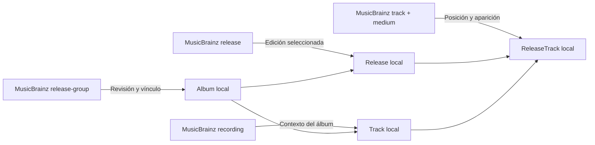
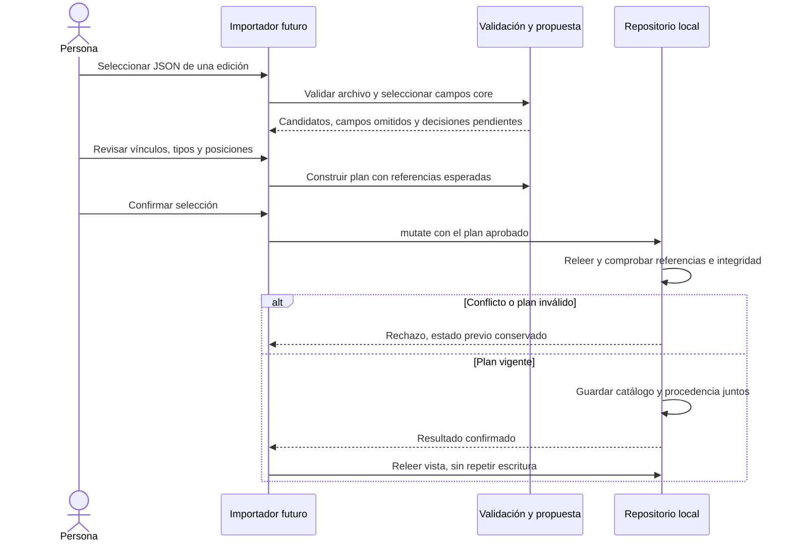

# Evaluación de metadatos externos

Estado: **propuesta de evolución**, resultado de [EXT-01](https://github.com/NicoCG32/Auditorium/issues/24). Fuentes consultadas el **2026-10-14** y revalidadas el **2026-10-16**. El estudio se realizó contra el contrato del MVP v1.0.0, con DB v3 y respaldo v1. La evolución posterior CAT-01 introdujo DB v4/respaldo v2 para referencias Wikidata; UX-01 amplía el incremento en revisión a DB v5/respaldo v3. Se documenta en [integraciones opcionales](INTEGRACIONES_OPCIONALES.md) y [edición del catálogo](EDICION_CATALOGO.md); no implementa el importador de archivos propuesto aquí. La distribución web y la identidad visual evolucionaron después de esa release; este estudio evalúa el mapeo contra los contratos locales de referencia y lo prueba offline con datos ficticios.

## Resultado de la evaluación

MusicBrainz ofrece entidades compatibles con gran parte del catálogo de Auditorium, pero sus identidades y campos no pueden trasladarse directamente. Se propone comenzar por **previsualizar un archivo JSON core de una edición**, revisar correspondencias y confirmar una operación local. La consulta remota desde la PWA y las portadas se evaluarían después, con requisitos de transporte y uso propios.

La [propuesta de decisión ADR-007](adr/007-importacion-metadatos.md) fija ese orden. Su implementación requiere nuevas tareas: contrato de entrada, procedencia persistente, migración/respaldo, revisión y confirmación. La prueba de este estudio verifica compatibilidad con el modelo actual; no añade una función de importación a la interfaz.

## Correspondencias de dominio

MusicBrainz distingue el grupo conceptual de publicaciones, la edición distribuida, la grabación y su aparición en un medio. Una grabación puede aparecer en múltiples listas. Fuentes: [Release Group](https://musicbrainz.org/doc/Release_Group), [Recording](https://musicbrainz.org/doc/Recording) y [Track](https://musicbrainz.org/doc/Track).



Las flechas representan correspondencias propuestas; los UUID locales siguen siendo las identidades del [modelo de dominio](MODELO_DOMINIO.md).

| Origen                               | Destino propuesto            | Decisión necesaria                                                                                          |
| ------------------------------------ | ---------------------------- | ----------------------------------------------------------------------------------------------------------- |
| `release-group`                      | `Album`                      | Revisar candidato y tipos; no fusionar álbumes homónimos ni sustituir su ID                                 |
| `release`                            | `Release`                    | Confirmar álbum y edición; conservar listas diferentes                                                      |
| `recording`                          | `Track`                      | Usar contexto `(albumId local, recording MBID)`; la misma grabación en otro álbum necesita otra pista local |
| `track`                              | `ReleaseTrack`               | Crear una aparición independiente; conservar título específico y duración de esa posición                   |
| `medium.position` / `track.position` | `discNumber` / `trackNumber` | Exigir enteros positivos y posiciones únicas; no convertir `A1` ni corregir el orden silenciosamente        |
| Lista elegida explícitamente         | `CoreTrack[]`                | El grupo no define la lista original local; importar una Deluxe no sustituye esa referencia                 |
| Artista y crédito del grupo          | `Artist` / `AlbumArtist`     | Revisar nombre acreditado, posición y rol; no promover créditos de pista a créditos del álbum               |

### Identidad musical y variantes

La [guía de grabaciones](https://musicbrainz.org/doc/Style/Recording) mantiene una grabación cuando solo cambia su mastering. En Auditorium se propone reutilizar una pista dentro del mismo álbum mediante selección explícita. Título, duración o palabras como «remaster», «demo» y «live» no bastan para deducir identidad ni `variantOfTrackId`; tampoco dos MBIDs distintos prueban una relación de variante.

Los [MBIDs](https://musicbrainz.org/doc/MusicBrainz_Identifier) son identificadores externos y pueden redirigir tras una fusión. Un vínculo externo no cambia el UUID local ni autoriza unir registros. La resolución de alias debe mostrar el cambio de origen y conservar la identidad y las referencias personales.

### Campos y pérdidas de representación

El [contrato de catálogo](../src/domain/catalog/schemas.ts) admite menos información que el modelo de MusicBrainz. La propuesta debe mostrar qué se conserva, qué se omite y qué requiere elección:

| Diferencia                                            | Tratamiento propuesto                                                                                                               |
| ----------------------------------------------------- | ----------------------------------------------------------------------------------------------------------------------------------- |
| Tipo primario y varios secundarios                    | Seleccionar un `releaseType`; mostrar la combinación externa, sin ocultarla bajo el default `album`                                 |
| Varios medios o formatos mixtos                       | Revisar `Release.format`; para una combinación no representable, elegir `other` y una descripción explícita                         |
| Números impresos como `A1`                            | Mantenerlos en la revisión/procedencia; usar la posición numérica para la lista local                                               |
| Créditos y frases de unión por álbum, edición o pista | Mostrar su nivel; `AlbumArtist` no almacena todas esas relaciones. No inferir roles a partir de una frase libre                     |
| Varios pares sello/número de catálogo                 | Elegir el par que se guardará; no concatenarlo como un identificador único                                                          |
| Fechas parciales y varios territorios                 | Proponer solo un año válido y una selección territorial; no inventar mes/día ni afirmar que el primer año define la lista original  |
| Países históricos o regiones especiales               | Mostrar su significado. El schema solo exige dos letras mayúsculas; que un código pase validación no lo convierte en un país actual |
| Duración ausente, nula o cero                         | Omitir; el dominio exige milisegundos enteros positivos. Distinguir duración de grabación y de aparición                            |
| Pregaps, pistas de datos o posiciones incoherentes    | Solicitar resolución o excluir explícitamente; no renumerar ni descartar silenciosamente                                            |

Referencias del proveedor: [tipos](https://musicbrainz.org/doc/Release%20Group/Type), [ediciones](https://musicbrainz.org/doc/Release), [créditos](https://musicbrainz.org/doc/Artist_Credits), [números de catálogo](https://musicbrainz.org/doc/Release/Catalog_Number) y [territorios](https://musicbrainz.org/doc/Release/Country).

Una edición digital no prueba una compra ni crea un `OwnedItem`. Metadatos, anotaciones y valoraciones públicas no se convierten en escucha, notas personales, copias, deseos o calificaciones locales.

## Selección de datos y condiciones de uso

La [licencia de datos](https://musicbrainz.org/doc/About/Data_License) distingue core bajo **CC0** de datos suplementarios bajo **CC BY-NC-SA 3.0**. El [inventario](https://musicbrainz.org/doc/MusicBrainz_Database) sitúa anotaciones, etiquetas —incluidas asociaciones de género— y valoraciones de usuarios entre los suplementarios. La primera propuesta selecciona campos core de identificación, créditos, edición y listas; excluye datos suplementarios y portadas. Conservar fuente y fecha mejora la trazabilidad aunque CC0 no exija atribución.

La licencia de los datos es distinta del acceso al servicio. La [API](https://musicbrainz.org/doc/MusicBrainz_API) publica lectura sin API key y uso no comercial gratuito; el uso comercial requiere revisar sus planes o acuerdo. MetaBrainz distingue [categorías de uso para datasets y Live Data Feed](https://metabrainz.org/supporters/account-type), incluida una categoría para autores de software abierto. Esa clasificación no fija una tarifa universal para la API ni decide por sí sola la categoría futura de Auditorium por estar publicado en GitHub. La adquisición del archivo también queda sujeta a las condiciones aplicables de su fuente.

El flujo manual permite conservar el funcionamiento local sin infraestructura remota obligatoria. Un adaptador alojado añadiría operación y posibles costos propios; no se selecciona proveedor, cuenta o plan en este estudio.

## Transporte remoto: requisitos previos

Un futuro adaptador distinguiría búsqueda textual, consulta por MBID y listado de entidades vinculadas. JSON se solicita con `fmt=json` o `Accept: application/json`; las colecciones de entidades vinculadas incluidas en un lookup se limitan a 25 y se completan mediante browse. Esto no indica un máximo general de 25 pistas por edición. Browse de ediciones puede devolver menos que `limit`: el offset debe avanzar por la cantidad recibida. [Contrato de API](https://musicbrainz.org/doc/MusicBrainz_API). Search admite `limit` entre 1 y 100 y `offset`; la puntuación del buscador solo ordena candidatos. [Búsqueda](https://musicbrainz.org/doc/MusicBrainz_API/Search).

MusicBrainz exige un `User-Agent` con información para contactar a los mantenedores y recomienda incluir la versión; publica un límite general de **una petición por segundo por IP**, con rechazos 503 posibles por tráfico o carga global. [Reglas publicadas](https://musicbrainz.org/doc/MusicBrainz_API/Rate_Limiting). Para el adaptador se propone aplicación, versión y URL pública de contacto. Una cola por pestaña no controla el tráfico agregado de otras ventanas o dispositivos tras la misma IP; un intermediario comparte su límite entre todos sus clientes. Esta consecuencia debe resolverse en el transporte que realmente emite las solicitudes.

La [documentación de MDN](https://developer.mozilla.org/en-US/docs/Glossary/Forbidden_request_header) señala que Chrome elimina `User-Agent` de `fetch` aunque ya no sea un encabezado prohibido en la especificación. No basta escribirlo en JavaScript. `client=` se documenta para envíos POST, sin acreditar que sustituya ese encabezado en GET. Antes de elegir transporte deben comprobarse identificación aceptada, encabezados efectivos, CORS y redirecciones en los navegadores objetivo.

Requisitos propuestos para ese adaptador: cola coordinada, consultas explícitas y acotadas, deduplicación, cancelación, timeout y reintentos limitados con espera creciente. Un 503 o timeout conserva la biblioteca y no significa que una edición no exista. La caché de metadatos tendría versión, fuente, fecha y una acción explícita de actualización; no sondearía periódicamente la colección. Estas capacidades aún no están implementadas ni verificadas con HTTP real.

### Privacidad de las consultas

La [política de MetaBrainz](https://metabrainz.org/privacy) indica que registra IP, User-Agent, endpoint y parámetros. La propuesta remota anunciaría el destinatario y enviaría únicamente texto de búsqueda o MBIDs seleccionados. Identidad local, biblioteca completa, notas, valoraciones, compras y deseos quedan fuera de las solicitudes.

Un intermediario introduce otro receptor de consultas; no elimina la observación del tráfico. Credenciales omitidas y una política de referrer restrictiva reducirían datos auxiliares, sin ocultar la IP al destinatario. La importación manual permite revisar y guardar el archivo sin solicitudes de Auditorium; su procedencia declarada no prueba autenticidad.

## Portadas como capacidad separada

[Cover Art Archive](https://coverartarchive.org/) conserva el copyright de los titulares de las imágenes; estas no heredan CC0. El derecho a usar una imagen debe revisarse para el uso previsto, y [Internet Archive no garantiza los derechos indicados en sus ítems](https://archivesupport.zendesk.com/hc/en-us/articles/360014759692-Rights).

La [API de CAA](https://musicbrainz.org/doc/Cover_Art_Archive/API) distingue portada de edición y portada representativa de grupo, exige iniciar las solicitudes mediante `coverartarchive.org` y seguir sus redirecciones hacia Internet Archive, y ofrece miniaturas de 250/500/1200. Un adaptador no debe fijar las URLs de destino como un acceso permanente directo. Declara ausencia actual de reglas propias de rate limiting, pero también contempla errores y el destino de la redirección; no es una garantía de volumen ilimitado. No se encontró una autorización global de redistribución ni un TTL normativo que justifique caché permanente.

La propuesta mantiene portada opcional y separada de la importación core: carga por acción explícita, fuente visible, retirada/reemplazo y fallo no bloqueante. Una URL HTTPS no demuestra permiso ni disponibilidad. No se propone descargar binarios a assets, precaché PWA o respaldos. Resolver derechos, destinos HTTPS/CORS y almacenamiento de imágenes requiere su propia tarea.

Ese criterio de carga pertenece a esta propuesta histórica. El incremento [UX-01](EDICION_CATALOGO.md) adopta carga automática por URL y permite portadas locales validadas en IndexedDB y respaldo; no descarga el binario remoto ni cambia la precaché. La [ADR-009](adr/009-edicion-metadatos-portadas.md) registra esa decisión posterior.

## Flujo local propuesto



Este diagrama describe una implementación futura, no el flujo actual del panel de respaldos. El archivo externo es un contrato distinto de `auditorium-backup`: importar metadatos no adopta identidad ni utiliza `restoreEmpty`.

### Plan, correspondencias y confirmación

El DTO de propuesta permanece separado del snapshot hasta confirmar. Expresa crear, reutilizar mediante selección explícita, conservar sin cambios o resolver un conflicto. Muestra pérdidas y conserva los valores externos necesarios para revisar; no inserta claves desconocidas en los schemas estrictos actuales.

La correspondencia persistente requeriría un contrato propio con proveedor, tipo de entidad, MBID, destino local, contexto de álbum cuando corresponda, fecha/origen y campos aceptados. No debe declararse unicidad global `(proveedor, MBID)`: una grabación puede corresponder a pistas de álbumes diferentes. Alias externos, duplicados locales y procedencia de un archivo requieren tratamiento explícito. Se necesitan migración, integridad y evolución del respaldo para guardar esas referencias; este estudio no asigna una nueva versión de schema.

Enriquecer un álbum existente conserva su UUID, lista original y campos no seleccionados. La identidad y toda la biblioteca personal deben permanecer iguales. No se invoca `addAlbumToLibrary` al enriquecer: podría crear otra entrada activa para un álbum retirado. Añadir a la biblioteca sería una acción separada y explícita.

Antes del commit se compara el catálogo afectado con las referencias revisadas, dentro de la transacción. Si cambió, se relee y se solicita revisar de nuevo; no se aplica el borrador sobre otro estado. Catálogo y procedencia se validarían y escribirían atómicamente. Si el commit confirmó pero falla la lectura de la vista, solo se reintenta esa lectura.

## Prueba reproducible y límites

La [prueba de estudio](../src/test/studies/musicbrainz-mapping.test.ts) usa datos y MBIDs ficticios, los schemas de catálogo y el repositorio IndexedDB existentes con una factoría aislada. Los DTO/helpers pertenecen exclusivamente a pruebas y no se importan desde la aplicación.

```sh
npm run test -- src/test/studies/musicbrainz-mapping.test.ts
```

Las correspondencias y selecciones aprobadas están escritas a mano; el caso de homónimos utiliza el registro manual existente. La prueba comprueba ejemplos sin escritura, pistas contextuales por álbum, conservación de identidad/biblioteca y rechazo de referencias inválidas. Simula una aprobación mediante una mutación local de catálogo; no implementa un matcher por MBID, resolución de alias, parser ni importador de respuestas completas. La procedencia del archivo MusicBrainz de este estudio permanece fuera de su snapshot de prueba; la referencia Wikidata incorporada después por CAT-01 es otro contrato.

La evidencia no cubre transporte, CORS, headers efectivos, licencias particulares de imágenes, servicio real, archivos hostiles completos, una interfaz de revisión ni migraciones de procedencia. Esos requisitos se conservan como criterios de implementación posterior.

## Incrementos posteriores propuestos

| Incremento                    | Criterios antes de integrarlo                                                                                   |
| ----------------------------- | --------------------------------------------------------------------------------------------------------------- |
| Contrato de importación local | DTO externo versionado, límites de bytes/colecciones, selección core y errores de formato sin escritura         |
| Procedencia e identidad       | Correspondencias contextuales, alias, migración y respaldo; conservación de IDs y datos personales              |
| Revisión y confirmación       | Candidatos, pérdidas, elección de lista/tipo/formato, cancelación, referencia esperada y commit atómico         |
| Transporte remoto opcional    | Condiciones de uso, identificación efectiva, CORS/redirects, límite compartido, fallos y privacidad verificados |
| Portadas opcionales           | Derechos/condiciones revisados, carga explícita y política de almacenamiento propias                            |

Este resultado completa la evaluación de MusicBrainz sin habilitar esas integraciones. El incremento posterior AI-01/CAT-01 permite referencias enlazables a Spotify/YouTube recuperadas de Wikidata y recomendaciones opcionales, según la [ADR-008](adr/008-integraciones-opcionales.md). No incorpora reproducción, cuentas de biblioteca, sincronización ni el importador JSON propuesto aquí.
