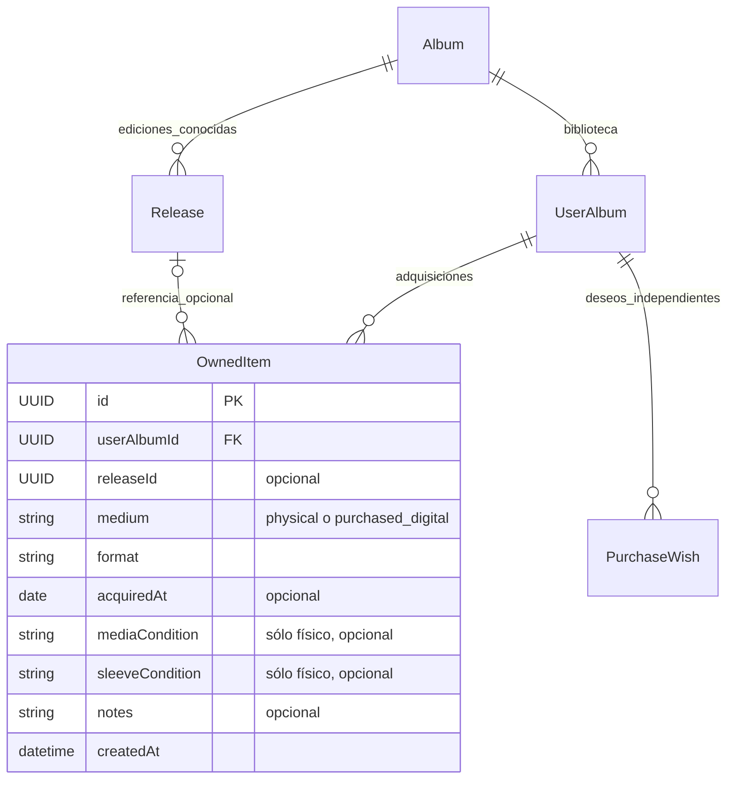
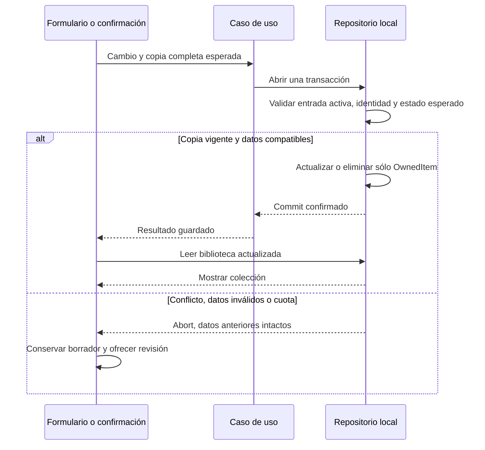

# Mi colección: ejemplares y compras digitales

COL-05 #71 · 27 de octubre de 2026. Mi colección es el último destino principal, después de Biblioteca, Añadir álbum y Calificaciones. Registra las adquisiciones explícitas: cada ejemplar físico y cada compra individual digital tienen su propio registro.

## Consultar y localizar

La pantalla muestra recuentos independientes de **Ejemplares físicos**, **Digital adquirido** y **Álbumes en colección**. Son totales de los álbumes activos, aunque apliques filtros; el resultado indica cuántas adquisiciones coinciden. Los datos de un álbum retirado permanecen guardados y vuelven a aparecer al restaurarlo.

**Buscar en mi colección** combina palabras del álbum, artista, formato, edición, sello, número de catálogo, año, fecha o notas de la copia, sin distinguir mayúsculas ni acentos. **Medio de la colección** permite Todos los medios, Físico o Digital adquirido. **Formato de la colección** combina ese medio con Vinilo, CD, Casete, Otro o Descarga digital. Cambiar de medio reinicia el formato para evitar una combinación oculta incompatible. **Limpiar filtros de colección** restablece la vista conjunta.

Cada tarjeta muestra álbum, artista, portada disponible, medio, edición y datos opcionales de adquisición. Una etiqueta como **CD · Copia 2** distingue las copias del álbum. Su número se deriva del orden de registro antes de aplicar filtros y puede cambiar al eliminar una copia. Es una etiqueta de presentación, no una identidad persistente ni una nota por edición. Los UUID se mantienen internamente y en los respaldos.

## Registrar, corregir y eliminar

1. Despliega **Registrar una adquisición**, busca un álbum y elige **Abrir colección de…**. Si la biblioteca está vacía, puedes ir a Añadir álbum.
2. En Mi colección de la ficha, pulsa **Registrar ejemplar**. Elige medio y formato. Fecha, condiciones físicas, notas y edición son opcionales.
3. **Edición del ejemplar** ofrece sólo ediciones conocidas del mismo álbum compatibles con el medio y formato. Cambiarlos limpia la selección anterior; pasar a digital también limpia las condiciones físicas. Si necesitas otra edición, añádela desde Pistas y ediciones antes de vincularla.
4. Confirma con **Guardar ejemplar**. Repite el registro para otra copia, aunque tenga la misma edición y formato.
5. **Editar ejemplar…** abre esa copia. **Guardar cambios del ejemplar** conserva su identidad y fecha de registro; los campos opcionales vacíos se eliminan. Cambiar la edición asociada conserva ambas ediciones y las otras copias.
6. **Eliminar ejemplar…** pide una confirmación que identifica la copia. **Conservar ejemplar** o Escape cancelan. Confirmar elimina sólo ese registro y sus notas; conserva catálogo, otras copias, valoraciones, audio, enlaces y deseos. No hay papelera de adquisiciones; un respaldo anterior permite recuperarlas en un destino vacío.

La fecha de adquisición puede ser anterior al alta en Auditorium y debe ser un día válido. Se conservan espacios y saltos de línea de las notas. Cancelar un formulario con cambios ofrece guardar, descartar o seguir editando mediante la protección existente.

La búsqueda, filtros y selector de álbumes permanecen al volver desde la ficha durante la visita. El regreso recupera foco y posición. Al entrar desde Mi colección, el inventario queda desplegado y recibe el foco. Las consultas y borradores no se conservan al recargar; los registros guardados sí.

## Conceptos y reglas

- Album describe la obra única; tipo, categorías y géneros no se duplican al adquirir otra copia.
- Release describe una edición física o digital: Deluxe, Especial, Aniversario o Remaster. Puede existir y ser referencia de una valoración sin posesión. Varias copias pueden compartirla.
- OwnedItem describe una adquisición individual. Físico admite Vinilo/CD/Casete/Otro y condiciones opcionales; Digital adquirido exige Descarga digital y no admite condiciones físicas.
- Una suscripción, reproducción, URL de compra, archivo propio o descarga gratuita no crean una adquisición. Cambiar propiedad no marca escucha ni cambia notas generales, por género o pista.
- Los deseos tienen acceso secundario mediante **Consultar deseos de compra** y Más opciones. Una compra no los cumple automáticamente; seleccionar una edición de referencia no implica comprarla.

## Guardado y concurrencia

Editar exige el registro completo leído al abrir el formulario. La confirmación de eliminación captura también ese registro. Medio, formato, referencia, fecha, condiciones, notas, identidad y fecha de alta deben seguir coincidiendo; una copia modificada en otra ventana o por sincronización no se sobrescribe.

**Cargar colección guardada** reemplaza explícitamente el borrador por los datos actuales. Si la copia fue eliminada, cierra el editor sin recrearla. Una eliminación en conflicto exige revisar y confirmar otra vez. Si falla la escritura o falta espacio, se conservan datos anteriores y borrador. Si el commit terminó y falla la lectura posterior, se muestra el resultado confirmado y **Reintentar lectura de colección** sólo vuelve a leer, sin repetir la operación.

## Persistencia y comprobación

El incremento conserva IndexedDB 11/nativa 110, JSON y snapshot 7, ZIP completo 1 y el contrato remoto. No añade campos persistentes ni infiere propiedad al migrar o importar. Los cambios usan la sincronización existente y se respaldan en `ownedItems`. Los binarios de audio siguen fuera de JSON y sincronización.

Las pruebas usan dos copias Aniversario, otra edición del álbum, una Deluxe digital y un álbum sin adquisiciones. Cubren independencia de datos, compatibilidad, cancelación, concurrencia, lectura posterior fallida, filtros y regreso, teclado, móvil, temas, accesibilidad, guardado sin conexión, recarga y exportación. La matriz de CI incluye Chromium, Firefox, WebKit y Pages; los datos ficticios no sustituyen la observación de uso de personas reales.

Véanse [dominio](MODELO_DOMINIO.md), [persistencia](MODELO_DATOS.md), [Mi experiencia](MI_EXPERIENCIA.md) y [notas por género](VALORACIONES_POR_GENERO.md).
