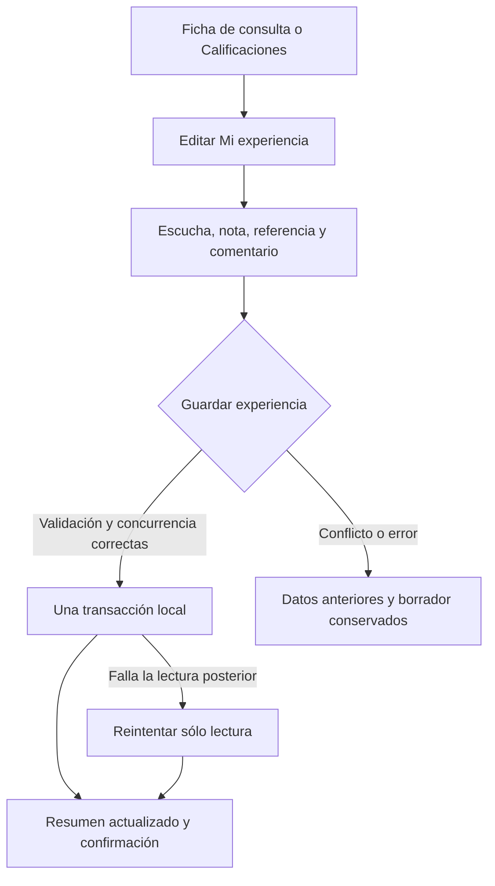
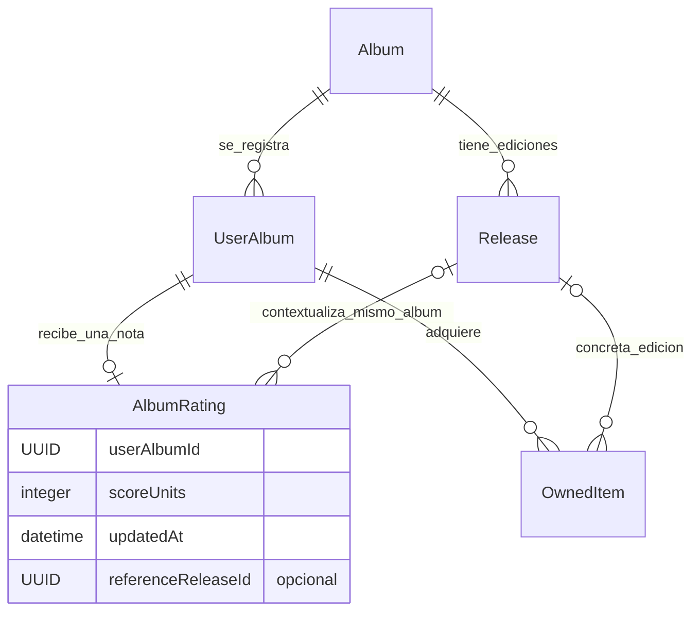

# Ficha, calificación y edición de referencia

UX-06 organiza la consulta del álbum y permite guardar su experiencia personal como una sola operación. El álbum conceptual, sus ediciones, la opinión personal y las adquisiciones mantienen responsabilidades distintas.

RATE-02 amplía el editor con **Valorar por género (opcional)**: notas independientes de la general y referencias de edición propias. Guarda el conjunto de forma atómica, con comparación del estado esperado y de las etiquetas del álbum. La [guía contextual](VALORACIONES_POR_GENERO.md) explica la comparación en Biblioteca/Calificaciones, ausencia explícita y renombrado protegido. DB11/JSON7/ZIP1 se mantienen sin migración nueva.

## Recorrido

La ficha empieza con portada, título, artista, clasificación, año, enlaces de escucha o compra y un resumen de **Mi experiencia**. **Calificar álbum**, **Recalificar álbum** y **Editar experiencia** abren el mismo editor. **Editar álbum** abre los metadatos de catálogo por separado.

**Datos del álbum**, **Pistas y ediciones**, **Mi colección** y **Más acciones: deseos y retirada** empiezan plegados. Abrir la ficha o un enlace de reproducción no cambia el estado de escucha. Las pistas conservan sus notas independientes; no se promedian para obtener la nota del álbum.

Desde **Calificaciones** se puede buscar y alternar entre **Por calificar** y **Calificados**. Al volver desde la ficha se conservan la búsqueda y la selección. Una obra con Original, Deluxe y Aniversario aparece una sola vez.

## Una experiencia, un guardado

El editor reúne estado de escucha, nota opcional de 1 a 10 en pasos de 0,5, edición de referencia opcional y comentario personal. **Guardar experiencia** confirma el conjunto y vuelve al resumen. Los espacios y saltos de línea de un comentario con contenido se conservan; dejarlo en blanco retira el comentario.

**Quitar nota del borrador** vacía sólo la general y su referencia. Cada género tiene su propia acción para quitar su nota del borrador. La base no cambia hasta **Guardar experiencia**. Cancelar o navegar con cambios permite seguir editando, descartar o guardar antes de salir. Quitar una nota conserva las demás, escucha, comentario, enlaces, pistas y adquisiciones.

## Edición de referencia

El selector empieza con **Sin edición de referencia** y contiene sólo las ediciones ya añadidas al mismo álbum. Puede elegirse una edición física o digital aunque no se haya adquirido. Cada opción muestra edición, formato y año conocidos, además de sello, número de catálogo o país cuando existan. Las etiquetas idénticas reciben un ordinal visible.

La selección contextualiza la única nota actual. Cambiarla o quitarla conserva la cifra; recalificar conserva la selección mientras no se cambie explícitamente. Añadir una edición o registrar una compra no elige una referencia. Sin ediciones también se puede valorar.

Antes de eliminar una edición referenciada hay que cambiar la referencia o elegir **Sin edición de referencia** y guardar la experiencia. La nota se conserva. Las adquisiciones y deseos vinculados también impiden borrar la edición hasta resolver sus vínculos. Eliminar una adquisición no elimina la edición ni la referencia de la nota.

## Concurrencia y recuperación

El caso de uso compara la experiencia leída con la persistida dentro de la misma transacción. Una modificación ajena de escucha, comentario, nota o referencia impide sobrescribirla. El editor conserva el borrador y ofrece **Cargar datos guardados**, que lo sustituye sólo mediante esa acción explícita. Los cambios independientes en enlaces o colección se conservan y no provocan un conflicto de experiencia.

Una nota inválida, una edición ajena o desaparecida, falta de espacio o un aborto revierten toda la operación. No queda guardada sólo la escucha o el comentario. Si falla la lectura después de confirmar, se bloquean nuevas escrituras y **Reintentar lectura de experiencia** vuelve a leer sin repetir la transacción. Los campos que no cambian conservan sus fechas.

## Migración y compatibilidad

`AlbumRating.referenceReleaseId` es opcional y referencia una `Release` del mismo álbum que la entrada personal. La clave de la nota sigue siendo `userAlbumId`; no existe una nota por edición.

- IndexedDB **9**, versión nativa **90**, conserva tablas e índices de DB8. Valida las filas y los cinco documentos posibles del checkpoint dentro de la actualización atómica. Un error conserva la versión y los datos anteriores.
- El respaldo **6** incluye la referencia cuando existe. Los formatos **1–5** siguen siendo estrictos y rechazan este campo; se normalizan sin inventar una edición para las notas anteriores. Toda exportación nueva usa 6.
- Supabase admite **3/4/5/6**, conserva aislamiento por cuenta, RLS, revisión esperada e idempotencia. Sólo 6 acepta la referencia, con edición existente del mismo álbum; una fila actualizada no puede volver a una versión anterior. La siguiente escritura válida de una biblioteca antigua usa 6.

Una aplicación anterior no abre DB9 ni respaldos6. Conserva respaldos históricos independientes y permite que la PWA aplique su actualización normal antes de sincronizar desde otro dispositivo.

## Verificación

Las pruebas cubren guardado conjunto, recalificación, retirada reversible de nota, referencias válidas o ajenas, álbum sin ediciones, edición digital no adquirida, conflictos, cuota, recuperación de lectura y eliminación concurrente. La migración comprueba todos los documentos del checkpoint y su reversión. Los recorridos de navegador validan Biblioteca, Calificaciones, cancelación, teclado, accesibilidad y tamaños móvil y escritorio. Las pruebas SQL usan cuentas ficticias y revierten todos sus datos.

Véanse [modelo de dominio](MODELO_DOMINIO.md), [persistencia](MODELO_DATOS.md), [respaldos](RESPALDOS_JSON.md), [sincronización](SINCRONIZACION_SUPABASE.md) y [plan de desarrollo](PLAN_DESARROLLO.md).
