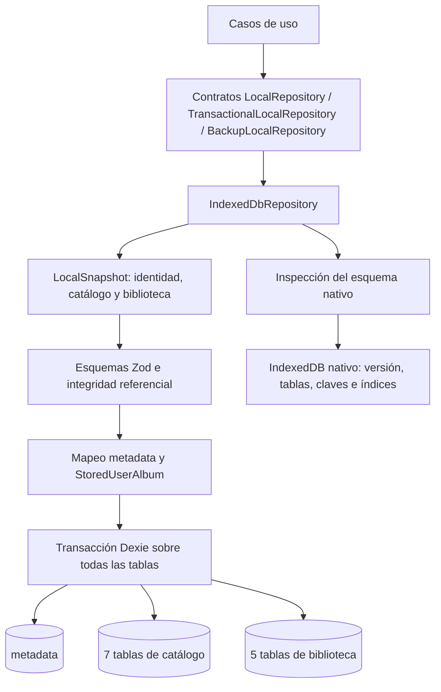
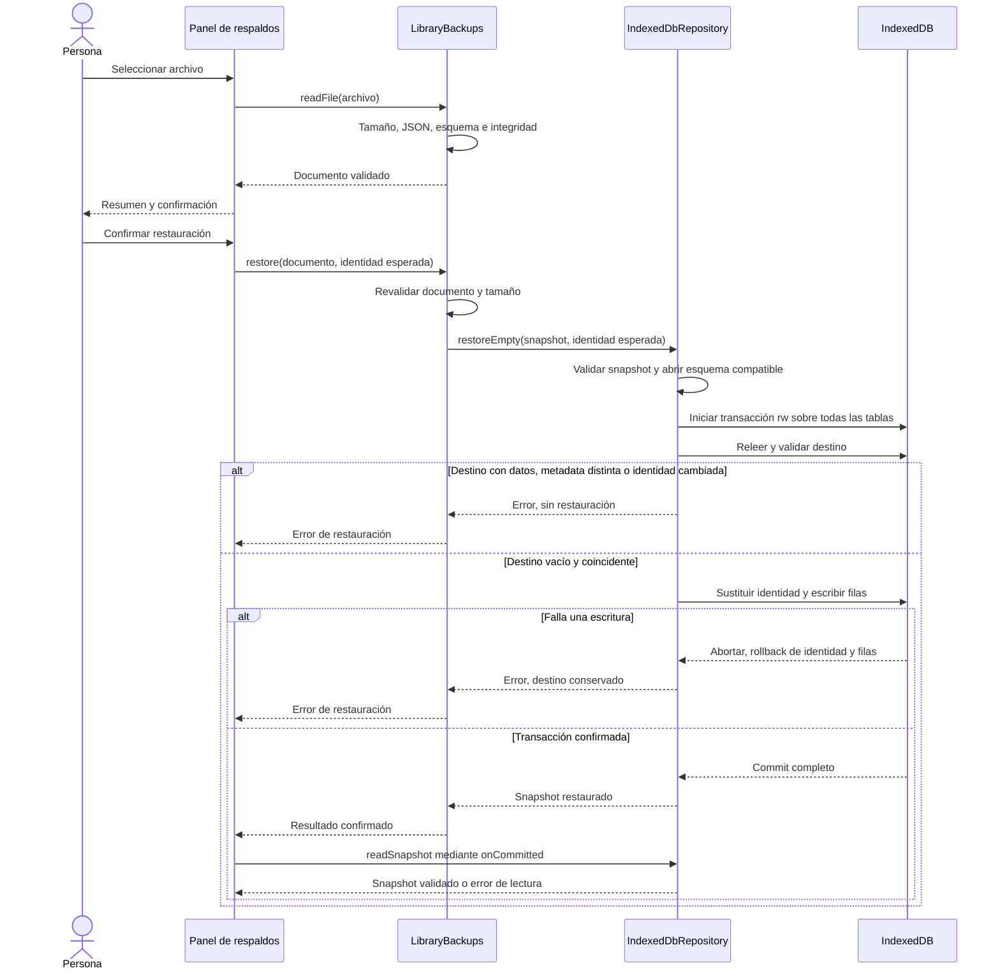

# Modelo de datos y persistencia

## Propósito y alcance

Este documento describe la representación física y los contratos de persistencia vigentes en el código de Auditorium, desde el MVP **v1.0.0** hasta el incremento CAT-01 de DB4/respaldo2. La release original conserva sus contratos anteriores. Esta vista complementa el modelo conceptual del catálogo y la biblioteca; aquí se especifican claves, índices, transformaciones, validación, transacciones y recuperación.

La información musical y personal reside en IndexedDB, en la base `auditorium` del origen y perfil de navegador utilizados. El repositorio implementa los contratos del dominio mediante Dexie. La caché de recursos de la aplicación pertenece al service worker y se explica en [PWA y uso sin conexión](PWA_OFFLINE.md); no sustituye esta base ni contiene el respaldo de la biblioteca.

## Contrato y representación

[`LocalSnapshot`](../src/domain/repositories/local-repository.ts) reúne tres componentes:

| Componente | Contenido                                                                    | Representación física                   |
| ---------- | ---------------------------------------------------------------------------- | --------------------------------------- |
| `identity` | `userId`, `createdAt`                                                        | Registro `local_identity` en `metadata` |
| `catalog`  | Artistas, álbumes, créditos, pistas, lista original, ediciones y apariciones | Siete tablas de catálogo                |
| `library`  | Entradas personales, notas, ejemplares y deseos                              | Cinco tablas de biblioteca              |

`LocalRepository` ofrece `open`, `readSnapshot` y `close`. `TransactionalLocalRepository` añade `mutate`; `BackupLocalRepository` añade `restoreEmpty`. El dominio depende de estos contratos, sin importar Dexie. La implementación concreta es [`IndexedDbRepository`](../src/infrastructure/repositories/indexeddb-repository.ts).

El diagrama muestra responsabilidades. La inspección precede a la apertura de Dexie; las lecturas y escrituras se ejecutan después dentro de sus respectivas transacciones.

## Esquema físico vigente

La [definición de la base](../src/infrastructure/db/database.ts) declara versión lógica **4**, correspondiente a versión nativa IndexedDB **40**. Todas las claves primarias son explícitas y únicas. No se emplean claves autoincrementales ni índices `multiEntry`.

En la tabla, los corchetes representan una clave o índice compuesto, en el orden indicado. Los índices secundarios son **no únicos**, excepto los marcados como **único**. Se enumeran los índices declarados y materializados, sin incluir las posibilidades de consulta mediante prefijos compuestos que Dexie pueda ofrecer.

| Tabla            | Clave primaria                       | Índices secundarios                                                                      |
| ---------------- | ------------------------------------ | ---------------------------------------------------------------------------------------- |
| `metadata`       | `key`                                | Ninguno                                                                                  |
| `artists`        | `id`                                 | `name`                                                                                   |
| `albums`         | `id`                                 | `title`, `releaseType`, `originalYear`                                                   |
| `albumArtists`   | `[albumId, artistId, role]`          | `[albumId, position]` **único**; `artistId`                                              |
| `tracks`         | `id`                                 | `albumId`, `title`, `variantOfTrackId`                                                   |
| `coreTracks`     | `[albumId, discNumber, trackNumber]` | `[albumId, trackId]`                                                                     |
| `releases`       | `id`                                 | `albumId`, `format`                                                                      |
| `releaseTracks`  | `id`                                 | `[releaseId, discNumber, trackNumber]` **único**; `[releaseId, trackId]`, `trackId`      |
| `userAlbums`     | `id`                                 | `activeAlbumKey` **único**; `[userId, albumId]`, `albumId`, `listeningStatus`, `addedAt` |
| `albumRatings`   | `userAlbumId`                        | Ninguno                                                                                  |
| `trackRatings`   | `[userAlbumId, trackId]`             | `trackId`                                                                                |
| `ownedItems`     | `id`                                 | `userAlbumId`, `releaseId`, `medium`, `format`, `createdAt`                              |
| `purchaseWishes` | `id`                                 | `userAlbumId`, `targetReleaseId`, `targetFormat`, `status`, `createdAt`                  |

Los índices de títulos, nombres, formatos y pares edición/pista no imponen unicidad. Por ejemplo, varias apariciones de la misma pista en una edición son posibles si ocupan posiciones diferentes. La clave de `coreTracks` impide dos filas en una misma posición original; la clave de `trackRatings` limita a una nota por entrada personal y pista.

La retirada de un álbum personal no elimina su catálogo ni los registros personales asociados. Se conserva la entrada con `deletedAt`; la eliminación de un ejemplar o una nota sí retira su fila correspondiente. Los efectos funcionales se detallan en [eliminaciones personales](ELIMINACIONES_PERSONALES.md).

### Historial de esquema

| Versión Dexie | Versión nativa IndexedDB | Incorporación                                                                           |
| ------------- | ------------------------ | --------------------------------------------------------------------------------------- |
| 1             | 10                       | `metadata`, las siete tablas de catálogo, `userAlbums`, `albumRatings` y `trackRatings` |
| 2             | 20                       | Añade `ownedItems`                                                                      |
| 3             | 30                       | Añade `purchaseWishes`                                                                  |
| 4             | 40                       | Admite `Album.catalogReference`; conserva las trece tablas y todos los índices de v3    |

Las migraciones mantienen claves, índices y registros históricos; v2/v3 crean las nuevas tablas vacías. v4 no crea tablas ni transforma filas: establece una barrera de compatibilidad para el campo opcional `catalogReference`, evitando que una versión anterior lo interprete como corrupción. No hay una conversión de notas, regeneración de identificadores ni transformación de las filas existentes en estas ampliaciones. Tras la apertura, una lectura validada comprueba su contenido. La versión del respaldo JSON tiene un historial independiente del esquema IndexedDB.

## Identidad y mapeo de registros

[`LocalIdentity`](../src/domain/identity.ts) contiene un UUID y una fecha UTC de creación. Los [escalares compartidos](../src/domain/shared/scalars.ts) normalizan los UUID a minúsculas y exigen fechas válidas en formato UTC con precisión de milisegundos.

`open()` consulta la identidad en una transacción `rw` sobre todas las tablas. Si ya existe un registro válido bajo `local_identity`, conserva su UUID y fecha. Si falta, solo genera una identidad cuando **todas** las tablas están vacías. Si encuentra información sin esa identidad, devuelve `identity_missing`; no infiere un propietario. Las inicializaciones concurrentes quedan serializadas por sus transacciones de escritura.

Los [mappers de almacenamiento](../src/infrastructure/db/records.ts) establecen dos diferencias respecto al snapshot:

| Registro persistido | Transformación                                                                                                  |
| ------------------- | --------------------------------------------------------------------------------------------------------------- |
| `IdentityRecord`    | Añade `key: "local_identity"` a la identidad. La clave técnica no forma parte de `LocalIdentity`.               |
| `StoredUserAlbum`   | Añade `activeAlbumKey`. Para una entrada activa es `${userId}:${albumId}`; para una entrada retirada es `null`. |

`toStoredUserAlbum` valida la entrada y calcula la clave activa. `fromStoredUserAlbum` valida el registro, verifica que el campo técnico coincida con sus datos y lo retira del modelo devuelto. Un valor incoherente provoca `corrupt_data`.

El valor `null` no aporta una clave válida al índice IndexedDB. Así, el índice único `activeAlbumKey` limita a una entrada activa por identidad y álbum, permitiendo coexistir varias entradas retiradas. El snapshot y el respaldo no incluyen `activeAlbumKey`: la restauración vuelve a derivarlo mediante el mismo mapper.

Las mutaciones musicales ordinarias deben conservar **ambos** campos de identidad. La restauración explícita de un respaldo es la operación que puede adoptar la identidad de origen, conforme a la [decisión sobre identidad y respaldo](adr/005-identidad-respaldo.md).

## Integridad y transacciones

IndexedDB aplica claves e índices únicos, pero no ofrece claves foráneas. La integridad del grafo se comprueba mediante esquemas y validadores del dominio antes de persistir y al leer.

| Ámbito           | Comprobaciones principales                                                                                                                                                               | Código de referencia                                                                                                                                             |
| ---------------- | ---------------------------------------------------------------------------------------------------------------------------------------------------------------------------------------- | ---------------------------------------------------------------------------------------------------------------------------------------------------------------- |
| Catálogo         | Identificadores, créditos y posiciones sin duplicados; referencias existentes; al menos un artista principal por álbum; pistas y ediciones del mismo álbum; variantes sin ciclos         | [Integridad del catálogo](../src/domain/catalog/integrity.ts)                                                                                                    |
| Biblioteca       | Propietario local; entradas activas sin duplicados; referencias a catálogo y entradas; notas únicas; pertenencia de pistas y ediciones; compatibilidad de ejemplares y deseos            | [Integridad de biblioteca](../src/domain/library/integrity.ts)                                                                                                   |
| Valores y fechas | UUID, tipos, enumeraciones y campos permitidos; nota entera `scoreUnits` entre 2 y 20; alta anterior o igual a actualización, baja y registro de información asociada según cada entidad | [Esquemas personales](../src/domain/library/schemas.ts), [ejemplares](../src/domain/library/owned-items.ts) y [deseos](../src/domain/library/purchase-wishes.ts) |

`readSnapshot()` inicializa o verifica la identidad y después lee las trece tablas en **una transacción de lectura**. Construye y valida el snapshot antes de devolverlo; no presenta una combinación de filas leídas antes y después de una escritura concurrente.

`mutate(change)` ejecuta el siguiente proceso en **una transacción `rw` sobre todas las tablas**:

1. Lee y valida el snapshot vigente dentro de la transacción.
2. Entrega una copia mediante `structuredClone` al cambio síncrono del caso de uso.
3. Comprueba la conservación de identidad y valida el catálogo y la biblioteca resultantes.
4. Escribe únicamente las diferencias de filas y devuelve el resultado cuando la transacción se confirma.

El callback y su resultado no pueden introducir promesas externas. Esta restricción evita que una espera ajena a IndexedDB rompa el alcance transaccional.

[`writeSnapshotChanges`](../src/infrastructure/db/write-changes.ts) compara cada tabla por su clave primaria y el contenido serializado de sus filas. Las filas idénticas no se escriben. Dentro de cada tabla primero elimina las filas desaparecidas o modificadas mediante `bulkDelete` y después inserta las nuevas versiones mediante `bulkPut`. Liberar las claves afectadas permite intercambiar posiciones sujetas a un índice único. Todas esas operaciones permanecen dentro de la misma transacción: un fallo revierte también las eliminaciones previas.

La validación abarca el snapshot completo aunque la escritura sea diferencial. Este diseño favorece la consistencia; no constituye una evaluación de rendimiento para colecciones de gran tamaño.

### Concurrencia y confirmaciones

Las transacciones releen el estado vigente antes de cambiarlo. Además, las operaciones que dependen de un borrador o una confirmación utilizan comparaciones específicas del estado esperado, equivalentes a una comprobación de comparación e intercambio —CAS— dentro de esa transacción.

| Operación                                | Estado comparado                                                                                                             |
| ---------------------------------------- | ---------------------------------------------------------------------------------------------------------------------------- |
| Guardar una lista original o de edición  | Token serializado de sus filas ordenadas y pistas referenciadas; cambios en otra lista no invalidan por sí solos el borrador |
| Guardar experiencia personal             | `updatedAt`, `listeningStatus` y `personalNotes` cuando se proporciona `expected`                                            |
| Quitar una nota                          | Valor `expectedScoreUnits` cuando se proporciona; rechaza quitar una nota que cambió                                         |
| Retirar o restaurar una entrada personal | Token con la entrada, nota de álbum, notas de pistas, ejemplares y deseos, ordenados de forma estable                        |
| Editar un deseo                          | Registro esperado completo; además, debe estar activo                                                                        |
| Cambiar el estado de un deseo            | Estado anterior esperado; cumplirlo exige además un ejemplar compatible vigente                                              |
| Restaurar un respaldo                    | Identidad esperada completa y destino completamente vacío                                                                    |

Las actualizaciones fechadas también rechazan una fecha anterior a la actualización vigente correspondiente. No existe un número global de revisión ni una comprobación CAS uniforme para todas las escrituras. Los tokens son referencias locales de contenido, no credenciales, hashes criptográficos ni mecanismos de sincronización remota.

Las reglas están en [listas](../src/application/track-lists.ts), [casos de uso musicales](../src/application/music-library.ts), [cambios de biblioteca](../src/domain/library/library.ts) y [token de entrada personal](../src/domain/library/personal-entry.ts).

## Apertura, errores y recuperación

Antes de abrir o migrar con Dexie, [`checkNativeSchema`](../src/infrastructure/db/preflight.ts) inspecciona la estructura mediante IndexedDB nativo. Acepta las versiones 10, 20, 30 y 40; verifica el conjunto exacto de tablas, rutas de claves primarias, `autoIncrement`, nombres y rutas de índices, unicidad y `multiEntry`. Espera la finalización de la transacción de inspección antes de cerrar esa conexión y continuar con la apertura. Si la base aún no existe, aborta la creación exploratoria y deja la creación real a Dexie.

Una versión posterior o sin migración compatible se rechaza. Una estructura distinta se informa como corrupta; no se elimina, reconstruye ni corrige automáticamente. Después de abrir, se comprueba que la versión nativa final sea 40. Si otra conexión bloquea la actualización, la aplicación informa el bloqueo y permite reintentar después de cerrarla. Un intento nativo pendiente que termina tras solicitar el cierre se cierra sin inicializar datos.

[`LocalStorageError`](../src/infrastructure/db/errors.ts) conserva el código y la causa del fallo:

| Código                       | Interpretación                                              |
| ---------------------------- | ----------------------------------------------------------- |
| `unavailable`                | IndexedDB ausente o restringido por el entorno              |
| `blocked`                    | Otra conexión impide completar la apertura o actualización  |
| `version_mismatch`           | Versión del esquema incompatible                            |
| `corrupt_data`               | Estructura, datos, relaciones o campos derivados inválidos  |
| `identity_missing`           | No existe la identidad requerida para los datos almacenados |
| `identity_generation_failed` | No pudo generarse una identidad válida                      |
| `quota_exceeded`             | El navegador rechazó la escritura por falta de espacio      |
| `constraint`                 | Se incumplió una restricción de escritura                   |
| `aborted`                    | La transacción o conexión no pudo completar la operación    |
| `unexpected`                 | Fallo de almacenamiento no clasificado                      |

Los errores propios de los casos de uso y de las confirmaciones se mantienen como errores de dominio o aplicación; no todos se convierten en `LocalStorageError`. Que un error pueda reintentarse no garantiza su resolución: una corrupción o incompatibilidad exige una recuperación explícita. Las pruebas y límites de estas garantías se detallan en [migraciones y recuperación](MIGRACIONES_RECUPERACION.md).

## Contrato de respaldo JSON

El [contrato de respaldo](../src/domain/backup.ts) usa `format: "auditorium-backup"`, `schemaVersion: 2`, `exportedAt` y `data: LocalSnapshot`. Exige las siete colecciones de catálogo y las cinco de biblioteca, incluidas `ownedItems` y `purchaseWishes`, aunque estén vacías. No incluye filas de `metadata`, índices técnicos, cachés, imágenes descargadas ni archivos musicales; las URL de portadas se conservan como datos del catálogo.

La versión **2 del respaldo** no equivale a la versión **2 de IndexedDB**. El formato vigente contiene el snapshot completo utilizado por la base v4, incluidas referencias de catálogo. Se admite el formato 1 mediante un schema histórico estricto que no acepta `catalogReference`; tras validarlo se normaliza a la versión 2 y se comprueba la integridad completa. No se inventan referencias al migrar un archivo anterior. Los objetos se validan con esquemas estrictos, además de referencias, propietario, duplicados y fechas. No se importa directamente un volcado de las tablas nativas.

[`LibraryBackups`](../src/application/library-backups.ts) aplica un límite de **20 MiB**, medido en bytes:

- Comprueba el tamaño declarado del archivo antes de leerlo.
- Comprueba el tamaño UTF-8 real del texto antes de analizar JSON; admite un BOM inicial.
- Valida el documento y comprueba también el tamaño de su representación normalizada mediante serialización.

La exportación parte de una lectura validada y consistente. Serializa el documento con sangría de dos espacios y un salto de línea final. La aplicación inicia su descarga, pero esa acción no demuestra que el navegador haya guardado el archivo en el equipo.

### Restauración atómica en destino vacío

Seleccionar un archivo permite validarlo y revisar su contenido antes de confirmar, sin escribir sus datos en la biblioteca. La preparación conserva la identidad del destino que se mostró al usuario. Al confirmar, el caso de uso vuelve a validar documento y tamaño, y el repositorio valida el snapshot antes de abrir el destino para la restauración.

Dentro de una única transacción de escritura se relee el destino y se exige que **todas las colecciones de catálogo y biblioteca estén vacías**, que `metadata` contenga exactamente un registro y que su identidad coincida en UUID y fecha con la identidad esperada. Una biblioteca sin entradas visibles pero con catálogo o entradas retiradas no cumple esa condición.

La restauración adopta la identidad y los identificadores de origen. Identidad y filas se confirman juntas; un fallo de cuota o una interrupción transaccional revierte ambas. No hay fusión de bibliotecas ni sobrescritura de un destino con datos. Los rechazos propios del respaldo se expresan como `BackupError`: `empty_file`, `file_too_large`, `invalid_json`, `unsupported_version`, `invalid_backup`, `not_empty` o `destination_changed`.

Si la restauración ya se confirmó pero falla la lectura posterior de la vista, el [panel de respaldos](../src/ui/library/BackupPanel.tsx) conserva ese resultado y ofrece reintentar **la lectura**, sin repetir la importación. Para instrucciones operativas y protección del archivo, consulte [respaldos JSON](RESPALDOS_JSON.md).

## Límites y evolución

IndexedDB depende del origen, perfil, disponibilidad y políticas del navegador. La persistencia solicitada al navegador no reemplaza un respaldo externo ni garantiza conservación ante eliminación del almacenamiento. La restauración no repara una base corrupta existente. Un archivo de respaldo contiene información personal y carece de cifrado propio.

El núcleo no incorpora servidor de biblioteca, autenticación de cuenta ni sincronización entre dispositivos. Las [integraciones opcionales](INTEGRACIONES_OPCIONALES.md) reciben sólo consultas o contexto acotado por acción explícita. Las claves y resultados de recomendaciones viven en memoria y quedan fuera del snapshot, respaldo y base; únicamente la referencia de catálogo seleccionada se incorpora al álbum. Las evidencias de aceptación de la versión se reúnen en [validación del MVP](VALIDACION_MVP.md).
