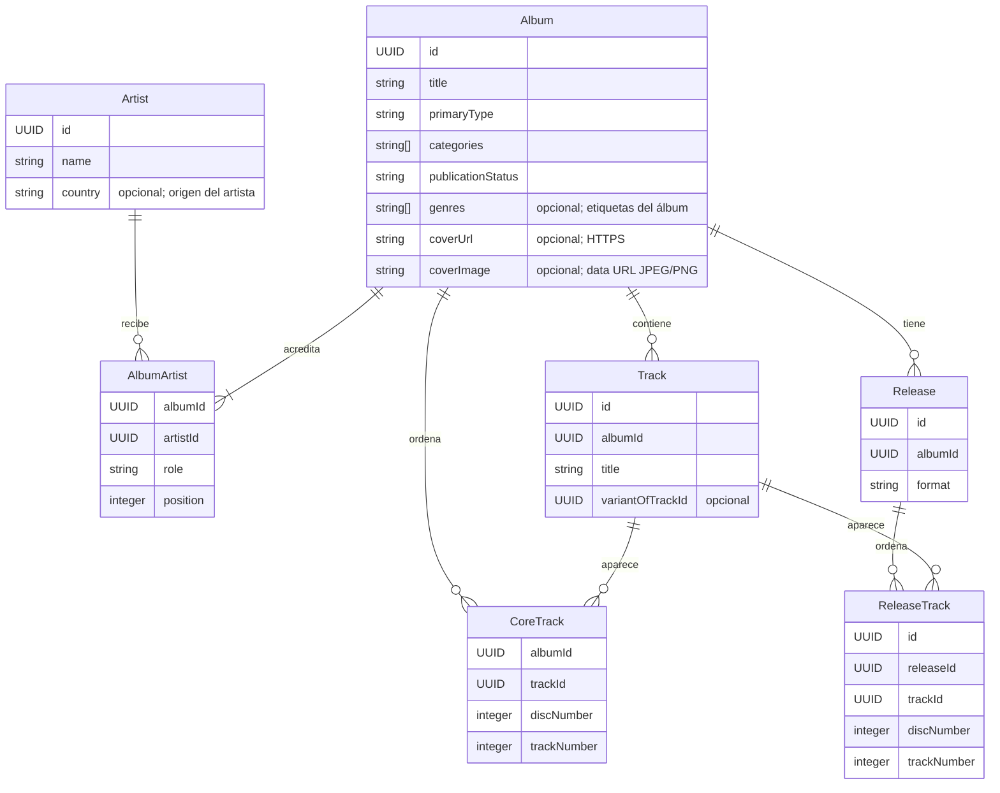
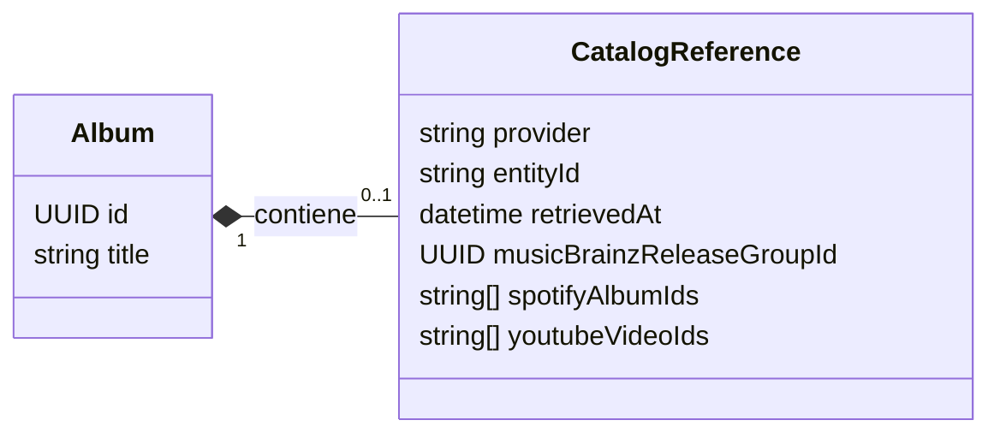
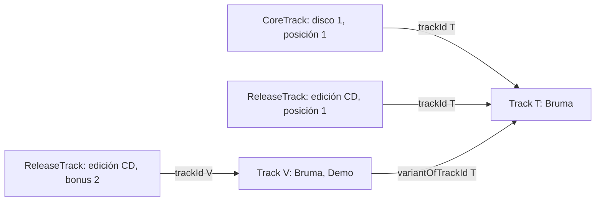
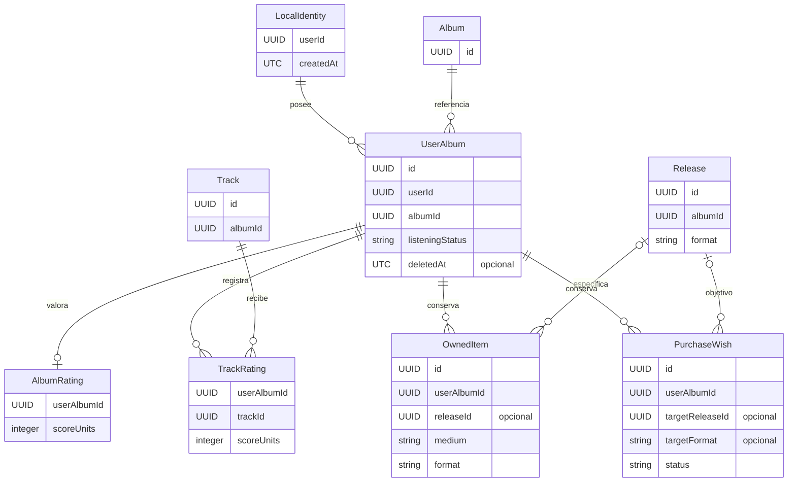
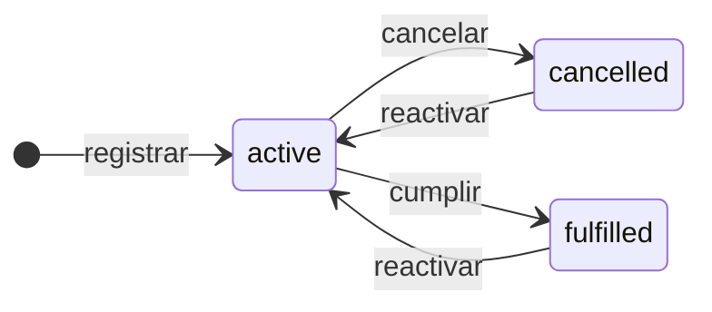
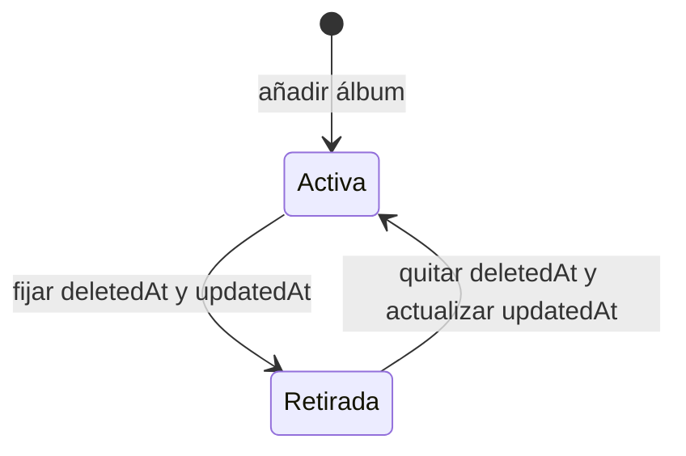

# Modelo de dominio

LINK-01 implementa los [enlaces personales](ENLACES_PERSONALES.md): valores identificados contenidos en `UserAlbum.links` y un único favorito opcional de escucha. Son independientes de catálogo, nota y adquisición; la guía enlazada incluye su diagrama e invariantes.

Este documento describe los contratos de Auditorium en el incremento en revisión, basados en el MVP **v1.0.0** y ampliados por CAT-01 y UX-01. El modelo separa la descripción musical del catálogo de la relación personal con esa música. Las entidades, cardinalidades y reglas se contrastan con los esquemas y casos de uso del código; no representan servicios externos ni modifican la release publicada.

UX-03 define por separado los [contratos de clasificación del álbum, enlaces personales, favorito y adjuntos](CONTRATOS_EXPERIENCIA.md), junto al [recorrido de usuario](EXPERIENCIA_USUARIO.md). LINK-01 concreta enlaces y favorito; UX-05 implementa la [clasificación independiente](CLASIFICACION_ALBUM.md). Los adjuntos y la referencia de nota a edición conservan su seguimiento posterior.

El refinamiento propuesto conserva una entrada y una valoración personal por álbum conceptual, con [edición de referencia opcional](CONTRATOS_EXPERIENCIA.md#calificación-única-y-edición-de-referencia) en la nota. Mi colección agrupará ejemplares físicos y compras digitales con filtros diferenciados; una edición puede conocerse sin poseerse. La referencia y el cambio de navegación aún no están implementados.

## Alcance y vocabulario

| Concepto             | Tipo                          | Significado                                                                                                                                                               |
| -------------------- | ----------------------------- | ------------------------------------------------------------------------------------------------------------------------------------------------------------------------- |
| Artista              | `Artist`                      | Persona o agrupación acreditada en un álbum.                                                                                                                              |
| Álbum                | `Album`                       | Publicación musical conceptual, independiente de su edición, formato o propiedad. `primaryType`, `categories` y `publicationStatus` describen dimensiones independientes. |
| Crédito              | `AlbumArtist`                 | Relación ordenada entre álbum y artista, con un papel y un nombre acreditado opcional.                                                                                    |
| Pista                | `Track`                       | Identidad musical dentro de un álbum. Puede reutilizarse en diferentes posiciones y ediciones.                                                                            |
| Lista original       | `CoreTrack[]` de un álbum     | Lista de referencia del álbum, independiente de cualquier edición. Cada fila es una aparición de una pista.                                                               |
| Edición              | `Release`                     | Publicación concreta de un álbum en un formato. No es una copia poseída.                                                                                                  |
| Aparición en edición | `ReleaseTrack`                | Posición de una pista en una edición, con atributos propios de esa aparición.                                                                                             |
| Identidad local      | `LocalIdentity`               | UUID y fecha de creación de la biblioteca local. No es una cuenta autenticada.                                                                                            |
| Entrada personal     | `UserAlbum`                   | Relación entre la identidad local y un álbum: escucha, notas, fechas y retirada reversible.                                                                               |
| Valoración           | `AlbumRating` / `TrackRating` | Nota independiente del álbum o de una pista dentro de una entrada personal.                                                                                               |
| Ejemplar             | `OwnedItem`                   | Una copia física o una compra digital registrada individualmente.                                                                                                         |
| Deseo                | `PurchaseWish`                | Intención de compra por formato, edición o ambos, con estado propio.                                                                                                      |
| Instantánea          | `LocalSnapshot`               | Estado coherente compuesto por `identity`, `catalog` y `library`.                                                                                                         |

Las fuentes principales son los [esquemas de catálogo](../src/domain/catalog/schemas.ts), los [esquemas de biblioteca](../src/domain/library/schemas.ts), los contratos de [ejemplares](../src/domain/library/owned-items.ts), [deseos](../src/domain/library/purchase-wishes.ts) e [identidad](../src/domain/identity.ts).

## Catálogo musical

El catálogo contiene siete colecciones: `artists`, `albums`, `albumArtists`, `tracks`, `coreTracks`, `releases` y `releaseTracks`. Un álbum puede existir sin pistas ni ediciones mientras se completa su registro, pero debe tener al menos un crédito de artista principal válido.

El diagrama muestra relaciones conceptuales y solo los campos necesarios para entenderlas; las tablas siguientes completan cada contrato. `||` significa exactamente uno, `o{` cero o más y `|{` uno o más. Las líneas no representan claves foráneas declaradas en IndexedDB.

### Contratos y atributos

| Tipo           | Campos obligatorios en el modelo validado                                       | Campos opcionales                                                                                                             |
| -------------- | ------------------------------------------------------------------------------- | ----------------------------------------------------------------------------------------------------------------------------- |
| `Artist`       | `id`, `name`, `catalogScope`                                                    | `sortName`, `country`, `createdBy`                                                                                            |
| `Album`        | `id`, `title`, `primaryType`, `categories`, `publicationStatus`, `catalogScope` | `originalYear`, `genres`, `coverUrl`, `coverImage`, `description`, `createdBy`, `catalogReference`                            |
| `AlbumArtist`  | `albumId`, `artistId`, `role`, `position`                                       | `creditedAs`                                                                                                                  |
| `Track`        | `id`, `albumId`, `title`                                                        | `variantOfTrackId`, `versionLabel`, `referenceDurationMs`                                                                     |
| `CoreTrack`    | `albumId`, `trackId`, `discNumber`, `trackNumber`                               | Ninguno                                                                                                                       |
| `Release`      | `id`, `albumId`, `format`                                                       | `editionLabel`, `releaseTitleOverride`, `releaseYear`, `label`, `catalogNumber`, `barcode`, `countryCode`, `mediaDescription` |
| `ReleaseTrack` | `id`, `releaseId`, `trackId`, `discNumber`, `trackNumber`, `contentRole`        | `durationMs`, `displayTitleOverride`                                                                                          |

`catalogScope` tiene únicamente el valor `personal`, que se aplica por defecto. `primaryType` tiene por defecto `unspecified`, `categories` es una lista vacía y `publicationStatus` es `unknown`; `contentRole`, `standard`. `createdBy` registra atribución opcional en artista y álbum; los casos de uso de creación lo fijan a la identidad local. No sustituye a `UserAlbum.userId` ni constituye un mecanismo de autorización remota.

| Campo                      | Valores admitidos                                                        |
| -------------------------- | ------------------------------------------------------------------------ |
| `Album.primaryType`        | `unspecified`, `full_length`, `ep`, `single`, `other`                    |
| `Album.categories`         | `demo`, `split`, `compilation`, `live`, `soundtrack`; selección múltiple |
| `Album.publicationStatus`  | `unknown`, `published`, `unreleased`                                     |
| `AlbumArtist.role`         | `primary`, `collaborator`, `featured`, `other`                           |
| `Release.format`           | `vinyl`, `cd`, `cassette`, `digital`, `other`                            |
| `ReleaseTrack.contentRole` | `standard`, `bonus`, `alternate`, `other`                                |

Los años son enteros de 1 a 9999. Posiciones y duraciones son enteros positivos; las duraciones se guardan en milisegundos. `coverUrl` requiere HTTPS y `Release.countryCode` requiere dos letras mayúsculas; estos contratos verifican estructura, no disponibilidad de la imagen ni pertenencia a un registro de países. Los campos del contrato no implican que todos tengan un editor en la interfaz de esta versión.

`Album.genres` admite hasta veinte etiquetas libres de hasta ochenta caracteres, sin duplicados al normalizar mayúsculas, acentos y espacios exteriores. `Artist.country` es texto opcional de hasta cien caracteres que describe el origen de una persona o agrupación; no sustituye al país de una edición. Los álbumes con varios artistas conservan créditos y países separados. La consulta local agrupa etiquetas equivalentes para buscar, filtrar y ordenar.

`Album.coverImage` contiene una data URL JPEG/PNG con base64 canónico, firma válida y un máximo de 2 MiB decodificados. Es excluyente con `coverUrl`. Al seleccionar un archivo en la interfaz se comprueban además decodificación, dimensiones máximas de 8192 por eje y 32 millones de píxeles. El schema del dominio no abre imágenes ni hace llamadas de red. La portada local se conserva en IndexedDB y respaldos; la remota conserva sólo su enlace.

La [edición de metadatos](EDICION_CATALOGO.md) mantiene el ID de álbum y sus relaciones personales y musicales, con comprobación del estado esperado. Cambiar un nombre de artista crea una identidad para ese crédito del álbum y no renombra registros compartidos. Corregir el país de un artista que mantiene su ID cambia el dato en sus demás créditos; la interfaz advierte ese alcance.

### Referencia externa de álbum

`CatalogReference` es un valor opcional anidado en `Album`, no una tabla ni una identidad local alternativa. Su [schema estricto](../src/domain/catalog/catalog-reference.ts) admite:

La composición indica pertenencia al álbum, sin almacenamiento separado. Las tres propiedades de IDs externos son opcionales; `provider` siempre es `wikidata`.

| Campo                       | Regla                                                                                              |
| --------------------------- | -------------------------------------------------------------------------------------------------- |
| `provider`                  | Literal `wikidata`                                                                                 |
| `entityId`                  | QID: `Q` seguido de entero positivo sin cero inicial                                               |
| `retrievedAt`               | Fecha UTC válida con precisión de milisegundos                                                     |
| `musicBrainzReleaseGroupId` | UUID opcional del grupo de publicación                                                             |
| `spotifyAlbumIds`           | Hasta ocho IDs opcionales y sin duplicados; 22 caracteres alfanuméricos por ID                     |
| `youtubeVideoIds`           | Hasta ocho IDs opcionales y sin duplicados; 11 caracteres alfanuméricos, guion o guion bajo por ID |

El ID externo no impone unicidad global ni autoriza fusionar UUID locales. La fecha identifica la consulta, no certifica vigencia o autenticidad absoluta del contenido. Las URLs de procedencia y streaming se derivan de identificadores válidos; no se persisten respuestas arbitrarias del servicio. La portada permanece como dato independiente y opcional. Editar título, identidad, alias, rol u orden de los créditos invalida la referencia anterior; corregir año, géneros, país, descripción o portada la conserva. El registro manual no necesita una referencia para ser válido. Véase el flujo de [integraciones opcionales](INTEGRACIONES_OPCIONALES.md).

Las recomendaciones son un resultado transitorio de aplicación, no una entidad del catálogo o biblioteca. Sólo proponen orden, razón y acción sobre candidatos activos conocidos; no crean valoraciones ni cambian estados del dominio.

### Cardinalidades y reglas de catálogo

| Relación                                 | Cardinalidad y restricción                                                                                                                                       |
| ---------------------------------------- | ---------------------------------------------------------------------------------------------------------------------------------------------------------------- |
| `Album` → `AlbumArtist`                  | 1..n créditos por álbum; al menos uno con `role = primary` y artista existente. Cada crédito pertenece a un solo álbum y un solo artista.                        |
| `Artist` → `AlbumArtist`                 | 0..n créditos. La pareja álbum/artista puede tener papeles distintos; no puede repetir el mismo papel.                                                           |
| `Album` → `Track`                        | 0..n pistas; cada pista pertenece exactamente a un álbum.                                                                                                        |
| `Album` → `CoreTrack`                    | 0..n apariciones originales; cada fila referencia exactamente un álbum y una pista de ese álbum.                                                                 |
| `Album` → `Release`                      | 0..n ediciones; cada edición pertenece exactamente a un álbum.                                                                                                   |
| `Release` → `ReleaseTrack`               | 0..n apariciones; cada fila referencia exactamente una edición y una pista del mismo álbum.                                                                      |
| `Track` → apariciones                    | 0..n `CoreTrack` y 0..n `ReleaseTrack`. La misma pista puede ocupar varias posiciones distintas.                                                                 |
| `Track` → pista original de una variante | 0..1 referencia mediante `variantOfTrackId`; una pista puede ser origen de 0..n variantes. Las referencias permanecen dentro del mismo álbum y no forman ciclos. |

Los IDs son únicos dentro de las colecciones que tienen `id`. Los créditos son únicos por `(albumId, artistId, role)` y sus posiciones por `(albumId, position)`. Las posiciones originales son únicas por `(albumId, discNumber, trackNumber)` y las de una edición por `(releaseId, discNumber, trackNumber)`. Los números pueden tener huecos; la validación no exige una secuencia contigua.

Estas reglas se implementan en [getCatalogIssues](../src/domain/catalog/integrity.ts) y se incorporan a [catalogSchema](../src/domain/catalog/catalog.ts). Compartir un título no convierte dos registros en la misma entidad. El registro manual presenta [candidatos por título y artista](../src/application/album-candidates.ts) para revisión explícita, sin fusionar automáticamente sus IDs.

### Identidad de pista, variantes y apariciones

Una pista compartida reutiliza el mismo `Track.id`. Una interpretación musical diferente se representa con otro `Track.id` y, si corresponde, `variantOfTrackId` apuntando a su origen. `versionLabel` describe la versión y no es su identidad. Se permiten cadenas de variantes, pero no referencias a sí mismas, ciclos ni cruces entre álbumes.

En este ejemplo ficticio, las apariciones de T comparten una valoración personal de pista. V admite otra valoración. La lista original es una referencia editorial; el contrato no exige que todas sus pistas carezcan de `variantOfTrackId`.

`referenceDurationMs` pertenece a la pista. `durationMs`, `displayTitleOverride` y `contentRole` pertenecen exclusivamente a una aparición en edición. Cambiar el título mostrado en una edición no cambia el título de la pista compartida. `Release.releaseTitleOverride` permite un título específico de la publicación sin reemplazar `Album.title`.

Crear una edición con `copyCoreTracks` copia las posiciones originales y reutiliza sus IDs de pista en ese momento; no crea una vinculación que mantenga ambas listas sincronizadas. Guardar una lista sustituye solo sus apariciones. Quitar una aparición conserva la entidad `Track`, sus variantes, las otras listas y las valoraciones. El caso de uso [saveTrackList](../src/application/track-lists.ts) valida la lista completa y comprueba la referencia leída antes de escribir.

## Biblioteca personal

La biblioteca contiene `userAlbums`, `albumRatings`, `trackRatings`, `ownedItems` y `purchaseWishes`. Los ejemplares, deseos, valoraciones y experiencia se vinculan a la entrada personal, no directamente a una cuenta externa ni a una edición como unidad de biblioteca.

`|o` / `o|` expresa cero o uno: un ejemplar puede carecer de edición específica y un deseo puede apuntar solo a un formato. `deletedAt`, `releaseId`, `targetReleaseId` y `targetFormat` tienen las condiciones de opcionalidad descritas a continuación. Un deseo no guarda una referencia al ejemplar que permitió cumplirlo; por ello no existe una asociación persistente deseo/ejemplar en este diagrama.

### Contratos personales

| Tipo            | Campos obligatorios                                                  | Campos opcionales                                                                            |
| --------------- | -------------------------------------------------------------------- | -------------------------------------------------------------------------------------------- |
| `LocalIdentity` | `userId`, `createdAt`                                                | Ninguno                                                                                      |
| `UserAlbum`     | `id`, `userId`, `albumId`, `listeningStatus`, `addedAt`, `updatedAt` | `personalNotes`, `deletedAt`                                                                 |
| `AlbumRating`   | `userAlbumId`, `scoreUnits`, `updatedAt`                             | Ninguno                                                                                      |
| `TrackRating`   | `userAlbumId`, `trackId`, `scoreUnits`, `updatedAt`                  | Ninguno                                                                                      |
| `OwnedItem`     | `id`, `userAlbumId`, `medium`, `format`, `createdAt`                 | `releaseId`, `mediaCondition`, `sleeveCondition`, `acquiredAt`, `notes`                      |
| `PurchaseWish`  | `id`, `userAlbumId`, `status`, `createdAt`                           | `targetReleaseId`, `targetFormat`, `notes`; al menos uno de los dos objetivos es obligatorio |

`listeningStatus` toma por defecto `untracked`. Las notas personales y de copia/deseo conservan espacios y saltos de línea cuando contienen texto; los formularios omiten un campo formado solo por blancos. Omitir `personalNotes` al guardar la experiencia retira únicamente esas notas.

| Relación                              | Cardinalidad y restricción                                                                                                          |
| ------------------------------------- | ----------------------------------------------------------------------------------------------------------------------------------- |
| Identidad → `UserAlbum`               | 0..n entradas, todas con `userId` igual a la identidad del contexto. Cada entrada referencia un álbum existente.                    |
| Identidad y álbum → entrada activa    | Como máximo una entrada activa por `(userId, albumId)`. Pueden coexistir varias entradas retiradas y una activa con IDs diferentes. |
| `UserAlbum` → `AlbumRating`           | 0..1 valoración, identificada por `userAlbumId`.                                                                                    |
| `UserAlbum` y `Track` → `TrackRating` | Como máximo una valoración por `(userAlbumId, trackId)`. La pista debe pertenecer al álbum de esa entrada.                          |
| `UserAlbum` → `OwnedItem`             | 0..n copias individuales. No se deduplican por edición o formato.                                                                   |
| `OwnedItem` → `Release`               | 0..1 edición explícita del mismo álbum y compatible con el medio/formato.                                                           |
| `UserAlbum` → `PurchaseWish`          | 0..n deseos individuales. Objetivos iguales no se fusionan.                                                                         |
| `PurchaseWish` → `Release`            | 0..1 edición objetivo del mismo álbum; si además existe `targetFormat`, debe coincidir con `Release.format`.                        |

Los validadores admiten datos personales asociados a entradas retiradas para preservar su historia. Las operaciones de edición exigen una entrada activa; restaurarla es la excepción que actúa sobre una retirada. Las reglas se comprueban en [getLibraryIssues](../src/domain/library/integrity.ts), [createLibrarySchema y applyLibraryChange](../src/domain/library/library.ts).

### Valoraciones independientes

`scoreUnits` es un entero de 2 a 20. La nota visible va de 1 a 10 en pasos de 0,5: `scoreUnits = nota × 2`. Una nota de 9,5 se almacena como 19; 9,3 es inválida. Las [conversiones](../src/domain/library/scores.ts) validan sin redondear valores inválidos.

La nota del álbum se introduce explícitamente y no se calcula como promedio de pistas. La nota de una pista depende de `(userAlbumId, trackId)`, por lo que es común a todas sus apariciones; una variante con otro ID admite otra nota. Ausencia de valoración significa ausencia de registro, nunca cero ni `null`. Quitar una nota elimina solo su registro y no restaura automáticamente su valor anterior.

### Escucha, colección y deseos

| `listeningStatus` | Significado                       |
| ----------------- | --------------------------------- |
| `untracked`       | Sin estado de escucha registrado. |
| `queued`          | Pendiente de escuchar.            |
| `in_progress`     | Escucha en curso.                 |
| `completed`       | Escucha completada.               |

Todos los estados de escucha admiten cambios directos a cualquiera de los otros estados; no hay una secuencia obligatoria ni una transición automática por valorar, poseer o desear música. Cambiar escucha conserva ejemplares, deseos y valoraciones. Comprar o registrar una copia tampoco cambia la escucha.

Un `OwnedItem` físico usa `medium = physical` y uno de `vinyl`, `cd`, `cassette`, `other`. Una compra digital exige `medium = purchased_digital` y `format = digital_download`. Su edición compatible usa `Release.format = digital`. Streaming no crea un ejemplar poseído.

`mediaCondition` y `sleeveCondition` admiten `mint`, `near_mint`, `very_good`, `good`, `fair`, `poor` y están prohibidos en compras digitales. `acquiredAt` es una fecha válida `YYYY-MM-DD`, sin hora ni zona, que puede preceder al registro en biblioteca. `createdAt` es la fecha UTC de registro de la copia y no puede preceder a `UserAlbum.addedAt`.

Los deseos nuevos se crean con `status = active`. El panel ofrece las siguientes transiciones explícitas:

La edición de objetivo y notas exige estado activo. Para cumplir un deseo, `wishMatchesOwnedItem` exige deseo activo, misma entrada personal y un ejemplar vigente que satisfaga todos los objetivos indicados. Un objetivo de formato digital coincide con `digital_download`; un objetivo de edición exige igualdad explícita de ID, sin inferirla por formato. La compra no cumple automáticamente ningún deseo y una misma copia puede satisfacer varios mediante acciones separadas.

El diagrama describe las acciones del [panel de deseos](../src/ui/library/PurchaseWishesPanel.tsx). El contrato de dominio `set_wish_status` también permite fijar `active` o `cancelled` desde cualquier estado cuando coincide `expectedStatus`; fijar `fulfilled` siempre requiere un deseo activo y un ejemplar coincidente. La operación recibe `ownedItemId` como comprobación del comando, pero no lo añade a `PurchaseWish`. Eliminar después esa copia conserva el estado histórico del deseo cumplido. No hay fecha de cumplimiento ni historial de transiciones como campos de esta versión.

### Retirada reversible

La actividad de la entrada se expresa mediante la presencia de `deletedAt`, independientemente de la escucha:

Una retirada mantiene `UserAlbum.id`, `addedAt`, escucha, notas, valoraciones, copias y deseos. También conserva artistas, álbumes, ediciones, pistas y apariciones. Restaurar reactiva la misma entrada; si existe otra activa para el mismo usuario y álbum, se rechaza sin fusionar ni borrar ninguna. Añadir un álbum ya activo devuelve su entrada existente; añadir uno con entradas retiradas puede crear otra entrada personal activa con ID nuevo.

Eliminar un ejemplar, quitar una valoración y cancelar un deseo tienen efectos diferentes: la copia o valoración se retira individualmente; el deseo conserva su registro y cambia de estado. La aplicación no incluye borrado permanente del historial personal ni borrado del catálogo en cascada. El detalle de consecuencias se documenta en [retirada y eliminaciones personales](ELIMINACIONES_PERSONALES.md).

## Identidad, tiempo y consistencia

Los identificadores de entidades y referencias son UUID normalizados a minúsculas por [entityIdSchema](../src/domain/shared/scalars.ts). `MusicLibrary` genera los IDs nuevos mediante `crypto.randomUUID()` y recibe reloj/generador sustituibles para pruebas. `AlbumArtist`, `CoreTrack`, `AlbumRating` y `TrackRating` no tienen un `id` adicional: sus claves lógicas se forman con los campos de relación o posición.

`LocalSnapshot` reúne exactamente una `LocalIdentity`, un `Catalog` y una `Library`; el contrato está en [local-repository.ts](../src/domain/repositories/local-repository.ts). La identidad local se conserva entre aperturas. Los cambios ordinarios no la sustituyen. Restaurar un respaldo completo en un destino vacío adopta la identidad y todos los datos del origen; no crea una cuenta, sesión ni sincronización entre dispositivos.

Los timestamps son fechas UTC válidas con precisión de milisegundos, `YYYY-MM-DDTHH:mm:ss.sssZ`. Las reglas temporales implementadas son:

- `UserAlbum.updatedAt` no precede a `addedAt`; `deletedAt`, si existe, queda entre ambos.
- `AlbumRating.updatedAt` y `TrackRating.updatedAt` no preceden al alta de su entrada. Sus fechas son independientes de la experiencia personal.
- `OwnedItem.createdAt` y `PurchaseWish.createdAt` no preceden al alta de su entrada; `acquiredAt` describe otro hecho y admite una fecha anterior.
- Un cambio fechado no reemplaza una actualización posterior del mismo destino. No se exige que una nota, copia o deseo actualice `UserAlbum.updatedAt`.

Las estructuras son estrictas: los campos desconocidos se rechazan y los opcionales ausentes se omiten, sin utilizar `null` para metadatos desconocidos. El catálogo recorta espacios exteriores de sus textos; las notas personales preservan su contenido no vacío. Las colecciones pueden estar vacías y no se carga música de ejemplo al iniciar.

`applyLibraryChange` valida el contexto, el estado inicial y el cambio; devuelve una biblioteca nuevamente validada sin modificar el argumento original. [MusicLibrary](../src/application/music-library.ts) aplica esos cambios mediante el repositorio transaccional, con comprobación de estado vigente antes de confirmar. No hay un agregado persistente separado que duplique las filas personales: el límite de consistencia utilizado por los casos de uso es la instantánea validada dentro de la transacción.

Las referencias de concurrencia son comprobaciones locales de los datos leídos:

| Operación                 | Comprobación relevante                                                                 |
| ------------------------- | -------------------------------------------------------------------------------------- |
| Guardar lista             | `trackListToken`: apariciones ordenadas y pistas referenciadas de esa lista.           |
| Guardar experiencia       | `expected`: escucha, notas y fecha previamente leídas, cuando se suministra.           |
| Editar deseo              | Registro `expected` completo; debe seguir activo.                                      |
| Cambiar estado de deseo   | `expectedStatus`; cumplir comprueba además el ejemplar actual.                         |
| Retirar/restaurar entrada | `personalEntryToken`: entrada, valoraciones, copias y deseos, ordenados por clave.     |
| Quitar valoración         | `expectedScoreUnits`, cuando se suministra; la interfaz lo incluye en la confirmación. |

Los tokens no son credenciales, mecanismos de autenticación ni protocolos de sincronización. Un conflicto se comunica para releer y confirmar de nuevo; no se resuelve mezclando silenciosamente datos. Una transacción fallida conserva el estado anterior completo.

## Relaciones de dominio y almacenamiento

IndexedDB no declara claves foráneas ni borrados en cascada. Los campos `albumId`, `trackId`, `releaseId` y `userAlbumId` son referencias que comprueban los validadores de dominio y del snapshot antes de guardar. Sus índices facilitan consultas o unicidad, pero no sustituyen esas comprobaciones.

| Modelo                                                                                          | Clave de almacenamiento                           |
| ----------------------------------------------------------------------------------------------- | ------------------------------------------------- |
| `Artist`, `Album`, `Track`, `Release`, `ReleaseTrack`, `UserAlbum`, `OwnedItem`, `PurchaseWish` | `id`                                              |
| `AlbumArtist`                                                                                   | `[albumId+artistId+role]`                         |
| `CoreTrack`                                                                                     | `[albumId+discNumber+trackNumber]`                |
| `AlbumRating`                                                                                   | `userAlbumId`                                     |
| `TrackRating`                                                                                   | `[userAlbumId+trackId]`                           |
| `LocalIdentity`                                                                                 | Registro de `metadata` con `key = local_identity` |

`StoredUserAlbum.activeAlbumKey` es un dato derivado de persistencia: usuario/álbum para una entrada activa y `null` para una retirada. Su índice único refuerza la unicidad de entradas activas. No forma parte de `UserAlbum`, del modelo musical ni del respaldo de dominio. La definición física está en [database.ts](../src/infrastructure/db/database.ts) y la traducción en [records.ts](../src/infrastructure/db/records.ts); la evolución del almacenamiento se explica en [persistencia local](PERSISTENCIA_LOCAL.md).

El respaldo `LibraryBackup` envuelve el snapshot con `format = auditorium-backup`, `schemaVersion = 5` y `exportedAt`. Su versión es independiente de la versión 8 de la base local. Los archivos v1/v2/v3/v4 estrictos se normalizan al formato5. Cada versión conserva su contrato histórico: v1 no admite referencia externa; v1/v2 no admiten país, géneros ni portada local; v1/v2/v3 no admiten enlaces personales. Los álbumes de v1–v4 conservan releaseType y se transforman según la [tabla de migración](CLASIFICACION_ALBUM.md#migración-y-compatibilidad). La restauración no combina bibliotecas pobladas; véase [respaldos JSON](RESPALDOS_JSON.md).

## Ejemplo de lectura del modelo

El grupo ficticio **Luz de Cobre** publica **Horizonte Interior**. Se registra un `Artist`, un `Album` y su crédito principal. El álbum tiene dos pistas en su lista original y una edición CD que reutiliza esos IDs; una tercera pista, variante Demo de la primera, aparece como bonus exclusivamente en esa edición.

La biblioteca local añade una `UserAlbum`. Su estado de escucha puede ser `queued` mientras existen dos copias CD y un deseo de vinilo activo. La nota explícita del álbum puede ser 9,5, la primera pista 8,5 y su Demo 7,0; ninguna se deriva de las otras. Cumplir el deseo requiere registrar un vinilo coincidente y confirmarlo expresamente.

Retirar la entrada la oculta de la biblioteca activa, pero conserva todo el ejemplo. Restaurarla recupera la misma relación personal y sus IDs. Quitar una aparición bonus solo modifica la lista de la edición; no elimina la pista Demo ni su nota. Estos ejemplos explican el contrato y no se incorporan como datos iniciales del producto.

## Trazabilidad y documentación relacionada

- [ADR-002: álbum, edición y pista](adr/002-album-edicion-pista.md): separación musical e identidad de pista.
- [Catálogo](DOMINIO_CATALOGO.md) y [biblioteca personal](DOMINIO_BIBLIOTECA.md): contratos y validadores específicos.
- [Listas y ediciones](LISTAS_EDICIONES.md), [valoraciones de pistas](CALIFICACIONES_PISTAS.md), [ejemplares](EJEMPLARES.md) y [deseos](DESEOS_COMPRA.md): comportamiento de cada editor.
- [ADR-004: retirada personal](adr/004-retirada-personal.md) y [ADR-005: identidad y respaldo](adr/005-identidad-respaldo.md): decisiones de conservación y transferencia.
- [Pruebas de catálogo](../src/domain/catalog/catalog.test.ts), [biblioteca](../src/domain/library/library.test.ts), [ejemplares](../src/domain/library/owned-items.test.ts), [deseos](../src/domain/library/purchase-wishes.test.ts) y [casos de uso](../src/application/music-library.test.ts): ejemplos ejecutables de invariantes.
