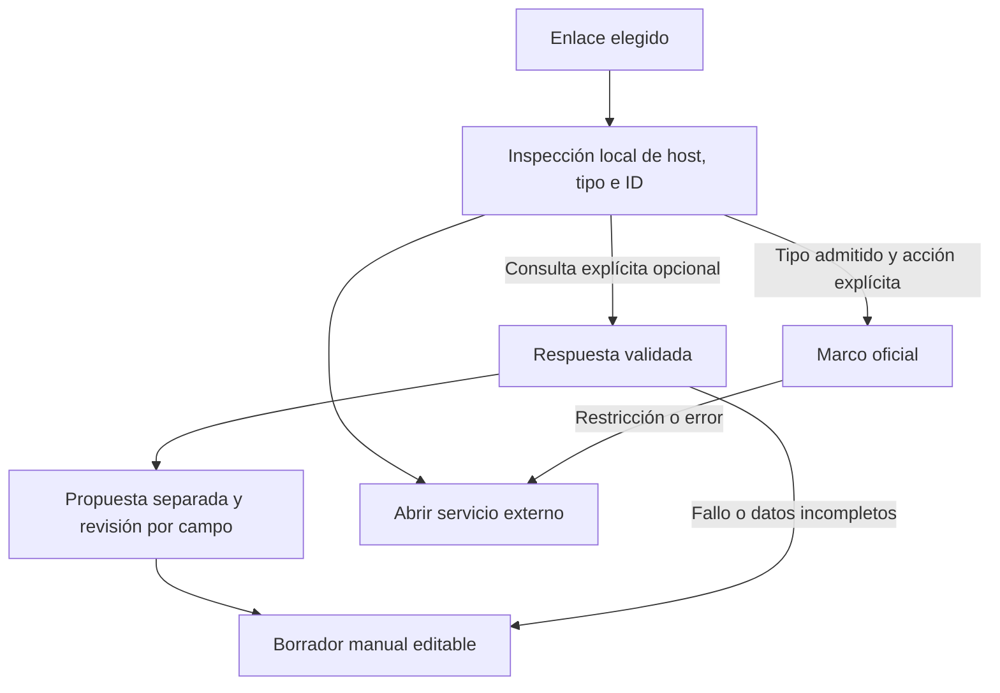

# Metadatos y reproducción desde enlaces

Decisión MEDIA-01 #67 · 22 de octubre de 2026. Evaluación para una web estática con coste obligatorio de USD 0. La [integración en la ficha](REPRODUCCION.md) corresponde a PLAY-01 #68; el [prototipo aislado](../prototypes/media-01/README.md) permite reproducir esta evaluación sin acceder a una biblioteca.

## Decisión de soporte

Para PLAY-01 se admiten como candidatos los **embeds oficiales de Spotify y YouTube**, cargados por acción explícita y con salida externa permanente. No se adopta el Web Playback SDK de Spotify ni una Web API autenticada como dependencia del flujo gratuito. Se mantiene el formulario manual ante cualquier falta de datos o disponibilidad.

La referencia musical sigue siendo `Album`; una URL de pista, vídeo o lista no se convierte en álbum por recibir un título. El canal de YouTube o autor de una lista tampoco identifica necesariamente a la banda. Consultar, cargar un marco e iniciar reproducción son resultados distintos de escuchar un álbum completo o registrar una adquisición.

oEmbed no garantiza año, géneros, país de la banda, clasificación musical ni una lista de pistas. Esos campos conservan su revisión manual o de catálogo.

## Matriz por tipo de URL

| Proveedor y URL                                | Metadatos propuestos                                                    | Miniatura                                    | Marco oficial                          | Muestra o contenido completo                                        |
| ---------------------------------------------- | ----------------------------------------------------------------------- | -------------------------------------------- | -------------------------------------- | ------------------------------------------------------------------- |
| Spotify `/album/ID`                            | oEmbed: título del recurso; revisión musical necesaria                  | Opcional; disponibilidad y dominio variables | `/embed/album/ID`                      | Lo decide Spotify; no garantizar reproducción completa              |
| Spotify `/track/ID`                            | Título de pista, sin inferir álbum ni créditos                          | Opcional, no portada verificada              | `/embed/track/ID`                      | Controles nativos; sin extraer URL de audio                         |
| Spotify `/playlist/ID`                         | Título de lista observado; no identidad de álbum                        | Opcional                                     | `/embed/playlist/ID`                   | Disponibilidad por contenido y contexto del oyente                  |
| YouTube `/watch?v=ID` o `youtu.be/ID`          | oEmbed observado: título de vídeo; no discografía ni artista confirmado | Miniatura del vídeo                          | `/embed/ID`                            | Vídeo con sus controles y posibles anuncios; sujeto a restricciones |
| YouTube `/playlist?list=ID`                    | Registro manual en esta decisión                                        | No se infiere de un vídeo de la lista        | Embed con `listType=playlist` y `list` | Contenidos de la lista sujetos a disponibilidad individual          |
| `music.youtube.com/watch?v=ID`, `/shorts/ID`   | Normalización local de ID de vídeo; alias no probados en vivo           | Mismas condiciones del vídeo                 | Candidato a embed de vídeo             | No demuestra que sea un álbum completo                              |
| Acortadores Spotify, otros tipos o proveedores | Formulario manual y URL original                                        | La persona puede elegir otra portada         | Salida externa                         | Sin integración ni resolución automática de redirecciones           |

Spotify documenta oEmbed para obtener información de recursos y [crear embeds](https://developer.spotify.com/documentation/embeds/tutorials/creating-an-embed) de álbumes, pistas y listas. La [referencia oEmbed](https://developer.spotify.com/documentation/embeds/reference/oembed) ofrece título, miniatura opcional y HTML; el prototipo ignora ese HTML y construye el marco desde un tipo e ID validados. La lista se comprobó empíricamente y no se generaliza a todo recurso de Spotify.

Los [parámetros oficiales de YouTube](https://developers.google.com/youtube/player_parameters) distinguen vídeo y lista. No exponen una entidad álbum. El endpoint oEmbed del dominio YouTube respondió en las pruebas, pero esta evaluación no encontró un contrato equivalente en su documentación actual de Data API: su uso como adaptador de metadatos queda **experimental**, separado del soporte documentado del reproductor. No se usa scraping ni un proxy de terceros.

## Embeds y APIs autenticadas

| Vía                       | Requisitos y decisión                                                                                                                                            |
| ------------------------- | ---------------------------------------------------------------------------------------------------------------------------------------------------------------- |
| Spotify Embed             | Se carga el marco oficial sin token de una cuenta en Auditorium; la reproducción disponible pertenece al proveedor. Candidato para PLAY-01.                      |
| Spotify Web Playback SDK  | Necesita token de una cuenta Premium. Excluido del recorrido gratuito.                                                                                           |
| Spotify Web API           | OAuth y aplicación registrada. Actualmente el propietario de una aplicación en modo desarrollo necesita Premium y existen restricciones de acceso. No se activa. |
| YouTube IFrame Player API | Control del vídeo insertado sin autorización de una cuenta YouTube; necesita identificación correcta del origen. Candidato para PLAY-01.                         |
| YouTube Data API          | Proyecto y credenciales, cuotas y, para datos privados, OAuth. Posible evaluación posterior; no se creó proyecto ni se usaron claves.                            |
| Enlace HTTPS genérico     | Apertura externa, sin enviar la URL a servicios de metadatos ni intentar descubrir HTML insertable.                                                              |

Los requisitos de Spotify se verificaron en [SDK: autenticación](https://developer.spotify.com/documentation/web-playback-sdk/tutorials/getting-started), [cambios de modo desarrollo de febrero de 2026](https://developer.spotify.com/documentation/web-api/tutorials/february-2026-migration-guide) y [cuotas vigentes](https://developer.spotify.com/documentation/web-api/concepts/quota-modes). OAuth con PKCE permite clientes de navegador sin guardar un secreto, pero no elimina estos requisitos: [flujos de autorización](https://developer.spotify.com/documentation/web-api/concepts/authorization).

La ausencia de autorización para el reproductor YouTube se describe en sus [políticas](https://developers.google.com/youtube/terms/developer-policies); la [Data API](https://developers.google.com/youtube/data/getting-started) tiene una configuración distinta. El reproductor no se trata como una forma de eludir permisos o disponibilidad.

## Transporte, identificación y errores

Las consultas del prototipo son `GET` CORS, sin credenciales, con tiempo máximo de doce segundos y respuesta JSON acotada a 64 KiB. No se sigue una redirección desde el endpoint, no se envía el borrador manual y no se interpreta HTML remoto. Se permiten únicamente endpoints derivados de hosts, tipos e identificadores reconocidos. Error HTTP, JSON no válido, CORS, cancelación o límite excedido conservan el enlace y el registro manual.

Para los marcos se usa `referrerpolicy="strict-origin-when-cross-origin"`. En YouTube se añade `origin` y `enablejsapi=1`. La [identificación del cliente](https://developers.google.com/youtube/terms/required-minimum-functionality#api-client-identity-and-credentials) exige el `HTTP Referer` o identificación equivalente; `origin` no autoriza a suprimir ese encabezado en una web normal. Las políticas `no-referrer` de portadas y `noreferrer` de la salida externa genérica no se copian al iframe ni a una ventana que aloje el reproductor.

| Error YouTube             | Tratamiento para PLAY-01                                          |
| ------------------------- | ----------------------------------------------------------------- |
| 2                         | Revisar ID o parámetros; conservar salida externa                 |
| 5                         | Informar incompatibilidad de reproducción del navegador           |
| 100                       | Vídeo retirado, privado o no encontrado; no deducir cuál          |
| 101 / 150                 | El titular no permite la inserción                                |
| 153                       | Falta identificación del origen; revisar configuración de Referer |
| Bloqueo de autoplay o red | Permitir interacción explícita o salida externa                   |

Los códigos y eventos proceden de la [referencia IFrame](https://developers.google.com/youtube/iframe_api_reference#Events). No deben disparar cambios en escucha o nota. Se conserva el vídeo visible y sus controles: mínimo 200 × 200 píxeles, sin reproductor sólo de audio, ocultación de anuncios ni extracción. El diseño de PLAY-01 debe respetar estas medidas incluso en móvil.

En Spotify, cargar un iframe no certifica reproducción ni duración. Su [guía de problemas](https://developer.spotify.com/documentation/embeds/tutorials/troubleshooting) advierte que ciertos contextos sólo permiten una muestra menor de treinta segundos y que `encrypted-media` es necesario. Se conserva el marco oficial, con permisos documentados; no se sustituye por una URL de muestra ni se garantiza que toda muestra esté disponible.

## Revisión de datos y privacidad

La consulta prepara una propuesta separada: título del recurso, miniatura si se admite y procedencia. Sólo una selección explícita puede copiar un campo al borrador. Título, banda, clasificación, portada y edición musical requieren revisión independiente. No se sustituye automáticamente un álbum, su nota, su referencia de edición o su colección.

La miniatura no es una portada verificada ni una licencia para redistribuirla. En el prototipo se muestra remotamente mediante otra acción y no se empaqueta. Sus dominios de imagen están acotados; si falta o cambia el CDN, el título puede seguir disponible. Para persistir datos de Spotify fuera del widget, un adaptador deberá concretar antes los términos de uso aplicables: el resultado técnico de oEmbed no resuelve por sí solo esa autorización.

Antes de habilitar PLAY-01 se debe completar la información y consentimiento de los servicios externos, con enlaces a sus condiciones y privacidad, y explicar cookies, conexión, contenido y anuncios. Los [términos del widget Spotify](https://developer.spotify.com/documentation/embeds/terms) y las [políticas YouTube](https://developers.google.com/youtube/terms/developer-policies) exigen divulgaciones específicas. El prototipo informa de esos contactos; no autentica cuentas ni publica datos. La futura integración conservará estas acciones opcionales y la alternativa manual.

## Evidencia del prototipo

Fecha de observación: **22 de octubre de 2026**, America/Santiago. Navegadores aislados, sin cuentas ni claves, origen HTTP de loopback y ruta `/Auditorium/prototypes/media-01/`, servidor exclusivamente estático. Las solicitudes a proveedores son cruzadas y reales; no hay backend ni proxy de metadatos. Esto comprueba un origen estático equivalente, **no una prueba en el dominio HTTPS de Pages**, otras regiones o dispositivos físicos.

| Prueba en vivo                                    | Chromium                                                                           | WebKit                                                              | Firefox Windows                                |
| ------------------------------------------------- | ---------------------------------------------------------------------------------- | ------------------------------------------------------------------- | ---------------------------------------------- |
| Spotify álbum, pista y lista: oEmbed JSON legible | HTTP 200; `Access-Control-Allow-Origin: *`                                         | Igual                                                               | No ejecutada: `spawn UNKNOWN` al iniciar motor |
| Spotify: marco de los tres tipos                  | Evento de carga observado; audio completo no comprobado                            | Igual                                                               | No ejecutada                                   |
| Spotify: miniatura                                | Lista y pista cargadas; álbum no validado en la última sonda por variación del CDN | Lista cargada; CDN nuevo de pista/álbum no revalidado en este motor | No ejecutada                                   |
| YouTube vídeo: oEmbed                             | HTTP 200, origen permitido; título y miniatura                                     | Igual                                                               | No ejecutada                                   |
| YouTube vídeo: API y reproducción tras pulsar     | `ready` y estado `playing` durante tres segundos                                   | Igual                                                               | No ejecutada                                   |
| YouTube lista: API del marco                      | `ready`; contenidos y reproducción de la lista no comprobados                      | Igual                                                               | No ejecutada                                   |
| Referer del iframe                                | Encabezado real con origen local, sin ruta de borrador                             | Igual                                                               | No ejecutada                                   |
| Acortador Spotify y genérico                      | Sólo salida externa; sin consulta ni iframe                                        | Igual                                                               | No ejecutada                                   |

Se usaron los IDs públicos de prueba del [script reproducible](../prototypes/media-01/probe.mjs), incluido el vídeo de ejemplo de la referencia oficial YouTube. No se guardaron audio, vídeo ni portadas en el repositorio. El estado `playing` no acredita la reproducción completa ni la disponibilidad de otros contenidos. Las cuentas Premium, SDK autenticado, vídeos privados/restringidos reales, móviles físicos y reproducción completa Spotify **no se comprobaron**.

Las pruebas deterministas usan respuestas ficticias y no contactan proveedores: siete enlaces, seis códigos de error YouTube y una cancelación por motor. Comprueban revisión explícita, borrador conservado, alternativa externa, ausencia de almacenamiento y liberación del iframe. Se ejecutan también en CI Linux, incluido Firefox; **esa simulación no sustituye la prueba en vivo que falta en Firefox**. Seis pruebas Node comprueban tipos, destinos, respuestas acotadas y contratos.

## Contratos implementables para PLAY-01 y metadatos

1. Usar el enlace de escucha elegido o favorito; mantener Comprar separado. Inspeccionar URL localmente y habilitar sólo tipos soportados. Acortadores y genéricos conservan salida externa.
2. Crear el iframe únicamente al solicitarlo; sin autoplay. Una instancia, destruida al cambiar álbum/enlace/pantalla o cerrar. Respetar Referer, origen, permisos y tamaño; conservar el vídeo y los controles oficiales.
3. Distinguir `loading`, marco cargado, API lista, reproducción iniciada, error y cerrado. Un `load` tardío no reemplaza un error o un estado posterior; callbacks de una instancia retirada se ignoran.
4. Mantener Abrir en el servicio siempre disponible. Si no hay una señal fiable de Spotify, explicar el límite sin inventar si es muestra o contenido completo. La experiencia personal nunca cambia por eventos de reproducción.
5. Mantener la consulta de metadatos desacoplada del reproductor. Spotify oEmbed sólo como propuesta de revisión y con condiciones de persistencia resueltas; YouTube oEmbed permanece experimental. Data API y SDK autenticados quedan fuera del requisito gratuito.
6. Para cualquier adaptador, validar respuesta, proveedor, tamaño, URL de imagen y procedencia; usar texto, nunca HTML remoto. No inferir álbum desde pista/lista/vídeo, ni banda desde canal. Confirmar cada reemplazo de un campo ya editado y conservar la entrada manual.
7. Validar raíz/Pages, 320 px, teclado, tres motores, cancelación, errores, falta de red y liberación. Separar evidencia real de simulada y actualizar esta decisión si cambian términos, CORS o restricciones.

El [modelo de dominio](MODELO_DOMINIO.md) y los [enlaces personales](ENLACES_PERSONALES.md) conservan sus contratos. La siguiente integración se sigue en [PLAY-01 #68](https://github.com/NicoCG32/Auditorium/issues/68).
