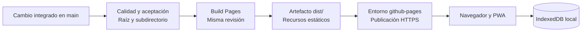

# Publicación web en GitHub Pages

La web/PWA utiliza la misma aplicación local de Auditorium, compilada para **`/Auditorium/`**. Su dirección de proyecto es [Auditorium web](https://nicocg32.github.io/Auditorium/). La disponibilidad de una revisión se comprueba en GitHub Actions y en el entorno `github-pages`.

## Uso y datos locales

Abre la dirección con conexión y espera **«Aplicación preparada para usar sin conexión»**. Después puedes reabrirla sin red. El panel «Aplicación y almacenamiento» ofrece instalación cuando el navegador lo permite; también puedes usar su menú. Véanse los [alcances de la PWA](PWA_OFFLINE.md).

La biblioteca se guarda en IndexedDB del origen y perfil del navegador. La publicación distribuye HTML, JS, CSS, manifest y recursos visuales propios. No envía al repositorio la colección, notas, valoraciones o respaldos. Cada persona gestiona su almacenamiento local; el hosting no crea una cuenta ni sincronización. Las preferencias de apariencia se conservan en el navegador; una foto de fondo elegida desde un archivo local permanece sólo como vista previa de esa apertura y se descarta al recargar. Véase [diseño base](DISENO_BASE.md).

El incremento AI-01/CAT-01 añade [acciones opcionales con proveedores externos](INTEGRACIONES_OPCIONALES.md), disponibles en Pages sólo después de integrar y publicar su revisión. Las consultas de catálogo van directamente a Wikidata; las recomendaciones envían un contexto reducido a Gemini o Groq con clave propia en memoria. El hosting estático no recibe ni custodia esa clave y no existe un servicio intermedio de Auditorium. El registro manual continúa funcionando sin esas acciones. El refinamiento UX-01 añade edición, géneros, país de artista y portada automática por URL o archivo local; la migración DB5 y el respaldo3 sólo estarán disponibles en el sitio después de integrar y publicar la revisión validada.

Localhost y `https://nicocg32.github.io` son orígenes diferentes. Para trasladar una biblioteca:

1. Exporta un JSON desde «Respaldos» en la aplicación original.
2. Abre la web publicada en el perfil que utilizarás.
3. Selecciona el archivo, revisa el resumen y confirma su restauración en un destino completamente vacío.
4. Comprueba la biblioteca y conserva el respaldo fuera del navegador.

La restauración adopta datos e identidad originales. No combina bibliotecas pobladas; las [reglas de respaldo](RESPALDOS_JSON.md) siguen vigentes.

Las subrutas de `nicocg32.github.io` comparten origen. El alcance `/Auditorium/` del service worker limita sus páginas, pero **no aísla IndexedDB de otras aplicaciones de ese mismo origen**. La base sigue llamándose `auditorium`; otra copia de Auditorium bajo otra subruta del dominio podría compartirla. Evita publicar allí copias de prueba que necesiten datos separados. Un dominio propio también cambia el origen y requiere trasladar la biblioteca mediante respaldo.

## Perfiles de compilación

| Comando               | Destino                                        |
| --------------------- | ---------------------------------------------- |
| `npm run build`       | `/`, para la distribución local existente      |
| `npm run build:pages` | `/Auditorium/`, mediante el modo Vite `pages`  |
| `npm run package`     | Recompila para raíz y prepara el paquete local |

Ambos builds escriben `dist/` y sustituyen la compilación anterior. Para revisar Pages localmente:

```sh
npm run build:pages
npm run preview -- --mode pages
```

Abre `/Auditorium/` en la dirección de preview. Para regresar a raíz, ejecuta `npm run build` antes de preview. La release v1.0.0 publicada conserva su tag y archivos originales.

La [configuración de Vite](../vite.config.ts) deriva de la base los recursos, manifest, inicio, alcance, iconos y fallback. `OfflineController` registra el worker con `BASE_URL`. Las vistas permanecen en una única URL; no se añaden rutas por álbum ni una redirección general `404.html`.

Las imágenes de los componentes utilizan `import.meta.env.BASE_URL`. Vite reescribe los `url('/auditorium/...')` públicos del CSS con la base de compilación; por ejemplo, el fondo oscuro se sirve en `/Auditorium/auditorium/backgrounds/sanctuary-desktop.webp`. Favicon e iconos PWA quedan en `/Auditorium/auditorium/icons/`. Se distribuyen 21 recursos visuales y se precargan los 13 utilizados por la interfaz, incluidos ambos temas y fondos aunque la ambientación esté desactivada. Los ocho restantes no se usan ni se precargan.

## Validación y despliegue



El [workflow](../.github/workflows/calidad.yml) ejecuta las verificaciones en PR y `main`. Solo un **push a `main`** con calidad satisfactoria habilita Pages. Compilación y despliegue utilizan la misma revisión de esa ejecución; una PR no publica.

La compilación obtiene el código sin persistir credenciales, usa Node/npm fijados y sube únicamente `dist/`. El despliegue necesita `pages: write` e `id-token: write`, se ejecuta en `github-pages` y publica ese artefacto. Las acciones se fijan por SHA. El artefacto Pages tiene retención de un día; el paquete local de revisión conserva siete días.

Pages debe estar configurado con **GitHub Actions** como fuente. El dominio propio no es requisito. GitHub ofrece Pages para repositorios públicos con GitHub Free; sus [límites y condiciones](https://docs.github.com/en/pages/getting-started-with-github-pages/github-pages-limits) siguen aplicándose. La biblioteca local no requiere infraestructura de datos contratada ni credenciales remotas.

Fuentes: [Vite en Pages](https://vite.dev/guide/static-deploy.html#github-pages) y [workflows de GitHub Pages](https://docs.github.com/en/pages/getting-started-with-github-pages/using-custom-workflows-with-github-pages).

## Actualizaciones y recuperación

Cuando una revisión nueva está preparada, guarda el trabajo y cierra todas las ventanas de Auditorium. La nueva versión se activa al reabrir. El service worker no fuerza recargas ni modifica la biblioteca. La [decisión de actualización](adr/006-actualizaciones-pwa.md) se conserva en ambos perfiles.

Si una revisión falla antes del despliegue, continúa la publicación anterior. Revisa el primer job fallido y corrígelo antes de repetir la ejecución. Para volver a código anterior, prepara una PR de reversión y valida `main`; no borres IndexedDB para solucionar un fallo de publicación. Revertir código no equivale a restaurar datos.

Un worker activo puede seguir mostrando la revisión anterior hasta cerrar sus clientes. «Comprobar actualización» permite consultar cambios. Un fallo de descarga conserva la versión activa y permite reintentar.

## Evidencia y límites

Las [pruebas Pages](../e2e/pages.spec.ts) usan `127.0.0.1:4179`, con perfiles y datos ficticios. Generan dos builds y sirven únicamente `/Auditorium/`; las rutas ajenas devuelven 404. Comprueban recursos/MIME, manifest/instalabilidad, scope, reapertura y operaciones offline con respaldo, y actualización entre ventanas con identidad y tablas conservadas.

```sh
npm run test:e2e -- --project chromium-pages
```

La suite raíz continúa en `127.0.0.1:4178`. La [matriz de validación](VALIDACION_MVP.md) conserva sus límites sobre dispositivos reales y accesibilidad. La instalabilidad de Chromium no certifica instalación en Safari/iOS ni en todos los navegadores móviles. Cuentas, sincronización, metadatos externos y reproducción mantienen sus tareas propias.
