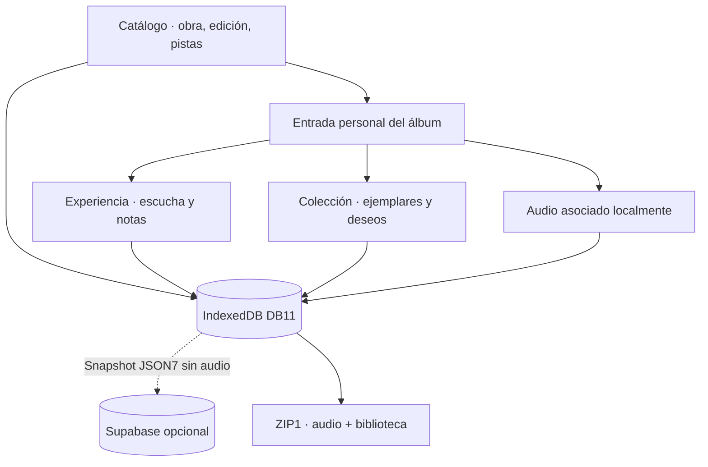

# Documentación de Auditorium

**Álbumes como obras, ediciones como versiones y una biblioteca que conserva la experiencia personal.**

[**Aplicación**](https://nicocg32.github.io/Auditorium/) · [**Portada**](../README.md) · [**Uso cotidiano**](general/02-uso-y-limites.md) · [**Respaldos**](RESPALDOS_JSON.md)

---

## Elige una ruta de lectura

### 01 · General — descubrir la fonoteca

- [**Origen y alcance**](general/01-origen-y-alcance.md): por qué hice la aplicación y cómo separo catálogo, experiencia y colección.
- [**Uso y límites**](general/02-uso-y-limites.md): registrar álbumes, valoraciones, ejemplares, reproducción y respaldos.
- [**Identidad y accesibilidad**](general/03-diseno-e-identidad.md): vinilo, estética gótica, temas y decisiones de interfaz.

### 02 · Técnica — entender el sistema

- [**Arquitectura por niveles**](tecnica/01-arquitectura.md): contexto, contenedores, componentes y despliegue web/PWA.
- [**Dominio y relaciones**](tecnica/02-dominio.md): álbum, edición, pista, catálogo, escucha y ejemplar; modelo lógico.
- [**Persistencia**](tecnica/03-datos-y-persistencia.md): 17 almacenes IndexedDB DB11, snapshot JSON7, ZIP1 de audio y cuenta Supabase opcional.
- [**Flujos y estados**](tecnica/04-flujos-y-estados.md): registro, valoración, retirada, deseos, respaldos, conflictos y sincronización.
- [**Integraciones y seguridad**](tecnica/05-integraciones-y-seguridad.md): Wikidata, Gemini/Groq, reproducción externa, claves de sesión y RLS.

<strong>Ver la relación entre catálogo y biblioteca personal</strong>

Este diagrama resume relaciones **lógicas**, no crea un esquema SQL para todos los datos. Para los índices y las claves exactas consulta [Datos y persistencia](tecnica/03-datos-y-persistencia.md).

### 03 · Desarrollo — mantenerlo sin perder información

- [**Proceso y decisiones**](desarrollo/01-proceso-y-decisiones.md): evolución del proyecto y criterios para los cambios.
- [**Entorno y verificación**](desarrollo/02-entorno-y-verificacion.md): comandos, CI, pruebas unitarias, navegador y entrega.
- [**Evolución y pendientes**](desarrollo/03-evolucion-y-pendientes.md): versión publicada frente a código aún sin distribuir.
- [**Derechos y recursos**](DERECHOS_Y_RECURSOS.md): código, diseños, audio, portadas, fuentes y atribuciones.

## Guías de consulta

| Quiero…                           | Documento especializado                                                                                                     |
| --------------------------------- | --------------------------------------------------------------------------------------------------------------------------- |
| **Registrar y clasificar música** | [Catálogo](DOMINIO_CATALOGO.md) · [Edición](EDICION_CATALOGO.md) · [Ficha de álbum](FICHA_ALBUM.md)                         |
| **Guardar mi experiencia**        | [Biblioteca](BIBLIOTECA.md) · [Valoraciones de pistas](CALIFICACIONES_PISTAS.md) · [Por género](VALORACIONES_POR_GENERO.md) |
| **Administrar mis discos**        | [Colección](MI_COLECCION.md) · [Ejemplares](EJEMPLARES.md) · [Deseos](DESEOS_COMPRA.md)                                     |
| **Conservar mis datos**           | [JSON](RESPALDOS_JSON.md) · [Audio](AUDIO_LOCAL.md) · [Importación](IMPORTACION_JSON.md)                                    |
| **Reproducir o buscar**           | [Enlaces](REPRODUCCION.md) · [Integraciones](INTEGRACIONES_OPCIONALES.md)                                                   |
| **Instalar y actualizar**         | [Entrega 1.1.0](ENTREGA.md) · [PWA](PWA_OFFLINE.md) · [Publicación](PUBLICACION_WEB.md)                                     |

## Decisiones de arquitectura

Las [ADR](adr/) recogen las decisiones y su contexto histórico. Incluyen el [MVP local](adr/001-mvp-local.md), la [separación álbum/edición/pista](adr/002-album-edicion-pista.md), la [sincronización opcional](adr/011-supabase-sincronizacion.md), el [audio local](adr/012-audio-local-respaldo.md) y las [notas por género](adr/013-valoraciones-por-genero.md).

<strong>Estudios, prototipos y referencias de implementación</strong>

- Las evaluaciones de [MusicBrainz](METADATOS_EXTERNOS.md) y [proveedores de streaming](PROVEEDORES_STREAMING.md) conservan los resultados y las propuestas de integración.
- Los [prototipos de audio](../prototypes/audio-01/README.md) y [proveedores](../prototypes/media-01/README.md) permiten reproducir pruebas aisladas.
- Las guías de [datos](MODELO_DATOS.md), [dominio](MODELO_DOMINIO.md), [arquitectura](ARQUITECTURA.md) y el [plan de desarrollo](PLAN_DESARROLLO.md) detallan la implementación y su evolución.

## Qué versión estás leyendo

La versión publicada es **1.1.0, del 29 de octubre de 2026**. La importación aditiva y el catálogo JSON figuran como **Sin publicar** en el [changelog](../CHANGELOG.md). Consulta las notas de la versión instalada para conocer sus funciones.

Los formatos de datos tienen versiones diferentes: **Dexie DB11, respaldo JSON7 y respaldo de audio ZIP1**. La sincronización de cuenta envía metadatos, no los archivos musicales locales.

## Licencias y recursos

La música, las portadas y otros recursos de terceros conservan sus condiciones de uso, separadas de la licencia del software.

[**Revisar licencias y recursos**](DERECHOS_Y_RECURSOS.md) · [**LICENSING.md**](../LICENSING.md).
