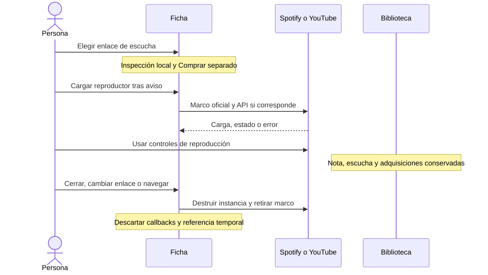

# Reproducción desde tus enlaces

PLAY-01 #68 · 22 de octubre de 2026. La ficha permite cargar los reproductores oficiales de Spotify y YouTube desde un enlace personal de escucha. Se mantiene el registro manual y la apertura del servicio externo.

AUDIO-02 añade [archivos propios persistentes](AUDIO_LOCAL.md). Ambos tipos de fuente comparten un solo reproductor activo: cargar audio local retira el marco de streaming, y cargar streaming pausa y libera el audio local. Preparar una fuente no modifica la experiencia ni reproduce automáticamente.

## Recorrido

1. Abre un álbum de tu Biblioteca. En **Enlace para escuchar**, se selecciona el favorito guardado o el primer enlace de escucha. Puedes elegir otro sin cambiar el favorito persistido.
2. Revisa el proveedor y el aviso de datos. **Cargar reproductor** autoriza esa conexión para la instancia actual. Escuchar empieza al usar los controles del servicio; la aplicación no envía un comando de reproducción automática.
3. **Abrir en el servicio** permanece disponible, también ante restricciones o fallos. **Reintentar reproductor** retira la instancia anterior y vuelve a conectar.
4. **Cerrar reproductor** retira el marco y devuelve el foco al botón de carga. Cambiar de enlace, álbum o pantalla también libera la instancia. La selección y la conexión no se recuerdan al reabrir la ficha.

Comprar conserva su sección y propósito; sus enlaces no entran en el selector de escucha. Reproducir, pausar, terminar un vídeo o consultar una referencia no cambia la nota, el estado de escucha, la edición de referencia, los deseos o las adquisiciones.

## Soporte y disponibilidad

| Enlace                                                   | Comportamiento                                                                                                              |
| -------------------------------------------------------- | --------------------------------------------------------------------------------------------------------------------------- |
| Spotify álbum, pista o lista con ID reconocido           | Marco oficial, controles y enlace externo. Puede ofrecer sólo una muestra; cargar el marco no prueba reproducción completa. |
| YouTube vídeo o lista con ID reconocido                  | Marco oficial visible y API IFrame para estados y errores. Vídeo y controles se conservan.                                  |
| Acortadores, otros proveedores, tipos o IDs no admitidos | Apertura externa y edición manual; no se resuelven redirecciones ni se inserta HTML recibido.                               |

La disponibilidad depende del contenido, cuenta, región, navegador y servicio. No se introduce una cuenta Premium, token o backend como requisito de este flujo. Se aplican la [evaluación MEDIA-01](PROVEEDORES_STREAMING.md) y los [contratos de enlaces personales](ENLACES_PERSONALES.md).

El marco Spotify conserva `encrypted-media`; su [guía de problemas](https://developer.spotify.com/documentation/embeds/tutorials/troubleshooting) explica las limitaciones de reproducción. YouTube usa `autoplay=0`, `enablejsapi=1`, `origin` del sitio y `referrerpolicy="strict-origin-when-cross-origin"`. El origen se conserva tanto en raíz como bajo `/Auditorium/`; la ruta base no se añade al parámetro `origin`.

El vídeo YouTube tiene un área mínima de 200 × 200 píxeles, con controles visibles y proporción adaptable. Estos requisitos y los eventos proceden de la [API IFrame](https://developers.google.com/youtube/iframe_api_reference); la [identificación del cliente](https://developers.google.com/youtube/terms/required-minimum-functionality#api-client-identity-and-credentials) requiere conservar Referer. La política `no-referrer` de imágenes y enlaces externos no se aplica al reproductor ni al script de esa API.

## Datos del recurso y corrección del álbum

El propio reproductor muestra los datos del servicio. En Spotify, **Revisar los datos del recurso** permite consultar adicionalmente un título y una miniatura temporales mediante [oEmbed](https://developer.spotify.com/documentation/embeds/reference/oembed), mientras el widget está abierto. La miniatura se carga al recibir una URL admitida; si falla, el título sigue disponible. Consultar, cancelar o cerrar conserva la ficha.

La respuesta se presenta como texto, con atribución y enlace al recurso. No identifica automáticamente banda, año, clasificación ni edición; una pista, vídeo o lista tampoco identifica necesariamente un álbum. Para corregir la ficha se usa **Editar álbum**, con su borrador y confirmación de guardado habituales.

Las restricciones de contenido y caché de los [términos del widget Spotify](https://developer.spotify.com/documentation/embeds/terms) motivan conservar esta referencia sólo junto al widget, sin acciones de importación a la biblioteca. No entra en IndexedDB, sincronización ni respaldos. Un futuro adaptador que persista esos datos requiere otra decisión de soporte. YouTube oEmbed permanece experimental según MEDIA-01 y no se habilita en la aplicación; su reproductor y la edición manual siguen disponibles.

El cliente consulta únicamente el endpoint derivado del recurso Spotify reconocido, con CORS, credenciales omitidas, `cache: no-store`, sin redirecciones, doce segundos y JSON de hasta 64 KiB. La imagen se limita a hosts admitidos. El HTML de oEmbed se descarta.

## Estados y recuperación

| Situación                                           | Respuesta                                                              |
| --------------------------------------------------- | ---------------------------------------------------------------------- |
| Sin conexión al cargar                              | Aviso inmediato, sin crear marco; reintentar al recuperar conexión.    |
| Carga sin confirmación o script fallido             | Aviso y reintento explícito; salida externa conservada.                |
| Spotify `load`                                      | Sólo confirma carga del marco, no audio ni duración.                   |
| YouTube listo / reproduciendo / pausado / terminado | Mensaje independiente de la experiencia personal.                      |
| YouTube 2 / 5                                       | Enlace o parámetros inválidos / incompatibilidad del navegador.        |
| YouTube 100                                         | Privado, retirado o no disponible, sin inferir la causa concreta.      |
| YouTube 101 / 150                                   | El titular no permite la inserción.                                    |
| YouTube 153                                         | Falta identificación del origen; conservar alternativa externa.        |
| Consulta cancelada o instancia retirada             | Se aborta el trabajo propio y se ignoran respuestas/callbacks tardíos. |

Un `load`, `ready` o estado tardío no oculta un error terminal de la instancia actual. Reintentar crea otra instancia. El código externo se carga sólo al solicitarlo; una biblioteca o ficha sin conexión al reproductor no lo necesita.

## Privacidad y condiciones de uso

Esta función es opcional y de uso personal. Antes de cargar se informa del proveedor y se enlazan sus condiciones y privacidad. Continuar con la carga acepta las condiciones del servicio elegido; el registro manual y la apertura externa permanecen disponibles.

Auditorium entrega al reproductor el enlace elegido y el origen del sitio. El proveedor recibe la IP y los datos técnicos del navegador; sus marcos, código y terceros pueden usar cookies, recoger actividad de navegación y vincularla a una sesión que mantengas con ellos. La biblioteca, notas, calificaciones y credenciales de Auditorium no forman parte de esa solicitud. No se solicita autorización OAuth para tus cuentas de streaming.

La selección, estados y referencia consultada viven en memoria mientras está abierto este contexto. El shell de la PWA no incorpora reproductores ni medios externos y no tiene caché de ejecución para streaming. Las cookies o cachés del navegador y proveedor se gestionan en sus propios ajustes. Cerrar retira el marco y detiene su reproducción; para retirar también código de YouTube que ya se cargó, recarga la página y evita volver a cargar el reproductor.

Los controles, anuncios y contenido permanecen bajo gestión del proveedor. Auditorium no ofrece descarga, conversión, reproducción offline de streaming ni copia de sus medios. Los datos personales que registras manualmente siguen los controles de edición, retirada y respaldo de la biblioteca.

- Spotify: [condiciones](https://www.spotify.com/legal/end-user-agreement/), [privacidad](https://www.spotify.com/legal/privacy-policy/) y [cookies y opciones](https://www.spotify.com/legal/cookies-policy/).
- YouTube/Google: [condiciones YouTube](https://www.youtube.com/t/terms), [privacidad Google](https://policies.google.com/privacy) y [permisos de tu cuenta Google](https://security.google.com/settings/security/permissions).
- Consultas sobre la función: [incidencias del proyecto](https://github.com/NicoCG32/Auditorium/issues).

## Validación

Los contratos prueban URL/host/ID, respuesta acotada, fallos, omisión de credenciales y ciclo de vida. Los recorridos de navegador usan bibliotecas ficticias y respuestas simuladas para comprobar favorito, compra separada, no autoplay, errores, reintento, cancelación, navegación y ausencia de cambios en el respaldo. Se verifica teclado, 320 px y la base Pages.

La disponibilidad real y la simulación son evidencias distintas. MEDIA-01 conserva las observaciones previas de proveedores; cualquier sonda de integración adicional debe registrar origen, motor y qué estado se observó, sin deducir reproducción completa desde un marco cargado o unos segundos de vídeo.

Observaciones de integración del 22 de octubre de 2026, sin cuentas y con biblioteca ficticia:

- Chromium y WebKit, origen HTTP estático local en raíz y `/Auditorium/`: sin conexión automática; marco Spotify, oEmbed HTTP 200, título y miniatura cargados; YouTube API lista, Referer de origen, retirada del marco y datos locales conservados.
- Una sonda adicional mediante controles oficiales confirmó el estado de reproducción iniciada en WebKit. Chromium no confirmó el inicio en la ventana de diez segundos tras la interacción. En WebKit se observó un error CORS de publicidad de un tercero del proveedor; la interfaz y el cierre siguieron funcionando y la biblioteca se conservó. No se bloquean anuncios ni se altera el marco para evitar ese error.
- Estas observaciones no verifican reproducción completa, otras regiones, móviles físicos ni el prototipo en el dominio HTTPS real de Pages. Firefox en vivo conserva la limitación de arranque Windows de MEDIA-01; las pruebas deterministas en tres motores no sustituyen esa comprobación externa.

La regresión local aprobó 947 pruebas unitarias en 65 archivos; los recorridos simulados comprobaron ambos temas, 320 px, teclado, accesibilidad y ruta Pages. La ejecución continua amplía la regresión de la aplicación a los tres motores, cuentas y PWA.
