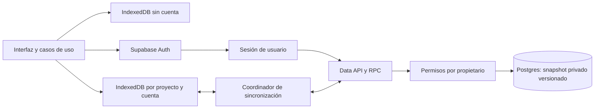
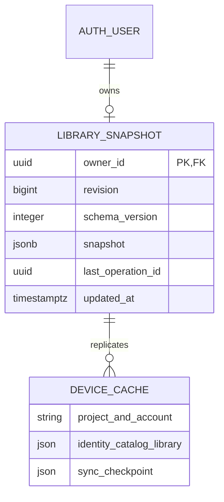
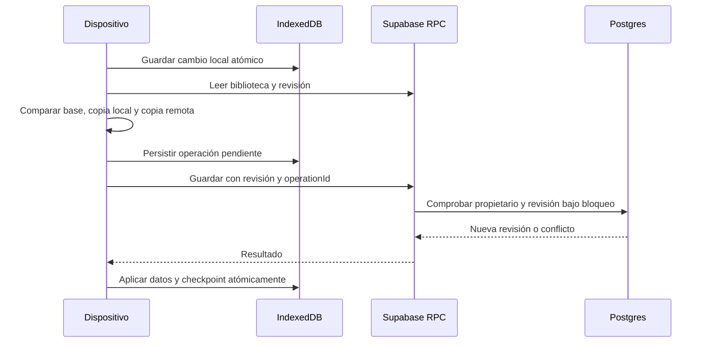

# Cuenta y biblioteca entre dispositivos

Supabase añade una cuenta opcional con correo y contraseña a la biblioteca local. Sin cuenta, Auditorium sigue funcionando con IndexedDB y respaldos JSON. Al iniciar sesión, la aplicación abre una caché distinta para esa cuenta; nunca mezcla automáticamente bibliotecas de usuarios diferentes.

## Uso

1. Abre **Más opciones → Cuenta y dispositivos** y crea tu cuenta.
2. Confirma el correo y entra con correo y contraseña. El enlace de confirmación puede abrir otra pestaña del mismo navegador. Si se abre en otro dispositivo, confirma el correo y después inicia sesión manualmente.
3. Para incorporar una biblioteca anterior, abre **Traer mi biblioteca sin cuenta**. La cuenta debe estar vacía; se copia el original y se conserva la biblioteca sin cuenta.
4. En otro dispositivo, entra con la misma cuenta. La biblioteca se descarga a su propia caché local.
5. Los cambios guardados se envían al terminar de editar. La aplicación consulta cambios remotos al volver a la ventana, recuperar conexión y cada 30 segundos mientras está visible. **Sincronizar ahora** permite solicitar una comprobación inmediata.

Los formularios en edición retrasan la aplicación de cambios remotos. Sin conexión se conserva el trabajo local y se reintenta después; cerrar sesión antes de sincronizar no borra la caché pendiente de esa cuenta. La sesión dura esta pestaña; la biblioteca descargada permanece en el perfil del navegador. La caché no tiene cifrado propio: conviene usar un perfil personal en equipos compartidos.

**Olvidé mi contraseña** envía un enlace. Al abrirlo en el mismo navegador se solicita una contraseña nueva de al menos 12 caracteres. Los tokens de sesión se guardan en `sessionStorage`; sólo el verificador temporal PKCE se comparte mediante `localStorage` para permitir que el enlace se abra en otra pestaña. Las contraseñas nunca entran en IndexedDB, borradores, historial ni respaldos. El service worker no guarda respuestas de Auth o de la base remota.

Los enlaces de acceso son de un solo uso: abre sólo el correo más reciente en el mismo navegador y perfil donde solicitaste la recuperación. Si Auth devuelve un error porque el enlace caducó, ya se utilizó o no es válido, Auditorium limpia los parámetros de autenticación de la URL y abre **Cuenta y dispositivos** con una explicación para solicitar otro enlace. Esto incluye los fallos durante el intercambio PKCE y los retornos sin el verificador del navegador. Una sesión válida y las bibliotecas del dispositivo se conservan; un enlace fallido no cierra otras sesiones.

## Arquitectura

El catálogo, las ediciones, las calificaciones y las adquisiciones mantienen sus conceptos e IDs. La identidad local de la biblioteca se conserva al copiarla entre dispositivos y no se convierte en el ID de Auth. `owner_id`, obtenido de la sesión verificada por el servidor, identifica al propietario remoto. Una cuenta tiene una biblioteca privada; no se crea un catálogo compartido por iniciar sesión.

Esta primera implementación transmite el agregado completo, con un máximo de 20 MiB por documento. Mantiene juntas sus relaciones y evita actualizar parcialmente un álbum o una colección. Las relaciones de dominio se validan en el cliente al leer y antes de escribir; Postgres valida propietario, versión, tamaño y revisión, pero no reproduce todas las restricciones internas del documento. Es una base para bibliotecas personales, con mayor consumo de transferencia que un protocolo incremental. La normalización y la sincronización por registros requerirán una migración posterior.

## Transacciones, reintentos y conflictos

IndexedDB v6 añade sólo `syncCheckpoint`; conserva las trece tablas musicales e identidades de v1–v5. LINK-01 usa DB7/nativa70 y respaldo4 para enlaces personales. UX-05 usa DB8/nativa80 y respaldo5. UX-06 usa DB9/nativa90 y respaldo6 para la referencia opcional de la nota. El servidor admite3/4/5/6, normaliza documentos antiguos en el cliente y actualiza la versión de la fila en la siguiente escritura válida; rechaza downgrade, clasificación declarada en formatos antiguos y referencias de nota anteriores a6 o a ediciones ajenas/inexistentes. Véase [experiencia y compatibilidad](MI_EXPERIENCIA.md#migración-y-compatibilidad). Todos los documentos del checkpoint se migran juntos y se reconocen los envíos anteriores ya confirmados. Véase [clasificación y migración](CLASIFICACION_ALBUM.md#migración-y-compatibilidad). La migración conserva RLS, revisión e idempotencia; [contrato de enlaces](ENLACES_PERSONALES.md). La biblioteca local durable más su checkpoint constituyen la cola de envío: una caída de red no elimina cambios guardados. Antes de enviar se conserva un `operationId`, la revisión esperada y el documento. El acuse remoto y los datos descargados se aplican en una transacción local con comprobación de la lectura previa.

La RPC deriva el propietario de `auth.uid()` y comprueba también el `account_id` de la petición. Así, una petición iniciada antes de cambiar de cuenta no puede escribir en la cuenta siguiente. Postgres serializa las escrituras y exige la revisión esperada. Repetir la última operación devuelve el mismo resultado; una revisión desactualizada produce conflicto en lugar de sobrescribir datos.

Los cambios independientes se combinan por registros completos, sin basarse en el reloj del dispositivo. Una eliminación se conserva si la otra copia no modificó el mismo registro. Dos cambios incompatibles sobre el mismo registro, identidades distintas o una combinación que rompe relaciones requieren intervención. No se resucitan registros omitidos mediante una unión indiscriminada.

Ante un conflicto puedes descargar ambas copias y elegir cuál conservar. Antes de aplicar la elección se guardan las dos originales en el checkpoint local. **Copias de la última resolución de conflicto** permite descargarlas después; se conserva la última resolución de ese dispositivo. La revisión se comprueba de nuevo al guardar, por lo que un tercer dispositivo puede provocar un conflicto nuevo. El respaldo externo sigue siendo necesario: el navegador puede eliminar almacenamiento local y la sincronización no es un historial de versiones.

## Instalación y operación

1. Crea un proyecto gratuito en Supabase. No se requieren servicios de pago ni una clave privilegiada en el navegador.
2. Aplica, en orden, las [migraciones SQL](../supabase/migrations). El cliente tiene lectura de su fila y acceso a una RPC; no tiene escritura directa sobre la tabla. RLS está activada. La función con privilegios se limita a un esquema privado, deriva el usuario del JWT y fija `search_path` vacío; el wrapper público es `SECURITY INVOKER`.
3. En Auth, habilita correo/contraseña y mantén la confirmación de correo. Configura Site URL y Redirect URLs con la URL exacta de la instalación, incluido `/Auditorium/` en Pages. Para desarrollo, añade explícitamente la URL local que vayas a utilizar.
4. Copia `.env.example` a `.env.local` y completa `VITE_SUPABASE_URL` y `VITE_SUPABASE_PUBLISHABLE_KEY`. Son configuración pública. Nunca uses `service_role`, una clave secret o credenciales SMTP como variables `VITE_`.
5. En GitHub Pages configura las variables de repositorio `SUPABASE_URL` y `SUPABASE_PUBLISHABLE_KEY`. El workflow las incorpora exclusivamente a la compilación del sitio. Sin configuración, el uso local continúa disponible.
6. Configura SMTP antes de abrir el registro a otras personas. El correo incluido de Supabase sólo entrega a direcciones del equipo y tiene un límite reducido; no acredita entrega pública. No se desactiva la confirmación para sortearlo.

### Correo transaccional con Brevo

La instalación de Pages utiliza [Brevo Free](https://help.brevo.com/hc/es/articles/208580669-FAQ-Cu%C3%A1les-son-los-l%C3%ADmites-del-plan-Gratis) como SMTP de Supabase Auth. El navegador solicita el registro o la recuperación a Supabase; Supabase envía el mensaje a través de Brevo. Pages no accede a la clave SMTP ni envía el correo directamente.

| Parámetro en Supabase   | Valor                                                                       |
| ----------------------- | --------------------------------------------------------------------------- |
| Nombre del remitente    | Auditorium                                                                  |
| Dirección del remitente | Una dirección verificada en Brevo                                           |
| Host                    | `smtp-relay.brevo.com`                                                      |
| Puerto                  | `587`                                                                       |
| Usuario                 | El identificador SMTP que muestra Brevo; puede diferir del correo de acceso |
| Contraseña              | Una clave SMTP exclusiva para esta instalación, no una clave API            |

Para reproducir la configuración:

1. Crea una cuenta gratuita en Brevo y verifica el remitente. Si dispones de dominio propio, autentícalo siguiendo sus instrucciones. Brevo puede sustituir la dirección de un remitente sin dominio autenticado por una de sus dominios de envío; el nombre visible permanece Auditorium.
2. Genera una clave SMTP exclusiva y cópiala directamente en **Supabase → Authentication → Emails → SMTP Settings**. Completa los parámetros de la tabla, habilita SMTP y guarda. No copies la clave a archivos del proyecto, variables `VITE_`, GitHub ni documentación.
3. Conserva la confirmación de correo y las URLs exactas de Pages. Comprueba registro, confirmación y recuperación desde la aplicación, abriendo los enlaces en el mismo navegador para completar el intercambio PKCE.
4. Revisa los eventos **Enviado** y **Entregado** en Brevo. La respuesta genérica de recuperación de Auditorium no demuestra por sí sola que se haya enviado un mensaje: evita revelar si existe una cuenta. Una entrega al servidor de correo tampoco acredita que el mensaje llegue a la bandeja principal.
5. Si un enlace falla, comprueba la URL de retorno y las opciones de seguimiento o reescritura de enlaces del proveedor. Anonimizar las estadísticas de clics no equivale a desactivar esa reescritura. Revisa también la vigencia de la clave SMTP y las cuotas antes de repetir solicitudes.

El plan gratuito de Brevo permite hasta 300 envíos diarios según sus condiciones consultadas el 19 de octubre de 2026. Supabase aplica además su propio límite de correo: al habilitar SMTP personalizado establece inicialmente 30 mensajes por hora, configurable en Auth. Ambos límites se aplican al mismo flujo; no se ha contratado un plan de pago. Consulta las condiciones actuales antes de modificar las cuotas. La [guía de Brevo SMTP](https://help.brevo.com/hc/en-us/articles/7924908994450-Send-transactional-emails-using-Brevo-SMTP), la [gestión de claves](https://help.brevo.com/hc/en-us/articles/7959631848850-Create-and-manage-your-SMTP-keys) y la [guía SMTP de Supabase](https://supabase.com/docs/guides/auth/auth-smtp) detallan los requisitos.

## Validación

Las pruebas del [protocolo](../src/application/library-sync.test.ts) ejercitan dos cachés, cambios independientes, bajas, conflictos, reintentos tras perder un acuse, edición durante el envío y control de concurrencia local. Las [pruebas de navegador](../e2e/cloud.spec.ts) utilizan el SDK real con un servicio ficticio controlado para verificar el recorrido sin enviar correos ni usar bibliotecas reales.

La [prueba SQL](../supabase/tests/library_sync.sql) comprueba en Postgres aislamiento entre dos cuentas ficticias, denegación anónima y de escritura directa, revisión, reintentos y vinculación de la cuenta. Ejecuta todo dentro de una transacción que revierte las cuentas y documentos. Los advisors de Supabase complementan esta validación. Las pruebas controladas no prueban la entrega de un proveedor SMTP ni el acceso desde dispositivos físicos.

Referencias: [Auth con contraseña](https://supabase.com/docs/guides/auth/passwords), [RLS](https://supabase.com/docs/guides/database/postgres/row-level-security), [correo SMTP](https://supabase.com/docs/guides/auth/auth-smtp), [decisión ADR-011](adr/011-supabase-sincronizacion.md).
