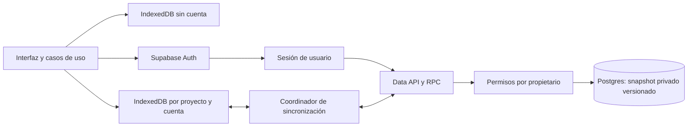
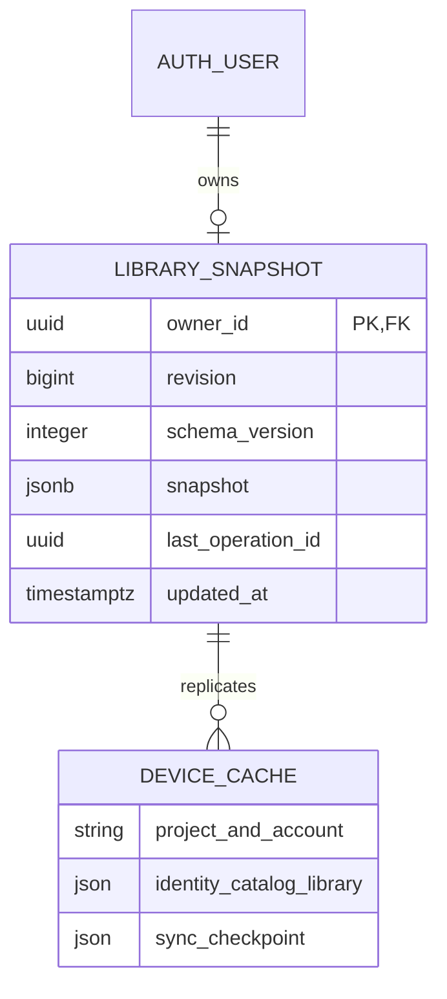
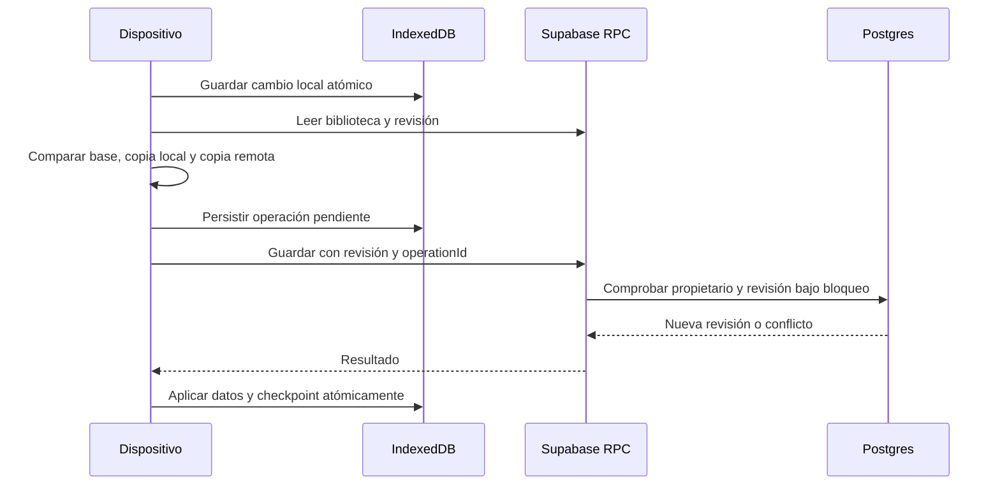

# Cuenta y biblioteca entre dispositivos

Supabase añade una cuenta opcional con correo y contraseña a la biblioteca local. Sin cuenta, Auditorium sigue funcionando con IndexedDB y respaldos JSON. Al iniciar sesión, la aplicación abre una caché distinta para esa cuenta; nunca mezcla automáticamente bibliotecas de usuarios diferentes.

## Uso

1. Abre **Más opciones → Cuenta y dispositivos** y crea tu cuenta.
2. Confirma el correo y entra con correo y contraseña. El enlace de confirmación puede abrir otra pestaña del mismo navegador. Si se abre en otro dispositivo, confirma el correo y después inicia sesión manualmente.
3. Para incorporar una biblioteca anterior, abre **Traer mi biblioteca sin cuenta**. La cuenta debe estar vacía; se copia el original y se conserva la biblioteca sin cuenta.
4. En otro dispositivo, entra con la misma cuenta. La biblioteca se descarga a su propia caché local.
5. Los cambios guardados se envían al terminar de editar. La aplicación consulta cambios remotos al volver a la ventana, recuperar conexión y cada 30 segundos mientras está visible. **Sincronizar ahora** permite solicitar una comprobación inmediata.

Los formularios en edición retrasan la aplicación de cambios remotos. Sin conexión se conserva el trabajo local y se reintenta después; cerrar sesión antes de sincronizar no borra la caché pendiente de esa cuenta. La sesión dura esta pestaña; la biblioteca descargada permanece en el perfil del navegador. La caché no tiene cifrado propio: conviene usar un perfil personal en equipos compartidos.

**Olvidé mi contraseña** envía un enlace. Al abrirlo en el mismo navegador se solicita una contraseña nueva de al menos 12 caracteres. Los tokens de sesión se guardan en `sessionStorage`; sólo el verificador temporal PKCE se comparte mediante `localStorage` para permitir que el enlace se abra en otra pestaña. Las contraseñas nunca entran en IndexedDB, borradores, historial ni respaldos. El service worker no guarda respuestas de Auth o de la base remota.

## Arquitectura

El catálogo, las ediciones, las calificaciones y las adquisiciones mantienen sus conceptos e IDs. La identidad local de la biblioteca se conserva al copiarla entre dispositivos y no se convierte en el ID de Auth. `owner_id`, obtenido de la sesión verificada por el servidor, identifica al propietario remoto. Una cuenta tiene una biblioteca privada; no se crea un catálogo compartido por iniciar sesión.

Esta primera implementación transmite el agregado completo, con un máximo de 20 MiB por documento. Mantiene juntas sus relaciones y evita actualizar parcialmente un álbum o una colección. Las relaciones de dominio se validan en el cliente al leer y antes de escribir; Postgres valida propietario, versión, tamaño y revisión, pero no reproduce todas las restricciones internas del documento. Es una base para bibliotecas personales, con mayor consumo de transferencia que un protocolo incremental. La normalización y la sincronización por registros requerirán una migración posterior.

## Transacciones, reintentos y conflictos

IndexedDB v6 añade sólo `syncCheckpoint`; conserva las trece tablas musicales e identidades de v1–v5. El formato de respaldo sigue en versión 3. La biblioteca local durable más su checkpoint constituyen la cola de envío: una caída de red no elimina cambios guardados. Antes de enviar se conserva un `operationId`, la revisión esperada y el documento. El acuse remoto y los datos descargados se aplican en una transacción local con comprobación de la lectura previa.

La RPC deriva el propietario de `auth.uid()` y comprueba también el `account_id` de la petición. Así, una petición iniciada antes de cambiar de cuenta no puede escribir en la cuenta siguiente. Postgres serializa las escrituras y exige la revisión esperada. Repetir la última operación devuelve el mismo resultado; una revisión desactualizada produce conflicto en lugar de sobrescribir datos.

Los cambios independientes se combinan por registros completos, sin basarse en el reloj del dispositivo. Una eliminación se conserva si la otra copia no modificó el mismo registro. Dos cambios incompatibles sobre el mismo registro, identidades distintas o una combinación que rompe relaciones requieren intervención. No se resucitan registros omitidos mediante una unión indiscriminada.

Ante un conflicto puedes descargar ambas copias y elegir cuál conservar. Antes de aplicar la elección se guardan las dos originales en el checkpoint local. **Copias de la última resolución de conflicto** permite descargarlas después; se conserva la última resolución de ese dispositivo. La revisión se comprueba de nuevo al guardar, por lo que un tercer dispositivo puede provocar un conflicto nuevo. El respaldo externo sigue siendo necesario: el navegador puede eliminar almacenamiento local y la sincronización no es un historial de versiones.

## Instalación y operación

1. Crea un proyecto gratuito en Supabase. No se requieren servicios de pago ni una clave privilegiada en el navegador.
2. Aplica, en orden, las [migraciones SQL](../supabase/migrations). El cliente tiene lectura de su fila y acceso a una RPC; no tiene escritura directa sobre la tabla. RLS está activada. La función con privilegios se limita a un esquema privado, deriva el usuario del JWT y fija `search_path` vacío; el wrapper público es `SECURITY INVOKER`.
3. En Auth, habilita correo/contraseña y mantén la confirmación de correo. Configura Site URL y Redirect URLs con la URL exacta de la instalación, incluido `/Auditorium/` en Pages. Para desarrollo, añade explícitamente la URL local que vayas a utilizar.
4. Copia `.env.example` a `.env.local` y completa `VITE_SUPABASE_URL` y `VITE_SUPABASE_PUBLISHABLE_KEY`. Son configuración pública. Nunca uses `service_role`, una clave secret o credenciales SMTP como variables `VITE_`.
5. En GitHub Pages configura las variables de repositorio `SUPABASE_URL` y `SUPABASE_PUBLISHABLE_KEY`. El workflow las incorpora exclusivamente a la compilación del sitio. Sin configuración, el uso local continúa disponible.
6. Configura SMTP antes de abrir el registro a otras personas. El correo incluido de Supabase sólo entrega a direcciones del equipo y tiene un límite reducido; no acredita entrega pública. No se desactiva la confirmación para sortearlo.

La apertura pública por correo queda pendiente de SMTP. Una opción para evaluar es [Brevo Free](https://help.brevo.com/hc/es/articles/208580669-FAQ-Cu%C3%A1les-son-los-l%C3%ADmites-del-plan-Gratis), con hasta 300 envíos diarios según sus condiciones consultadas el 18 de octubre de 2026. Requiere crear y validar la cuenta/remitente y comprobar los requisitos de entrega. Sus credenciales se introducen directamente en Supabase, fuera del repositorio y de Pages. No se ha contratado ni conectado ese servicio.

## Validación

Las pruebas del [protocolo](../src/application/library-sync.test.ts) ejercitan dos cachés, cambios independientes, bajas, conflictos, reintentos tras perder un acuse, edición durante el envío y control de concurrencia local. Las [pruebas de navegador](../e2e/cloud.spec.ts) utilizan el SDK real con un servicio ficticio controlado para verificar el recorrido sin enviar correos ni usar bibliotecas reales.

La [prueba SQL](../supabase/tests/library_sync.sql) comprueba en Postgres aislamiento entre dos cuentas ficticias, denegación anónima y de escritura directa, revisión, reintentos y vinculación de la cuenta. Ejecuta todo dentro de una transacción que revierte las cuentas y documentos. Los advisors de Supabase complementan esta validación. Las pruebas controladas no prueban la entrega de un proveedor SMTP ni el acceso desde dispositivos físicos.

Referencias: [Auth con contraseña](https://supabase.com/docs/guides/auth/passwords), [RLS](https://supabase.com/docs/guides/database/postgres/row-level-security), [correo SMTP](https://supabase.com/docs/guides/auth/auth-smtp), [decisión ADR-011](adr/011-supabase-sincronizacion.md).
