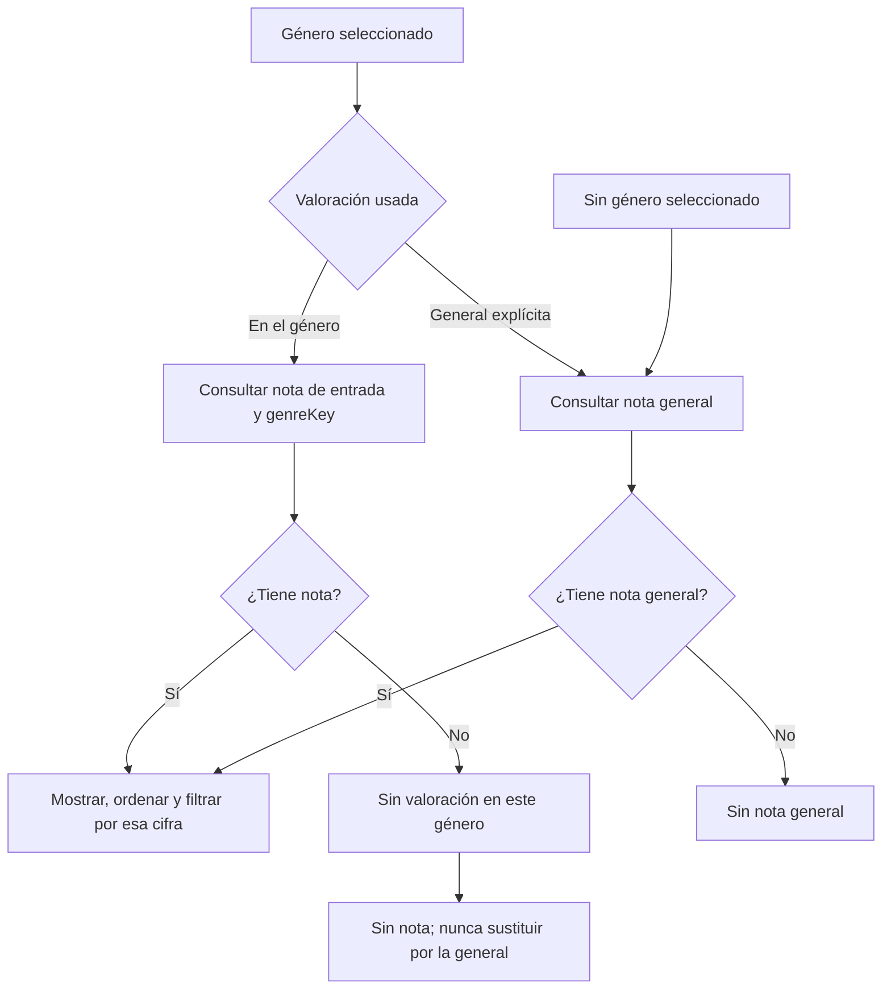
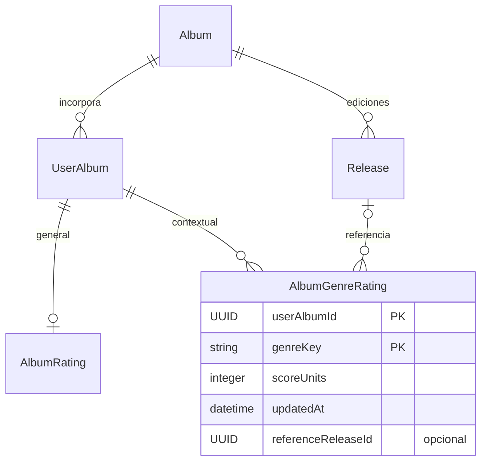
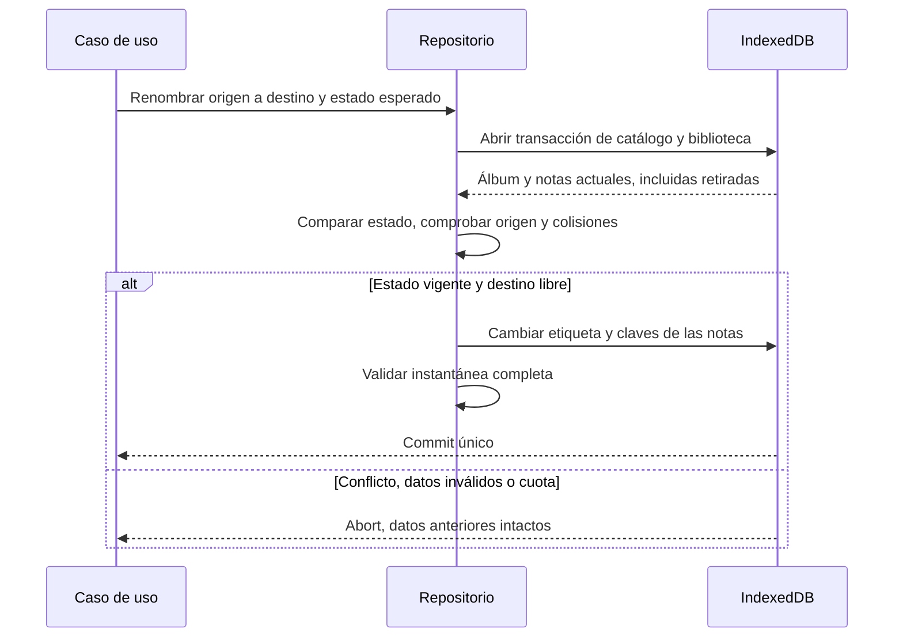
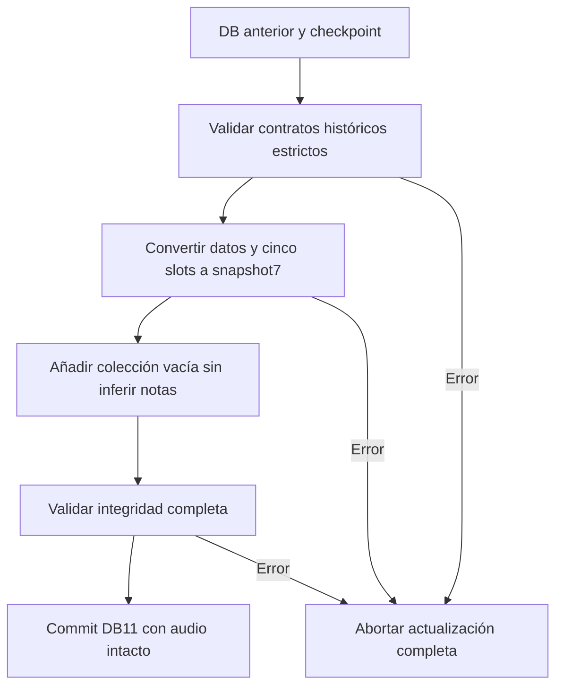

# Valoraciones personales por género

RATE-01 #80 y RATE-02 #81 · 26 de octubre de 2026. Modelo, operaciones, compatibilidad e interfaz de notas por género y comparación contextual. La nota general de **Mi experiencia** continúa siendo independiente y opcional.

## Valorar y comparar en la aplicación

En la ficha, **Calificar álbum**, **Recalificar álbum** o **Editar experiencia** abren el mismo editor. La nota general permanece visible. Despliega **Valorar por género (opcional)** para introducir notas en los géneros asignados al álbum. Cada campo admite coma o punto, de 1 a 10 en pasos de 0,5; vacío significa sin valoración en ese género. Puedes indicar una edición de referencia propia para cada nota, elegida entre las ediciones conocidas del álbum, aunque no las hayas adquirido.

**Guardar experiencia** confirma escucha, comentario, general y géneros en una sola transacción. Quitar la general deja intactas las notas por género; quitar una nota contextual no cambia las demás. Cancelar o navegar con cambios permite guardar, descartar o seguir editando. Un conflicto conserva el borrador: **Cargar datos guardados** lo reemplaza explícitamente. Si el guardado terminó y falla la lectura de la ficha, el reintento hace sólo esa lectura. Las notas guardadas sobreviven a recarga y se sincronizan mediante el contrato existente.

En **Biblioteca**, elegir **Género** selecciona automáticamente su nota contextual. **Valoración usada** permite elegir **General** de forma explícita. **Mayor nota**, **8 o más** y **Con/Sin nota** usan exactamente la misma base que las tarjetas. Sin contexto de género se muestra General; sin nota contextual se muestra **Sin valoración en este género**, incluso si existe una general. Cambiar de género vuelve a su base contextual y quitar el filtro vuelve a General. País, escucha y búsqueda siguen combinándose. Los valores de consulta se conservan al volver desde una ficha; son temporales y no se promete conservarlos al recargar.

**Calificaciones** tiene su propio selector **Género a valorar**, base visible y modos **Por calificar/Calificados**. Abrir un álbum desde una comparación contextual despliega los campos por género y enfoca la nota elegida. La ficha mantiene visible la general, indica el contexto de comparación y permite consultar todas las notas y sus referencias sin promediarlas.

Para corregir una etiqueta valorada, abre **Datos del álbum → Renombrar un género conservando sus valoraciones**. Elige origen y nombre nuevo y confirma. Si el destino ya está asignado o cambió el origen, la operación no combina ni elimina notas; puedes revisar o cargar los datos guardados. Esta operación conserva también las valoraciones de entradas retiradas. La edición ordinaria de metadatos sigue bloqueando quitar una etiqueta con notas.

Las recomendaciones explican el carácter comparativo de la escala. Continúan enviando únicamente el contexto autorizado de notas generales; no añaden etiquetas ni notas por género al proveedor. Se conservan consentimiento, clave de sesión y controles anteriores.

## Significado y separación

Guardar un álbum expresa que tiene valor para su propietario. Una nota mínima describe su experiencia comparada con otros álbumes de su biblioteca; no equivale a rechazo. Un álbum puede recibir 9 como Death Metal y 3 como Power Metal, además de una nota general distinta o ninguna.

Las notas general, por género y por pista son independientes, opcionales y explícitas. Todas usan 1–10 en pasos de 0,5, almacenados como `scoreUnits` enteros 2–20. La ausencia es ausencia: no se calcula una media, no se copia una nota y no se usa la general como sustituto de un género sin valorar. Valorar tampoco marca una escucha ni una adquisición.

El álbum conserva una sola identidad conceptual. Cada nota por género puede indicar una edición conocida del mismo álbum como referencia, aunque no se posea. Esa referencia pertenece a esa nota: no se hereda de la general, no crea otra entrada y no depende del inventario.

Las relaciones se validan en el dominio; IndexedDB no declara claves foráneas. La combinación `(userAlbumId, genreKey)` identifica una nota y no admite duplicados.

## Identidad de género y cambios de catálogo

`Album.genres` sigue siendo una lista de etiquetas libres. No hay una taxonomía global obligatoria. `genreKey()` aplica NFD, elimina marcas Unicode, pasa a minúsculas españolas, quita espacios exteriores y reduce los espacios consecutivos a uno. Así, `MÉTAL  Progresivo` y `Metal Progresivo` comparten `metal progresivo`; no se transliteran `ß` ni `æ`. La clave debe tener entre 1 y 80 unidades UTF-16.

Cambiar sólo mayúsculas, acentos o espacios manteniendo la clave conserva las notas. Quitar o sustituir una etiqueta con notas se bloquea en la edición ordinaria, incluso si las notas pertenecen a una entrada retirada. Nunca se borran implícitamente para guardar metadatos.

Un renombrado real usa `renameAlbumGenre` y su estado esperado: metadatos completos del álbum y todas las notas de la clave de origen. Cambia catálogo y notas en una única transacción. Rechaza un destino ya asignado, sin fusionar puntuaciones; mueve también las notas de entradas retiradas. Conserva puntuación, referencia y fecha, porque renombrar no es reevaluar. Las etiquetas históricas equivalentes pueden coexistir; el renombrado explícito reúne los alias del origen bajo una etiqueta. La migración no reescribe etiquetas.

## Operaciones y concurrencia

`rateAlbumGenre` y `removeAlbumGenreRating` requieren el registro completo esperado. Al crear, `expected: null` exige que no exista; al modificar o retirar, la fila debe coincidir, incluida referencia y fecha. Una nota ajena o un formulario desactualizado no sobrescribe cambios. Una actualización sin cambios conserva la fecha.

La referencia omitida conserva la referencia de esa misma nota; `null` la quita explícitamente. Se rechazan géneros no asignados, ediciones de otro álbum y notas anteriores al alta de la entrada. Las entradas retiradas conservan las notas y bloquean su edición personal hasta restaurarse. Quitar la general no quita las notas por género. Quitar una edición referenciada exige resolver antes todos sus vínculos de notas.

## Persistencia y compatibilidad

| Contrato       | Versión y cambio                                                                                                    |
| -------------- | ------------------------------------------------------------------------------------------------------------------- |
| IndexedDB      | DB11 / nativa110; añade `albumGenreRatings` con clave `[userAlbumId+genreKey]` e índices `userAlbumId` y `genreKey` |
| Tablas locales | 17: metadata, 7 de catálogo, 6 de biblioteca, checkpoint y 2 de audio                                               |
| JSON musical   | Formato7; `library.albumGenreRatings` obligatorio aunque sea `[]`; importa estrictamente 1–6                        |
| Sincronización | Snapshot7; servidor acepta 3–7, rechaza campos nuevos en formatos antiguos y retrocesos de versión                  |
| ZIP completo   | Manifiesto1 sin cambios; `library.json` nuevo en formato7; admite JSON6 histórico y conserva bytes de audio         |

Las bibliotecas anteriores comienzan con `albumGenreRatings: []`: no se inventan notas, fechas, referencias ni identidades. DB11 convierte tanto los datos locales como los cinco documentos posibles del checkpoint: `base`, `pending.snapshot`, `pending.localSnapshot`, `recovery.local` y `recovery.remote`. Se valida la forma histórica antes de convertir. Un documento inválido aborta toda la actualización, conservando versión, filas y audio.

El ZIP valida primero el SHA-256 del `library.json` original y después migra su contenido; no recalcula ni altera archivos de audio. JSON, RPC y checkpoints siguen excluyendo adjuntos y descriptores locales. La combinación remota trata cada nota por su clave compuesta y mantiene los conflictos entre cambios incompatibles.

La RPC conserva titularidad, RLS, revisión esperada, idempotencia y límite de 20 MiB. Comprueba estructura, puntuación, fechas, género asignado, referencia y unicidad de las nuevas notas. El normalizador SQL vive en el esquema privado, sin ejecución directa para `anon` o `authenticated`; sus casos de paridad Unicode se verifican junto al control de permisos. No se añaden tablas remotas, buckets ni servicios de pago.

## Verificación y referencias

Las pruebas cubren independencia de notas, CAS, referencia propia, retiradas, renombrado atómico y rollback por cuota; migraciones de base y checkpoints; JSON, ZIP y sincronización; y restauración en navegador con protección de etiquetas referenciadas. El SQL de regresión usa cuentas ficticias dentro de `BEGIN`/`ROLLBACK`.

Fuentes del contrato: [esquema de biblioteca](../src/domain/library/schemas.ts), [integridad](../src/domain/library/integrity.ts), [operaciones](../src/application/album-genre-ratings.ts), [casos de uso](../src/application/music-library.ts), [migración local](../src/infrastructure/db/migrate-genre-ratings.ts), [respaldo](../src/domain/backup.ts) y [regresión SQL](../supabase/tests/library_sync.sql). La decisión se registra en [ADR-013](adr/013-valoraciones-por-genero.md).
