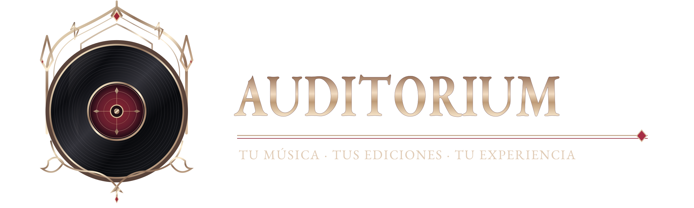

# Diseño e identidad

## El vinilo como centro visual

Pensé la identidad de Auditorium desde el gusto por los álbumes como obras completas. El vinilo funciona como símbolo reconocible y como punto de encuentro entre catálogo y colección. Busqué una estética oscura, con elementos góticos y metaleros, pero sin hacer que leer, buscar o llenar formularios resulte difícil.

## La estética al servicio de la biblioteca

- **Oscuro y pergamino:** dos temas disponibles, con variantes de palabra de marca.
- **Ambientación opcional:** fondos y presencia visual que pueden desactivarse para priorizar legibilidad.
- **Portadas como protagonistas:** acompañan el reconocimiento del álbum, sin reemplazar los títulos o controles.
- **Diseño adaptable:** navegación y formularios para pantallas pequeñas, controles de teclado y foco visible.

Los recursos maestros están en [`branding/`](../../branding/README.md); las versiones optimizadas que carga la interfaz están en `public/auditorium/`. Los banners del README son presentación del proyecto y no se fuerzan íntegros al caché offline.

## Criterios al diseñar o modificar

Al cambiar una pantalla, mantengo visibles los estados de carga, error y guardado. También cuido el regreso a una búsqueda, la distinción de acciones destructivas y el uso moderado de animaciones.

[Volver a General](../README.md) · [Arquitectura](../tecnica/01-arquitectura.md)
