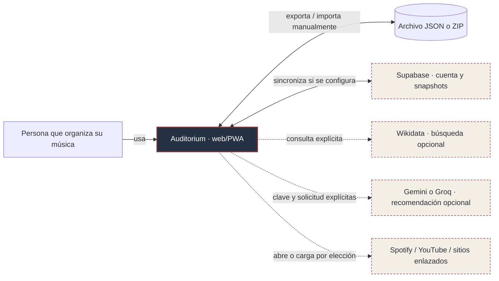
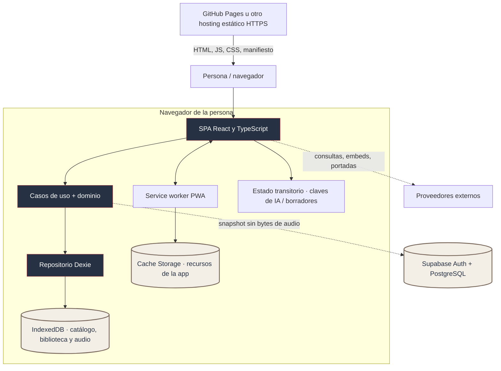
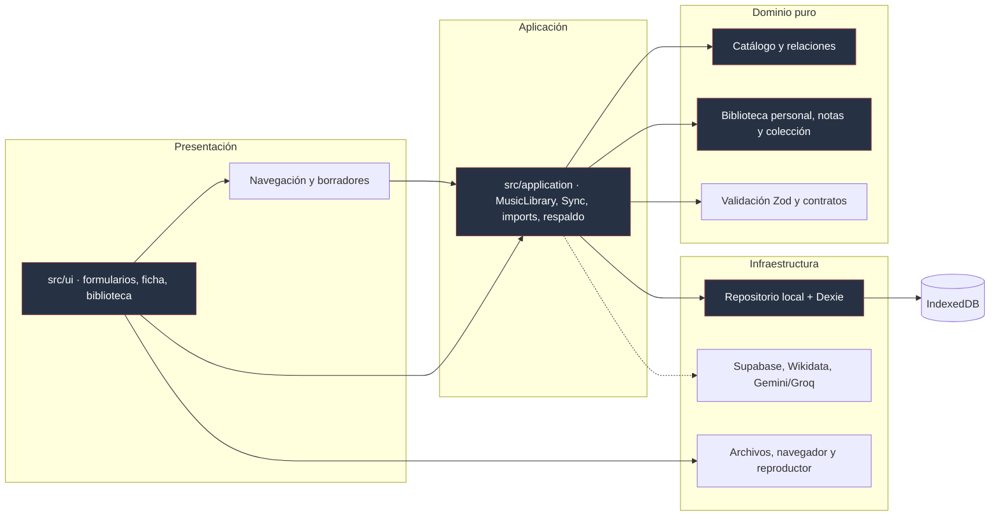
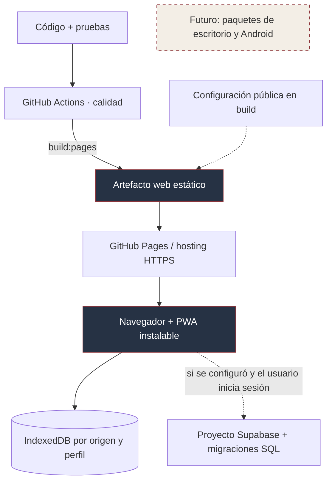

# Arquitectura de Auditorium

**Referencias de implementación:** `src/main.tsx`, `src/app/App.tsx`, `src/application/`, `src/domain/`, `src/infrastructure/`, `src/ui/`, `vite.config.ts` y `supabase/migrations/`.

Auditorium se distribuye como sitio estático. Los casos de uso y la mayoría de los datos viven en el navegador; la cuenta remota es **opcional**.

## Nivel 1 — Contexto del sistema

**Frontera importante:** el sitio estático no almacena la colección por defecto. Supabase puede recibir un snapshot de metadatos al iniciar sesión y sincronizar, pero el audio no sale en ese snapshot. Las peticiones a proveedores musicales no son equivalentes a importar ni a copiar catálogos automáticamente.

## Nivel 2 — Contenedores de ejecución

Los diagramas muestran **responsabilidades lógicas**, no procesos independientes dentro de un mismo navegador. La PWA permite utilizar recursos precargados sin conexión; las APIs remotas, portadas por URL y servicios de streaming siguen necesitando red.

## Nivel 3 — Componentes y dependencias

Las respuestas de servicios externos se revisan antes de incorporarlas al catálogo. Las ediciones, restauraciones y sincronizaciones pasan por validaciones de identidad, integridad y concurrencia.

| Responsabilidad            | Código de referencia                                                                                                                                                       |
| -------------------------- | -------------------------------------------------------------------------------------------------------------------------------------------------------------------------- |
| Orquestación y operaciones | [`src/application/`](../../src/application/)                                                                                                                               |
| Entidades y reglas         | [`src/domain/`](../../src/domain/)                                                                                                                                         |
| Persistencia local         | [`src/infrastructure/db/database.ts`](../../src/infrastructure/db/database.ts), [`indexeddb-repository.ts`](../../src/infrastructure/repositories/indexeddb-repository.ts) |
| Audio y archivos           | [`src/domain/audio.ts`](../../src/domain/audio.ts), [`src/infrastructure/db/audio-store.ts`](../../src/infrastructure/db/audio-store.ts)                                   |
| Cuenta y sincronización    | [`src/application/library-sync.ts`](../../src/application/library-sync.ts), [`src/infrastructure/supabase/client.ts`](../../src/infrastructure/supabase/client.ts)         |
| Interfaz                   | [`src/ui/`](../../src/ui/)                                                                                                                                                 |

## Nivel 4 — Despliegue actual y destinos futuros

**Consecuencia:** el mismo usuario que entra desde otro dominio, subdominio o perfil no ve automáticamente su IndexedDB anterior. Una actualización de código tampoco garantiza que un almacenamiento migrado pueda abrirse con una versión más antigua.

[Índice](../README.md) · [Datos](03-datos-y-persistencia.md) · [Flujos](04-flujos-y-estados.md)
