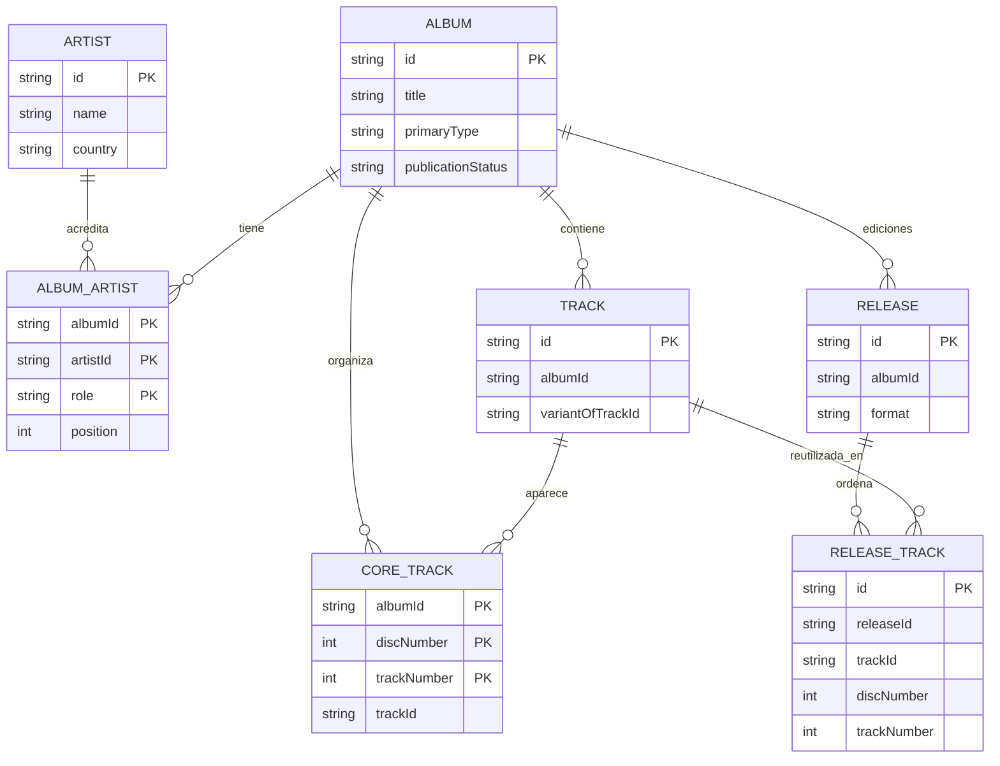
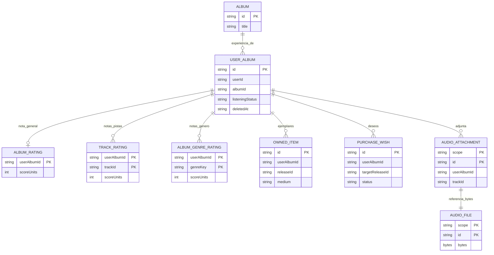

# Modelo de dominio

**Fuentes:** `src/domain/catalog/schemas.ts`, `src/domain/library/schemas.ts`, `src/domain/library/owned-items.ts`, `src/domain/library/purchase-wishes.ts`, `src/domain/library/library.ts` y validadores `integrity.ts`.

## Entidades

- **Album:** obra o identidad musical en el catálogo. Tiene título, tipo, categorías, año y metadatos opcionales.
- **Artist / AlbumArtist:** artista reutilizable y relación acreditada con rol/orden. No son una sola cadena incrustada en el álbum.
- **Track:** identidad de una pista asociada a un álbum. Una variante puede referir a otra pista con `variantOfTrackId`.
- **CoreTrack:** posición de la pista en la lista principal del álbum.
- **Release / ReleaseTrack:** edición y aparición ordenada de una pista en esa edición. La misma pista puede aparecer en varias ediciones; la aparición puede tener título y duración propios.
- **UserAlbum:** entrada personal que une la identidad local con un álbum; contiene estado, notas y enlaces, y puede marcarse como retirada.
- **OwnedItem:** ejemplar adquirido (físico o compra digital), asociado a `UserAlbum`, opcionalmente a una edición.
- **PurchaseWish:** intención de compra por formato o edición, también asociada a `UserAlbum`.
- **Ratings:** calificaciones general, por pista y por género independientes entre sí.
- **AudioAttachment / AudioFileRecord:** referencia y bytes de audio guardados localmente, con alcance (`scope`) vinculado a la identidad local.

## Relaciones de catálogo (modelo lógico)

**Precisión:** `ReleaseTrack` es la unión entre edición y pista, no un objeto `Track` propio de cada edición. `AlbumArtist` y `CoreTrack` también son entidades de relación. Estas cardinalidades son **del dominio**; IndexedDB no tiene claves foráneas SQL.

## Relaciones de experiencia y colección

El diagrama omite algunas referencias al catálogo: `TrackRating.trackId` identifica la pista valorada; `OwnedItem.releaseId` y `AudioAttachment.trackId` son opcionales. Un ejemplar puede registrarse sin edición específica y un archivo de audio puede asociarse al álbum completo.

## Invariantes del núcleo

| Regla                                                      | Consecuencia                                                                              |
| ---------------------------------------------------------- | ----------------------------------------------------------------------------------------- |
| Una sola entrada activa por usuario y álbum                | Una entrada retirada puede coexistir con otra activa; restaurarla puede generar conflicto |
| Valoraciones de 1 a 10 con pasos de 0,5                    | Persisten en `scoreUnits` entero entre 2 y 20                                             |
| Sin nota es ausencia de registro                           | No se inventa cero ni un promedio de pistas                                               |
| Nota general y notas por género independientes             | Modificar una valoración conserva las demás                                               |
| Pista valorada debe pertenecer al álbum correcto           | Las variantes y apariciones no se confunden                                               |
| Ejemplar físico o digital respeta formato/medio            | Los campos de conservación física no aplican a compra digital                             |
| Cumplimiento de un deseo requiere ejemplar correspondiente | No basta cambiar una etiqueta de estado                                                   |
| Retirar entrada personal no borra el catálogo              | Sus relaciones pueden conservarse para restauración                                       |
| Cambios y sincronización verifican versión/estado esperado | Un conflicto no debe sobrescribir silenciosamente datos                                   |

### Un ejemplo pequeño

Un álbum tiene una pista principal. La edición en vinilo puede contenerla como una aparición, y otra edición digital puede incluirla en otra posición. **La nota de esa pista** pertenece a mi entrada personal del álbum; **el ejemplar de vinilo** es otra entidad, asociada a esa entrada y posiblemente a la edición concreta. Puedo escuchar el álbum sin poseerlo y poseerlo sin haberlo valorado.

[Persistencia física](03-datos-y-persistencia.md) · [Estados](04-flujos-y-estados.md)
