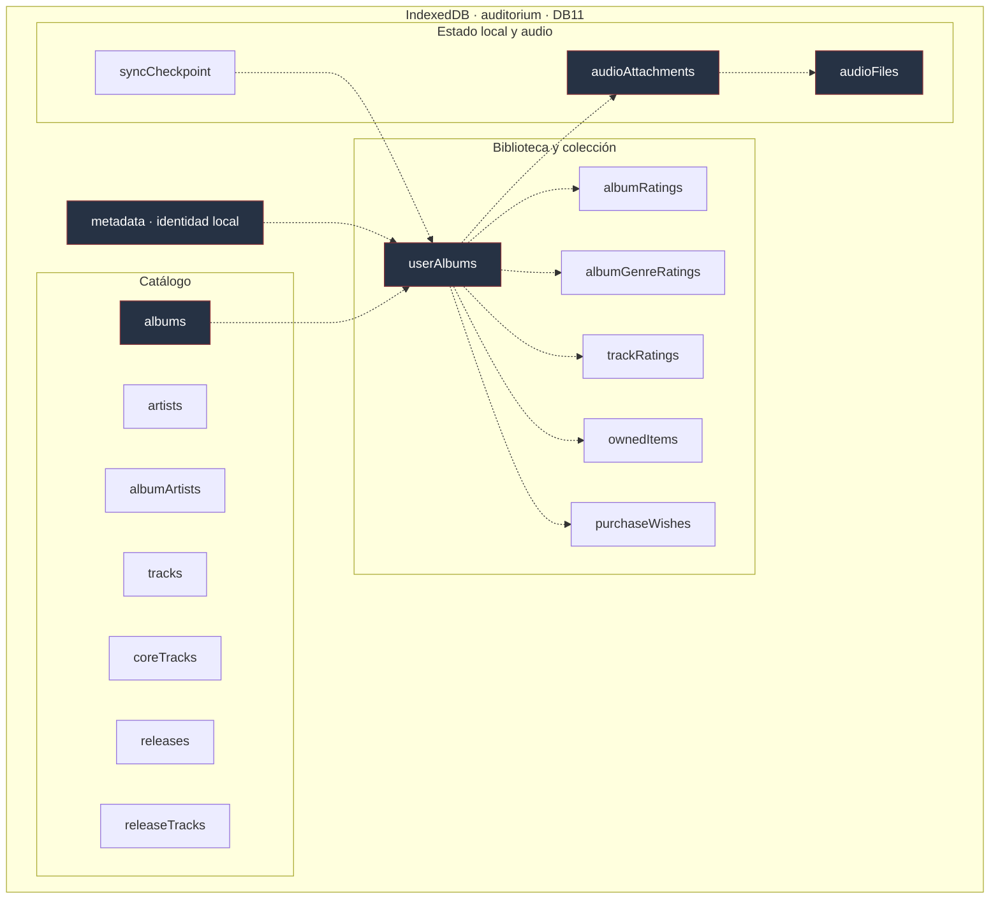
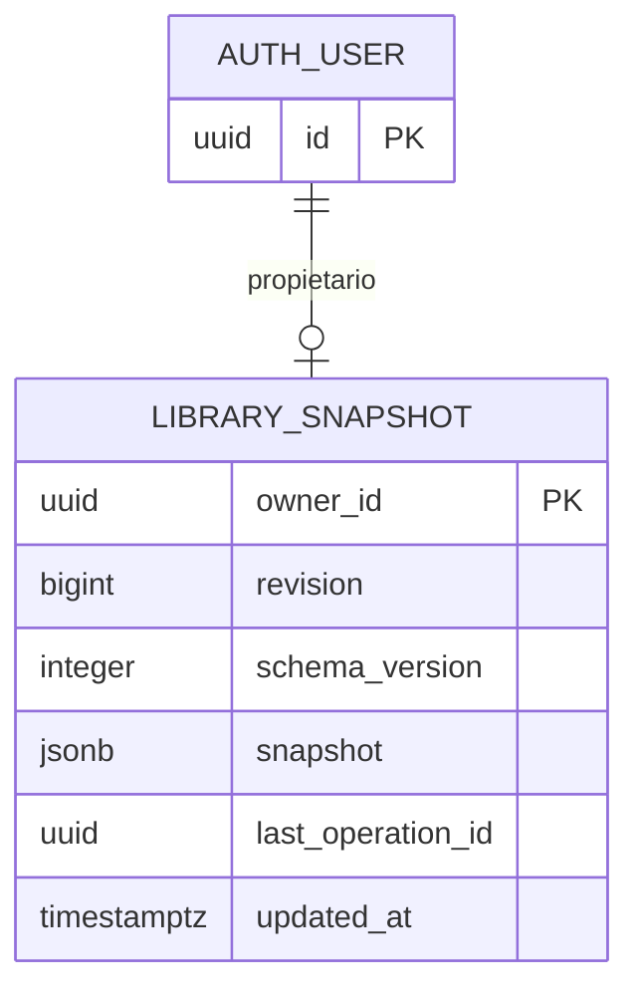

# Datos y persistencia

**Fuente de verdad:** `src/infrastructure/db/database.ts` declara los stores e índices; `src/domain/backup.ts` declara el snapshot; `src/domain/audio.ts` y las migraciones SQL delimitan audio y remoto.

## Una base de datos en el navegador

La base local se llama `auditorium`, se gestiona con Dexie e IndexedDB y tiene **versión Dexie 11** (`SCHEMA_V11`). El navegador utiliza el origen web y su perfil como frontera de almacenamiento: es distinto de una base PostgreSQL remota.

### Diagrama físico simplificado de IndexedDB

Las flechas punteadas expresan **dependencias lógicas**, no claves foráneas administradas por IndexedDB. El esquema completo se lee en el archivo de código, donde están los índices y las restricciones de unicidad.

### Claves e índices que importan

| Store                            | Clave / índice relevante                            | Finalidad                              |
| -------------------------------- | --------------------------------------------------- | -------------------------------------- |
| `artists`                        | `id`, búsqueda por `name`                           | Reutilizar identidades de artistas     |
| `albums`                         | `id`, índices por título, tipo y año                | Identidad de obra y exploración        |
| `albumArtists`                   | `[albumId+artistId+role]`, posición única por álbum | Créditos múltiples ordenados           |
| `tracks`                         | `id`, `albumId`                                     | Pistas independientes de apariciones   |
| `coreTracks`                     | `[albumId+discNumber+trackNumber]`                  | Lista principal del álbum              |
| `releases`                       | `id`, `albumId`, `format`                           | Ediciones del álbum                    |
| `releaseTracks`                  | `id`, posición única por edición                    | Lista concreta de edición              |
| `userAlbums`                     | `id`, `activeAlbumKey` único                        | Entrada personal activa/retirada       |
| `albumRatings`                   | `userAlbumId`                                       | Una nota general por entrada           |
| `albumGenreRatings`              | `[userAlbumId+genreKey]`                            | Una nota por género y entrada          |
| `trackRatings`                   | `[userAlbumId+trackId]`                             | Una nota por pista y entrada           |
| `ownedItems`, `purchaseWishes`   | `id`, `userAlbumId`                                 | Ejemplares y deseos                    |
| `metadata`, `syncCheckpoint`     | `key`                                               | Identidad y checkpoint remoto          |
| `audioAttachments`, `audioFiles` | `[scope+id]`                                        | Descriptor y bytes por identidad local |

## Tres formatos con finalidades diferentes

| Contrato                   | Versión en código   | Incluye                                                           | Excluye                                    |
| -------------------------- | ------------------- | ----------------------------------------------------------------- | ------------------------------------------ |
| Base local IndexedDB       | DB11                | Metadatos, biblioteca, checkpoints, descriptores y bytes de audio | No es un archivo transportable por sí sola |
| Respaldo/snapshot          | `schemaVersion = 7` | Identidad, catálogo y biblioteca                                  | Bytes y descriptores de audio; caché PWA   |
| Respaldo completo de audio | ZIP1                | Snapshot y archivos con manifiesto e integridad                   | No crea una cuenta remota                  |

Cada contrato tiene su propia versión: IndexedDB (`11`), snapshot (`7`), ZIP (`1`) y aplicación (`1.1.0`). Los validadores mantienen lectores de versiones anteriores y migraciones específicas.

## PostgreSQL opcional en Supabase

El dato remoto está modelado como **un documento JSONB por cuenta**, en `public.library_snapshots`, no como las 17 tablas locales replicadas en SQL. La tabla utiliza `owner_id`, RLS y funciones RPC con control de revisión para evitar sobrescrituras concurrentes. El código admite versiones históricas y crea el formato vigente `schema_version = 7` al guardar. **No almacena audio propio**.

La base local conserva las transacciones de la experiencia en este dispositivo. Un checkpoint permite razonar sobre qué snapshot fue confirmado remotamente; las operaciones de red no se ejecutan dentro de una transacción IndexedDB abierta.

## Límites y riesgos

- Snapshot JSON: **20 MiB máximo** (`MAX_BACKUP_BYTES`); la base remota también valida tamaño del documento.
- Audio: **16 MiB por archivo**, **128 adjuntos**, **128 MiB por biblioteca**; ZIP completo **160 MiB máximo** y manifiesto acotado.
- Un respaldo antiguo debe pasar por el lector y migración compatibles; **no** se deben editar IDs a mano para forzar una restauración.
- Los nombres de entidades en un diagrama no son garantía de cifrado local: IndexedDB depende de la seguridad del perfil del navegador y el dispositivo.

[Reglas de dominio](02-dominio.md) · [Restauración y flujos](04-flujos-y-estados.md) · [Cuenta y seguridad](05-integraciones-y-seguridad.md)
