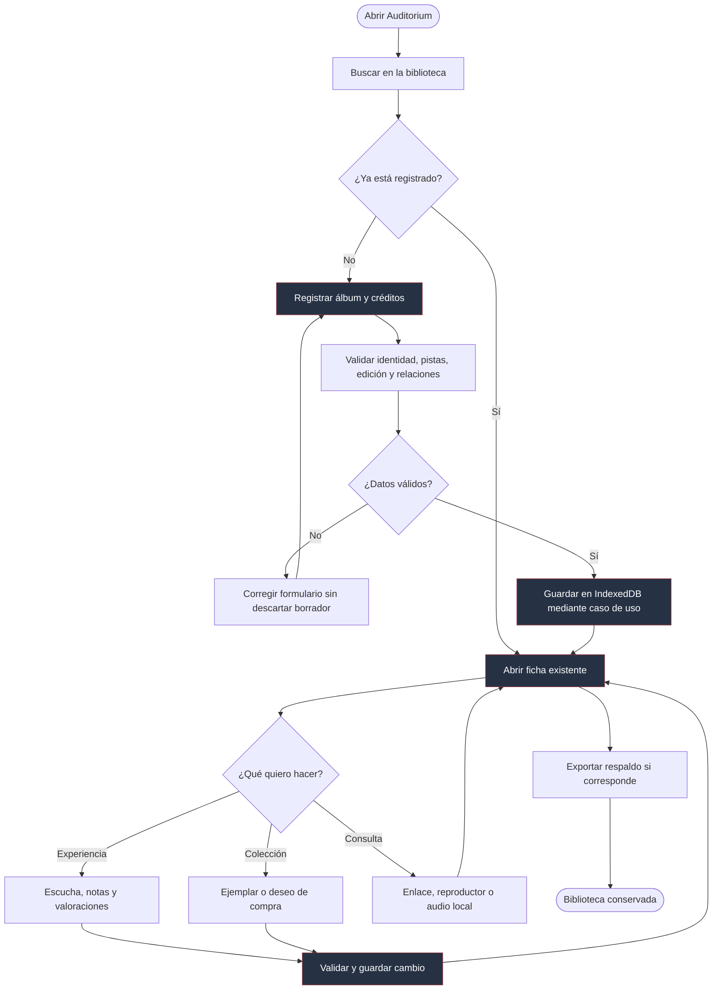
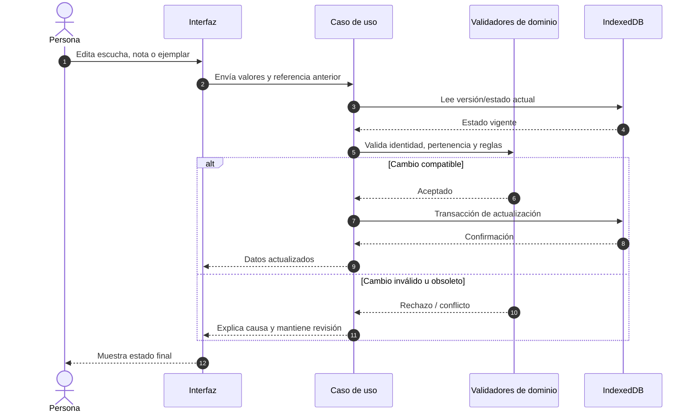
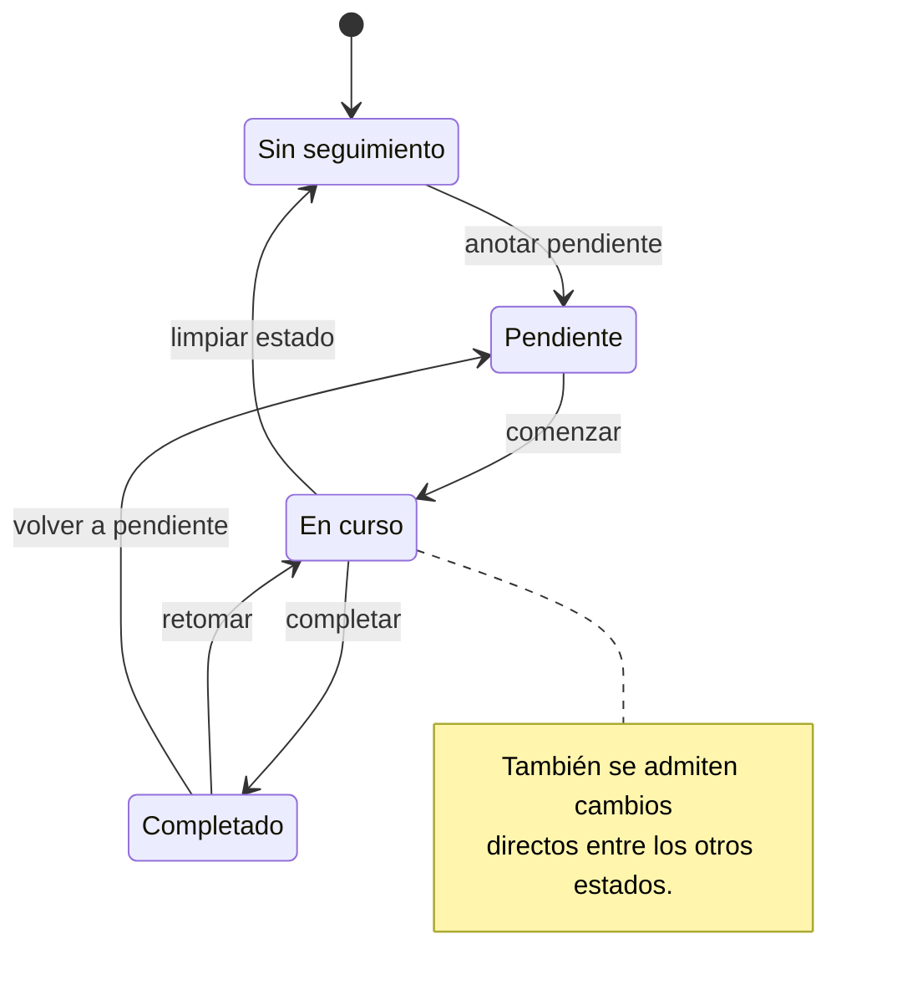
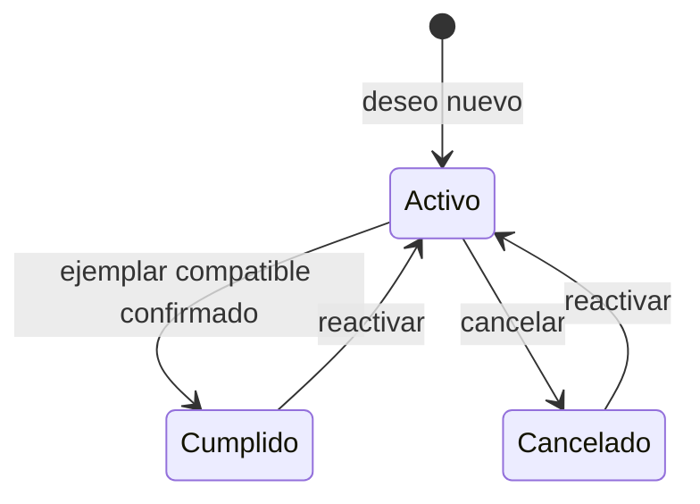
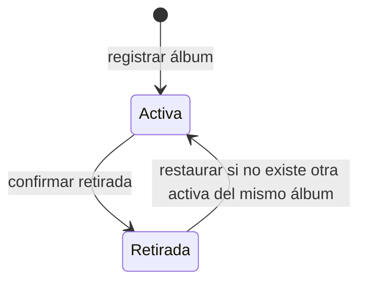
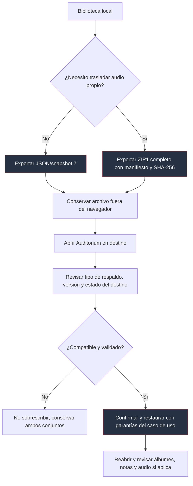
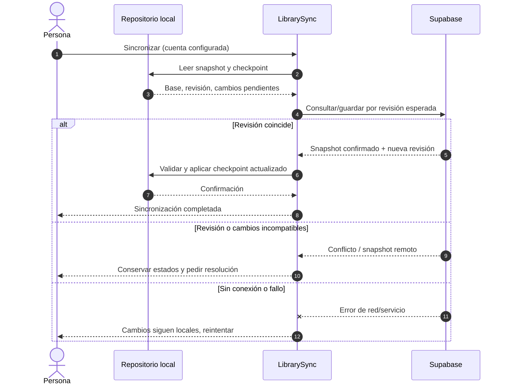
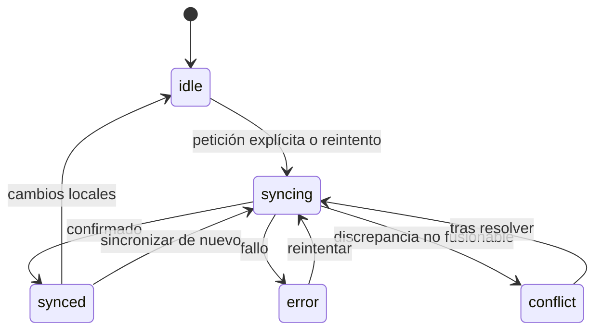

# Flujos y máquinas de estado

Los diagramas de arquitectura responden _dónde vive cada responsabilidad_. Estos responden _qué ocurre al usarla_ y _cuándo se modifica la información_. Las transiciones se basan en `src/domain/library/schemas.ts`, `src/domain/library/library.ts`, `src/application/library-sync.ts` y los casos de uso de `src/application/`.

## Flujo 1 — Alta y uso de un álbum

La ficha no tiene una sola salida: escuchar, valorar y coleccionar son acciones independientes. Una búsqueda de metadatos externos es una ayuda revisable, no una operación que salte la validación del catálogo.

## Flujo 2 — Cambio de datos personales

La comprobación de la referencia anterior depende del caso de uso; no toda edición tiene exactamente el mismo token. El principio común es **no ocultar una edición concurrente ni borrar otra relación para completar la operación actual**.

## Estados: experiencia de escucha

La propiedad `listeningStatus` acepta `untracked`, `queued`, `in_progress` y `completed`. El dominio no impone un itinerario obligatorio entre ellas: puede cambiarse directamente de cualquiera a otra. Este diagrama muestra un recorrido habitual y la posibilidad de cambiarlo, **no un flujo excluyente**.

## Estados: deseos de adquisición

Crear un deseo exige objetivo (edición o formato) y estado activo. **Cumplirlo requiere una adquisición compatible y que el deseo esté activo.** Las transiciones posteriores a cancelado/cumplido se expresan como reactivaciones; el estado de una compra no se crea automáticamente con una nota de escucha.

## Estados: entrada personal activa o retirada

Retirar es una marca (`deletedAt`), no eliminar el catálogo y todas las relaciones. Restaurar respeta las reglas de identidad y conflictos.

## Flujo 3 — Respaldo, cambio de dispositivo y audio

El archivo JSON nunca reemplaza el ZIP completo para transportar los bytes de audio. La restauración de un respaldo completo y la **importación aditiva** son procesos distintos: el segundo aparece como cambio _sin publicar_ en `CHANGELOG` y exige revisión de conflictos.

## Flujo 4 — Sincronización opcional

`LibrarySync` usa snapshots y checkpoints. El algoritmo intenta una fusión de registros cuando sus cambios no son incompatibles; **no** resuelve automáticamente dos ediciones divergentes del mismo registro. El audio sigue fuera del remoto.

[Arquitectura](01-arquitectura.md) · [Persistencia](03-datos-y-persistencia.md) · [Integraciones](05-integraciones-y-seguridad.md)
