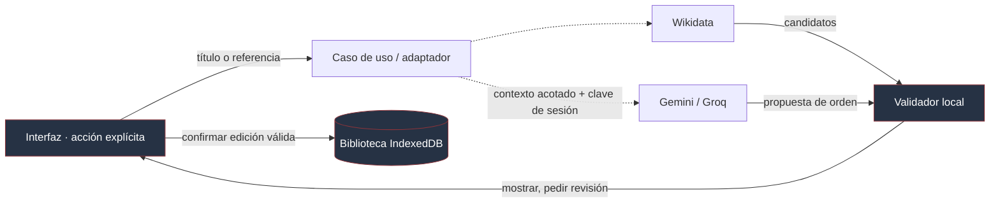

# Integraciones opcionales y fronteras de confianza

**Fuentes:** `src/infrastructure/catalog/wikidata-client.ts`, `src/infrastructure/ai/recommendation-client.ts`, `src/infrastructure/streaming/`, `src/infrastructure/supabase/`, `src/application/cloud-account.ts`, `src/domain/backup.ts`, `supabase/migrations/`.

Las integraciones externas cumplen funciones distintas. Esta guía resume cuándo se activan, qué información reciben y cómo se controla su acceso a la biblioteca.

| Integración                    | Se activa                                                     | Finalidad                                                               | Límite                                                             |
| ------------------------------ | ------------------------------------------------------------- | ----------------------------------------------------------------------- | ------------------------------------------------------------------ |
| **Supabase Auth + PostgreSQL** | Al compilar con configuración pública y usar la cuenta        | Iniciar sesión y compartir un snapshot de biblioteca entre dispositivos | Sin audio, RLS, revisión/concurrencia y migraciones SQL necesarias |
| **Wikidata**                   | Consulta iniciada desde el catálogo                           | Sugerir referencias de metadatos                                        | Candidatos revisables; no autoría ni edición automática de fichas  |
| **Gemini / Groq**              | Usuario introduce clave de proveedor y solicita recomendación | Priorizar álbumes para reescuchar o reevaluar                           | La respuesta se valida; no escribe calificaciones ni experiencia   |
| **Spotify / YouTube**          | Abrir o insertar reproductor desde enlaces reconocidos        | Reproducción desde un servicio tercero                                  | Disponibilidad, cookies, políticas y red dependen del proveedor    |
| **Portadas por URL**           | Al asociar o consultar recurso remoto                         | Mostrar imagen de cubierta                                              | Puede hacer una solicitud al sitio que hospeda la imagen           |

## Recorrido de solicitudes externas



La clave de IA es suministrada por quien usa esa función y no se incluye en respaldos. Como las solicitudes llegan al proveedor, no debe presentarse como un procesamiento enteramente local ni prometer privacidad absoluta. El contexto de recomendación es limitado por el caso de uso, no incluye la totalidad de la base.

## Supabase: configuración y control de acceso

Para habilitarlo en un despliegue, configurar las migraciones en el proyecto remoto y las variables públicas documentadas en [`.env.example`](../../.env.example):

```env
VITE_SUPABASE_URL=https://your-project.supabase.co
VITE_SUPABASE_PUBLISHABLE_KEY=sb_publishable_replace_me
```

`client.ts` valida que la URL sea HTTPS y que la clave tenga prefijo `sb_publishable_`. Las claves con prefijos `service_role`, secretos privados y contraseñas no deben llegar al bundle ni subirse a Git. **La clave publicable no reemplaza RLS**: en las migraciones, la propiedad del snapshot se obtiene de la identidad autenticada y una función RPC controla la revisión esperada.

Una cuenta introduce nuevas responsabilidades: reautenticación, fallos de red, concurrencia y límites de tamaño. La experiencia local sin cuenta no debe quedar bloqueada por falta de configuración o indisponibilidad del servicio.

## Alcance de los servicios

- **Spotify y YouTube:** reproducción mediante sus marcos oficiales y apertura de enlaces, sujeta a disponibilidad y conexión.
- **Metadatos:** Wikidata es el proveedor activo. La evaluación de MusicBrainz se conserva como referencia de diseño.
- **Recomendaciones:** proponen un orden para revisar álbumes; la persona decide sus valoraciones.
- **Almacenamiento:** IndexedDB depende de la protección del perfil del navegador. La sincronización transporta metadatos; el audio se traslada mediante ZIP completo.

[Arquitectura](01-arquitectura.md) · [Datos](03-datos-y-persistencia.md) · [Guía de uso](../general/02-uso-y-limites.md)
